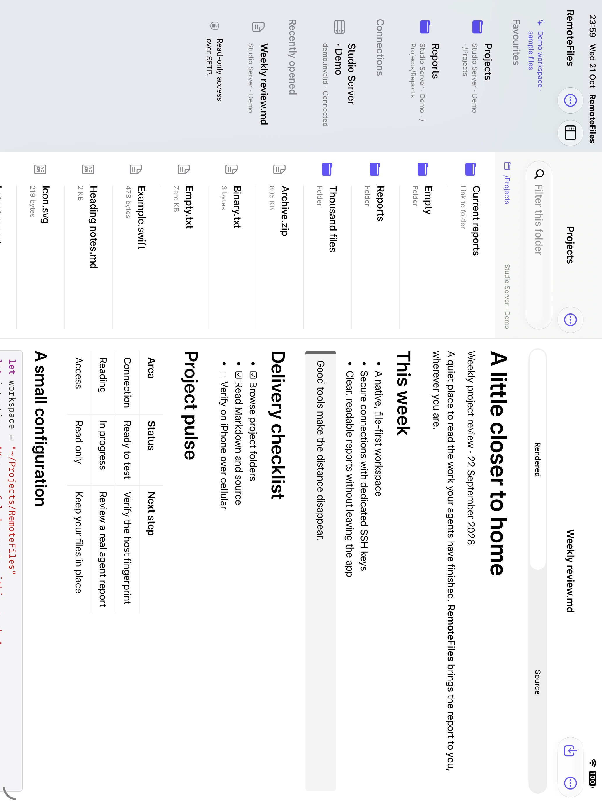

# RemoteFiles

RemoteFiles is an iPhone and iPad app for browsing and reading files on a Mac or Unix server over SFTP. It is useful when you want to check a report, look through a project, or read a file away from your computer without copying an entire directory to your device.

Connect to a server you already control, choose a folder, and open files in a reader or preview. You can also save selected files or complete folders on the device for reading without a connection.

> **Read-only browsing:** RemoteFiles does not edit or delete remote files. The optional public-key installer is a separate, explicitly confirmed server write. See [connections and security](docs/CONNECTIONS.md).

## A look inside

| Browse folders | Read Markdown | Inspect source |
| --- | --- | --- |
|  |  |  |

*Screenshots from the demo workspace.*

On iPad, the [workspace](docs/IPAD.md) can show the library, folder and reader side by side. It adapts to the available window size.

## Try the app

The project requires **Xcode 27 or newer** to build and **iOS 27 or newer** to run.

1. Open `RemoteFiles.xcodeproj` and select the **RemoteFiles** scheme.
2. Run it on an iOS simulator or your iPhone or iPad.
3. Choose **Settings → Explore Demo** to browse sample files without a server.

### Connect your own server

You'll need a reachable SSH server with SFTP enabled, an account that can read the files, and an SSH key accepted by that account. Choose **Add Connection**, generate or import a key, and enter the host and account details. Verify the displayed host-key fingerprint through a trusted channel before accepting it.

The [connection guide](docs/CONNECTIONS.md) covers setup, key installation and troubleshooting. A [jump host](docs/JUMP_HOSTS.md) is supported when your server is reached through a bastion.

For command-line builds, signing and tests, see [build and test](docs/DEVELOPMENT.md).

## Using RemoteFiles

- **Find a file:** search names or file contents, with case, whole-word and file-type filters. Enable PDF text or on-device OCR in **Folder actions → Search Options**. Build a **Saved Search Index** to search a persistent local text snapshot without rereading remote files. [Folder browsing](docs/FOLDER_BROWSING.md) explains scopes, index freshness and limits.
- **Read and preview:** open Markdown, text and source code, images, PDFs, audio, video, or static HTML/SVG. Markdown offers rendered and source views; text readers provide Find and reading-position history. Format support and size limits are in [reader and previews](docs/READER.md).
- **Save an original:** use **Save Original to Files** to export a copy without changing the server file. [Original-file export](docs/ORIGINAL_EXPORT.md) covers its limits and lifecycle.
- **Read offline:** choose **Keep Offline** for a file or **Keep Folder Offline** for a folder, then open the copy from **Offline Files** in the library. Saved copies are updated only when you request it; they are not automatically synchronized. Folder saves exclude symbolic links and special files, and a failed update retains the previous complete snapshot. See [offline files and folders](docs/OFFLINE_FILES.md) for storage limits and offline preview differences.

## Documentation

- [Connections and security](docs/CONNECTIONS.md) — server setup, SSH keys, host trust and local storage.
- [Reader and previews](docs/READER.md) — formats, navigation, export and limits.
- [Build and test](docs/DEVELOPMENT.md) — development setup and reproducible checks.
- [All documentation](docs/README.md) — feature guides, architecture notes and acceptance evidence.
- [Project status](PREVIEW_STATUS.md) · [Roadmap](ROADMAP.md) · [Contributor guide](AGENTS.md)
