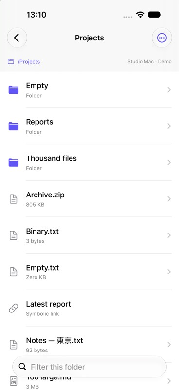
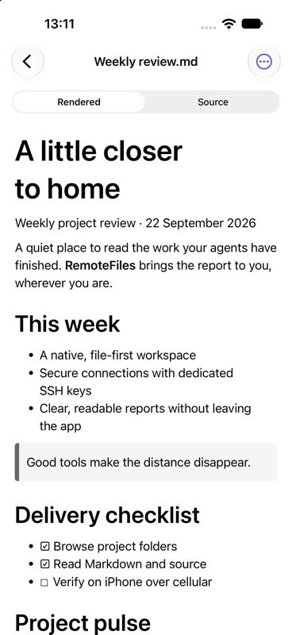
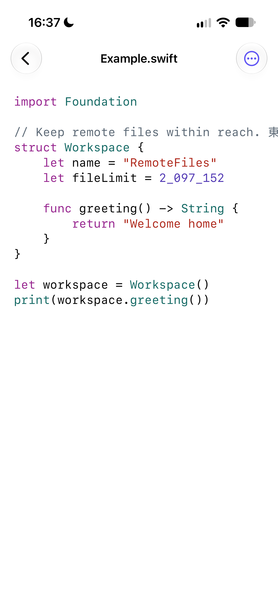

# RemoteFiles

A native iPhone app for browsing and reading files on your Mac or Unix server over SFTP. Open a favourite folder, read a Markdown report, inspect source code, or preview media—and refresh when the remote file changes.

## A look inside

| Browse folders | Read Markdown | Inspect source |
| --- | --- | --- |
|  |  |  |

*Screenshots from the demo workspace.*

## What you can do

- Browse remote folders, search names or UTF-8 file contents in subfolders, save favourites, and return to recent files.
- Keep files and complete folder trees in an [Offline library](docs/OFFLINE_FILES.md), browse saved copies without SFTP, and update them on request.
- Read Markdown or highlighted source, find text, jump to headings, and remember your reading position.
- Preview images, PDFs, audio, video, and static HTML/SVG.
- Copy source or save an original file to Files.
- Connect directly or through an [SSH jump host](docs/JUMP_HOSTS.md), with SSH keys and explicit host verification. Browsing is read only.
- Keep the library, folder and reader side by side in the [iPad workspace](docs/IPAD.md).

## Get started

Requires **iOS 27.0** and **Xcode 27.0 or newer** to build. Open `RemoteFiles.xcodeproj`, select the **RemoteFiles** scheme, and run on an iOS 27 simulator or your iPhone. Choose **Settings → Explore Demo** to try sample files, or [connect your server](docs/CONNECTIONS.md).

See [build and test instructions](docs/DEVELOPMENT.md) for signing, command-line builds, and verification.

## Documentation

- [Connections and security](docs/CONNECTIONS.md) — server setup, SSH keys, host trust, and local storage.
- [Reader and previews](docs/READER.md) — supported formats, navigation, export, and limits.
- [Build and test](docs/DEVELOPMENT.md) — development setup and reproducible checks.
- [All documentation](docs/README.md) — feature guides, architecture notes, and acceptance evidence.
- [Project status](PREVIEW_STATUS.md) · [Roadmap](ROADMAP.md) · [Contributor guide](AGENTS.md)
