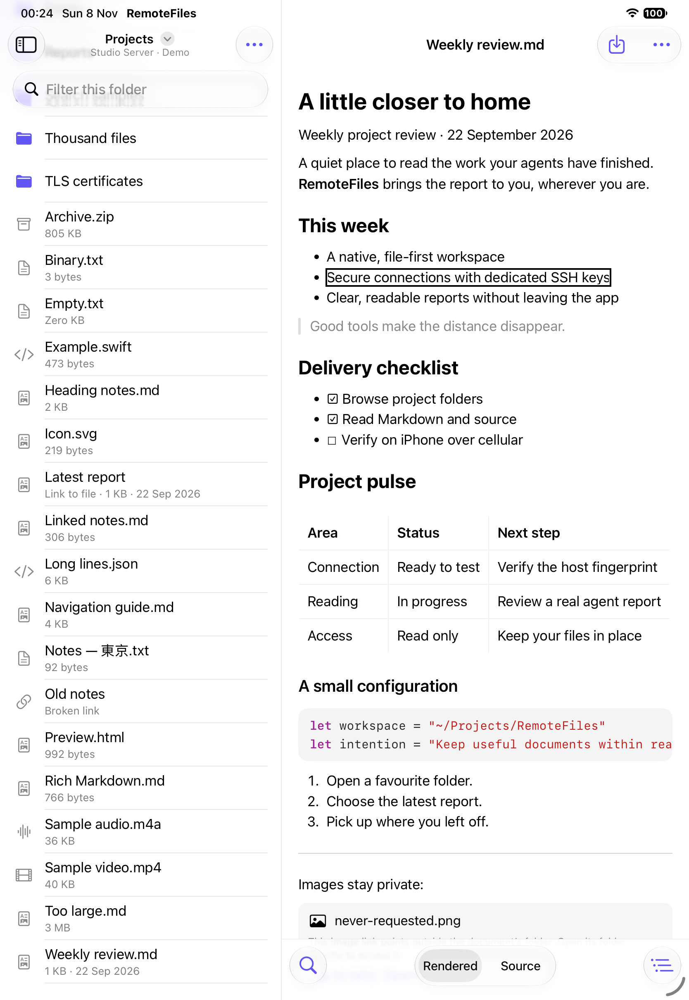

# CI history

[CI policy and timing](CI.md) · [Automated acceptance](AUTOMATED_ACCEPTANCE.md)

Dated investigations of CI failures and the timing baselines they produced, moved
here from the policy page on 3 November 2026. Each section describes the workflow
as it was at the time it was written; the current selection rules, timing budgets
and cache behaviour are in [CI policy and timing](CI.md). In particular, the UI,
VoiceOver and Release lanes no longer run on every escalated PR, build caches are
saved only from `main`, CI no longer shards the UI journeys, and the VoiceOver lane
no longer builds a disposable project copy.

## 10 November 2026: lost mode taps, ignored switch presses and idle waits traced to their causes

An independent pass over the items [9 November](#9-november-2026-unresolved-control-input-and-playback-causes)
left open. Three things made the difference:

- **CI's own runtime.** iOS 27.0 (24A434) was installed beside 27.2, on a new iPhone 18 Pro
  simulator for each. Every result below names its runtime.
- **A tracer outside the app.** A small library loaded with `DYLD_INSERT_LIBRARIES` logged each
  touch, gesture-recognizer state, write to a `UISwitch` or `UISegmentedControl`, control action,
  main-thread wait over 40 ms, and each UIKit animation that started without stopping. The app
  under test was the unchanged build.
- **Stalls on demand.** A script paused the app with `SIGSTOP` for 150 ms in every 200. That stands
  in for a starved main thread on a runner whose load is in the hundreds, without loading the Mac.

### Source-mode tap

**Cause.** UIKit moves a segmented control's selection when the touch ends, and sends its
`valueChanged` action later, from a block it runs after the next Core Animation commit
(`_UIAfterCACommitBlock`, called by the update cycle). SwiftUI's segmented `Picker` writes its
binding's value to the control in every `updateUIView`. An update in between writes the old mode
back, so the action then reports no change. The reader updates several times in the two seconds
after a document arrives, which is when the journey taps.

| Evidence | iOS | Result |
|---|---|---|
| Hosted run [42274841878, attempt 1](https://github.com/eyeb0l/RemoteFiles/actions/runs/42274841878/attempts/1), recording | 27.0 | The control lifts under the touch, with Source dimmed, and settles on Rendered: the touch arrived |
| Same value written 25 ms into the touch | 27.2 | 8 of 8 taps still selected Source, so a write during the touch is harmless |
| Old value written when the touch ended | 27.0 | 5 of 5 taps lost, with that recording's appearance |
| Nothing forced, taps 0.6 to 1.2 s after the control appeared, app paused as above | 27.0 | 1 of 39 lost; its trace is below |
| Both controls with touch-down and touch-up handled together | 27.0, 27.2 | Segmented control 12 of 12 selected, so a stall alone does not lose this tap |

The lost tap's trace, in seconds:

```
403522.1908 touch ended on the control          (selection now Source)
403522.2144 setSelectedSegmentIndex 0 (was 1)   (SwiftUI's update writes Rendered back)
403522.2188 sendActions valueChanged            (reads Rendered; the binding does not change)
```

Before the fix the reader wrote the unchanged selection to the control at about 0.15, 0.75 and
1.55 seconds after it appeared, and five times after each tap. Giving the picker its own view did
not stop that: two of the three remained.

**Fix.** `ReadingModePicker` replaces the `Picker` in `ReaderBottomBar` with the same
`UISegmentedControl`, and writes to it only when the mode changed somewhere else. It looks the same
on iOS 27.0, exposes the same Rendered and Source buttons to XCTest, and still follows ⌥⌘U, Find in
an HTML document and heading links. A person could lose this tap too, in the frame a document
finished loading.

**Proof.** `ReaderBottomBarTests` replays the three steps of the trace. It fails on the SwiftUI
picker, alone or in its own view, and passes on the new control. In the app the only writes left
are each control's first and real mode changes. The paused-app taps above went from 38 of 39 to
60 of 60, with no other write in that trace.

### Switch presses

**Cause.** A `UISwitch` acts on a touch only once its long-press recognizer has begun, and that
needs a 10 ms timer to fire between touch-down and touch-up. If the main thread is busy until both
events are waiting, the run loop handles them one after the other and the timer never gets its
turn. The recognizer fails and the switch does nothing. This is the trace
[5 November](#switch-touches-that-do-nothing) recorded without its cause, and it explains why a
217 ms press could still be ignored: what matters is whether the run loop comes round while the
touch is down, which the length of the press only makes more likely.

| Touch, app paused 150 ms in every 200 | iOS | Toggled | Ignored |
|---|---|---|---|
| Tap, touch-down and touch-up handled within 30 ms | 27.0 | 0 | 6 |
| Tap, handled within 30 ms | 27.2 | 0 | 1 |
| Tap, handled further apart | 27.0 | 14 | 0 |
| Tap, handled further apart | 27.2 | 13 | 1 (paused 160 ms straight after touch-down) |
| Half-second press | 27.2 | 15 | 0 |
| Tap, app not paused | 27.0, 27.2 | 24 | 0 |

Unlike the segmented control, the switch changes its value and sends its action together, so a
SwiftUI update cannot undo it: 5 of 5 taps survived the old value being written at touch-up.

**What stays.** `pressSwitch` already holds for half a second and presses again if nothing
changes. That is the right shape for this cause, since a longer hold needs a longer stall to fail,
and its comment now says so. No app change follows: the switch is UIKit's, and a person's tap is
lost only if the main thread stalls for the whole of it.

### Idle waits after Find closes

**Cause.** [#66](https://github.com/eyeb0l/RemoteFiles/pull/66) blamed a never-ending lens
animation on the segmented control. It is the keyboard. Closing Find removes the focused field,
the keyboard hides, and UIKit animates every change made while it hides, including the Find bar's
own fade, layout and symbol colours. Those layers are freed when the bar goes, and some of their
animations then never report stopping. XCTest counts starts against stops, so from then on every
`Wait for … to idle` runs its full 60 seconds and logs `App animations complete notification not
received`.

| Find bar | iOS | Tracer loaded | Result |
|---|---|---|---|
| Original | 27.2 | Yes | Stalled at the 4th, 12th and 19th close in three runs |
| Original | 27.0 | Yes | Stalled at the 11th close |
| Original | 27.0 | No | Stalled at the 2nd close |
| Original | 27.2 | No | 60 closes, none stalled |
| Leaves at once | 27.0 | Yes | 60 closes, none stalled |
| Leaves at once | 27.0 | No | 60 closes, none stalled |
| Leaves at once | 27.2 | No | 60 closes, none stalled |

Each run opened Find, searched, tapped Done and switched modes twice, again and again in one
launch, and stopped at its first stalled wait. In the traced stalls, between one and four
animations of the keyboard's own 0.38-second block were left open: `position`, `bounds.size` or
`contentsMultiplyColor` on layers of the Find field, its buttons and their symbols, all freed by
then.

**Fix.** `ReaderFindBar` leaves at once, with `.transition(.identity)`, and takes no animation
from the transaction. Nothing of the bar is then animated by the keyboard that its removal hides.
The bar used to fade for the 0.38 seconds the keyboard took; it already appeared and, with a
hardware keyboard, went without one.

**Limits.** No hosted log has shown this: the nine UI lane logs retained from 3 to 9 November have
no such message. The lens animations 9 November's sampler found are infinite by design and do not
count against XCTest's idle check.

### `InvalidTransition` beside hosted failures

`InvalidTransition { phase: idle targetPhase: failed(deinit) }` is not the failure it appears
beside. A hosted test that throws within half a second of taking down a window holding the reader's
toolbar reports that text in place of its own error. Two seconds later the same throw is reported
correctly, a window holding only `Text` or a bare `NavigationStack` never shows it, and the error
caught inside the test is the test's own `NSError`. So the description comes from something the
frameworks throw and catch while the toolbar is freed, which XCTest prints in place of the test's
error. The assertion printed before it, such as `Offline reader lifecycle did not settle`, is the
real failure.

### A ⌘F taken by SpringBoard

`testReaderShortcutsDriveAnOfflineCopy` failed 2 of 15 local runs with these changes, at `⌘F opens
Find in an offline copy`, and passed 6 of 6 without them, which is too few to tell the two apart.
The simulator's `backboardd` log shows the cause, and it is not the reader.
[9 November](#9-november-2026-first-shortcut-after-launch) took UIKit to register the app's
shortcuts just after the first chord. It registers them after one of the first few, on iOS 27.0:

| Run | App's shortcuts registered | ⌘F |
|---|---|---|
| Passed, with the changes | After the second ⌥⌘U, 1.8 s before ⌘F | Reached the app |
| Passed, without them | 5 ms before ⌘F was routed | Reached the app |
| Failed, with the changes | 0.34 s after ⌘F was routed | `KCMD: match in pid:` SpringBoard |

The journey now opens Find with `openFindWithShortcut`, which repeats ⌘F until Find opens and logs
`UI SHORTCUT` for each one lost. With Find open ⌘F only focuses its field, so a repeat cannot undo
a chord that worked. Sent as the very first chord after launch, ⌘F was lost and its repeat opened
Find in 4 of 4 runs. The keyboard journey sends five other chords before its ⌘F and is unchanged.

### Playback rate after backgrounding

Not reproduced. The test as it was when it failed ran 40 times on iOS 27.0 with its host paused as
above, and the rate was 0 every time the item had gone. The four hosted failures do narrow it,
though. Each took 5 to 6 seconds where a pass takes 0.13 to 0.38, and run 42004987008's assertion
failed within half a second, so the time went on taking the player down afterwards. A rate that
was only late would not slow that. A player told to play with no item keeps its rate of 1. So the
test played a player the app had already emptied, as [5 November](#playback-background-rate)
supposed, and which path emptied it first is still not known. The gate added then has held: 4
failures in 59 core jobs from 3 November until it merged, and none in the 64 since.

### Simulator boot bound

Nightly run [42598591962](https://github.com/eyeb0l/RemoteFiles/actions/runs/42598591962)'s first
attempt stopped at `simctl bootstatus` after 300 seconds. Its phase record shows the 1-minute load
at 512 when it stopped, against 8 before the boot: the device was booting slowly, not hung. Of 266
boots from 3 to 9 November the median took 104 seconds, 20 took more than three minutes, and the
slowest to finish took 298, counting `simctl boot` as well. The bound is now 600 seconds, and the
UI job's ceiling still has eleven minutes to spare.

### Evidence upload

Run [42296553075](https://github.com/eyeb0l/RemoteFiles/actions/runs/42296553075)'s first attempt
passed all 36 UI journeys and failed because `upload-artifact` could not reach GitHub
(`Failed to CreateArtifact: Unable to make request: ETIMEDOUT`). The upload now gets a second
attempt in a following step, and only that one can fail the job, so evidence that cannot be
retained still fails the lane. This is the one exception to the rule against `continue-on-error`,
and a runner test pins it to that step.

### Evidence

Traces, logs, result bundles, the tracer and the pause script are under
`/private/tmp/remotefiles-ci-indep/`. The lost tap is `runs/v270-early-throttle`, the switch
tables `runs/throttle1`, `runs/v270-throttle1` and `runs/throttle2-press`, and the Find runs
`runs/*findclose*` and `runs/n27*`, and the shortcut runs `runs/seq-*`. No hosted job was rerun.
Nothing here was tried on a device.

## 9 November 2026: abandoned VoiceOver and Release jobs (PR #106)

Run 42667473091 selected every lane for PR #106. The quick lanes and the UI journeys
passed. The VoiceOver and Release jobs were never created: the run lists no job,
log or annotation for either. GitHub reported both to **CI gate** as `abandoned`, so
the gate failed closed, as intended. Both lanes had passed in that morning's nightly
run, and nothing in the repository explains why GitHub did not schedule them.

Only an unknown path had selected them: the PR's new opt-in
`Tests/ServerCompatibilityAcceptance/` suite. Like `Tests/LinuxSearchAcceptance/`,
no CI target compiles it; its launcher copies it into an isolated snapshot. The
scope now classifies its README as repository-only and its other files as quick
validation. Because that fix changes `scripts/ci_scope.py`, its own push still
selects every lane, which gives the two lanes a fresh chance to run.

## 9 November 2026: portrait library-overlay Tab report (PR #66)

The PR #66 report came from one hardware-HID run on an iPad simulator, recorded in
that PR's thread. The iPad was in portrait with a reader open. The run tapped a
missing link, dismissed the alert with Escape, then tapped Show Sidebar to overlay
the library. One Tab and one Down left no visible focus ring and did not move the
folder selection. A second Tab and Down put the focus ring on the library's Offline
Files button. That Down and the following ones still moved the folder selection
beneath the overlay. The run logged no key events, and its screenshots have since
been deleted.

This investigation could not reproduce that state on unchanged `5a23f69`. The
dedicated iPad Pro 11-inch (M5) simulator (iOS 27.2, Xcode 27.2) ran an uncommitted
diagnostic build. It logged every key press that reached `UIApplication.sendEvent`,
each focus update, the first responder and each key-command decision.

- **Input limits.** The T3 device tool has no hardware-key command, and its `type`
  refuses to run unless a text field has focus (`TEXT_INPUT_NOT_FOCUSED`), so it
  cannot send Tab or arrows. XCTest's `typeKey` sends Tab (HID 43) and the arrows as
  real key presses. About a second after each key, though, focus drops to nil, and
  the next `typeKey` restores it before its key arrives. The simulator's hardware
  keyboard also detached, so the software keyboard appeared.
- **Where Tab went.** In each of four portrait runs, with or without the link alert,
  the first Tab focused the folder's search field beneath the library overlay.
  Arrows were then declined because a text field was being edited. XCTest never
  moved focus from that field into the library. Return through `typeText("\n")` did
  not end editing, and a second Tab left focus in the field.
- **Router timing.** The router counts a focus move as made by Tab only if the focus
  update arrives within one second of the Tab. Real Tab presses produced focus
  updates after 1.48 s, 2.07 s and 0.75 s, so two of the three moves were counted as
  focus the system restored. A Tab-counted move is also forgotten when focus
  passes through nil, and focus restored afterwards without Tab doesn't count again.
  Either path would produce the reported symptom if the focused item were in the
  library. In these runs the focused item was always the search field, whose own
  check declined the arrows.

Hardware-key injection was then tried with Iris's approval, using the SimulatorKit
`SimDeviceLegacyHIDClient` route that PR #66 had used. Its messages were accepted
without error but never reached the simulator: neither the app's log nor
`backboardd` saw them. That held after a reboot, with the hardware keyboard enabled
through `SimDevice setHardwareKeyboardEnabled:keyboardType:error:`, after an XCTest
key press had run on that boot, after a touch, and with the T3 Device panel closed.
Calling `resetHIDSession` left the client with `machPortNotConnected`. The message
builder still takes the HID usage and direction that the PR #66 tool passed. Sending
Tab and the arrows as one synthesized XCTest event record didn't help either. Only
the first key of each record arrived, and the Tab's key-up never did.

The existing `testArrowKeysSelectFilteredRowsAndSubfolderSearchResults` passed on the
same build (87 s), with the diagnostic hooks compiled in.

The cause of the reported run therefore remains unproven, and the keyboard router
was not changed. Confirming it needs a working hardware-key path on a simulator, or
a physical iPad with a keyboard, with the diagnostic log through the Offline Files
step. Diagnostic logs, screenshots and xcresults are outside the checkout in
`/private/tmp/remotefiles-kbfocus/` (`diag1b`, `diag2`, `diag3`, `diag4`, `diag6`,
`warmup` and `diag5-runner-crash.ips`, the crash of an earlier record attempt).

## 9 November 2026: unresolved control-input and playback causes

This follow-up starts at `5a23f69`, after #101 and #102. The earlier switch and playback
changes in #81 are mitigations, not established root-cause fixes. Green subsequent
runs do not establish why UIKit ignored a touch or which AVPlayer the old test held.

**Hosted evidence refreshed.** [#101's main run 42526282580](https://github.com/eyeb0l/RemoteFiles/actions/runs/42526282580)
and [#102's PR run 42527516008](https://github.com/eyeb0l/RemoteFiles/actions/runs/42527516008)
both passed the browse/read/refresh, keyboard-shortcuts, automatic-index and PDF/OCR
journeys. Their retained `simulator-ui.log` files contain no `UI SWITCH` rescue lines.
[#102's main run 42538381333](https://github.com/eyeb0l/RemoteFiles/actions/runs/42538381333)
passed Repository checks, both quick lanes and CI gate; its UI job was skipped, not
another execution of those journeys. Its core artifact records
`testMediaViewStopsWhenAppBackgrounds` passing in 0.131 seconds. The offline-reader Back
and offline-folder test fixes in #101 are separate from these four investigations;
the old `InvalidTransition` message remains untraced.

**Switches.** The earlier trace in [Switch touches that do nothing](#switch-touches-that-do-nothing)
establishes delivery to an enabled UISwitch without its long-press recognizer beginning;
it does not establish why. The current automatic-index binding updates its local
Boolean synchronously before starting persistence work; OCR uses a direct state binding.
Neither explains a touch that never reaches either setter. `pressSwitch`'s existing
hold/repeat remains a mitigation for those index journeys, not a touch-delivery fix or
evidence about a physical finger. There is no basis to apply that repeat to unrelated
controls.

**Source-mode tap.** The [#84 comment](https://github.com/eyeb0l/RemoteFiles/pull/84#issuecomment-6694488824)
explicitly distinguishes an observation (Rendered stayed selected) from a theory
(a dropped tap under load). The original failing UI artifact of
[42274841878, attempt 1](https://github.com/eyeb0l/RemoteFiles/actions/runs/42274841878/attempts/1)
was retained again. Its synthesized-event attachment puts the touch at
`(243.419, 822.664)`, inside Source's final accessibility frame
`{{201, 798.7}, {85, 48}}`. The recording still shows Rendered selected after the tap.
This weakens a simple wrong-coordinate explanation, but neither attachment records
the view receiving the touch or its recognizer states. The screenshot taken before
the tap still shows the document skeleton, although the rendered scroll container
already exists. A container's existence therefore does not prove that the whole
reader has finished presenting. That is not, by itself, proof that a readiness gate
would fix this tap. No retry or timeout increase follows from these artifacts.

**Playback.** The retained core artifact of
[42004987008, attempt 1](https://github.com/eyeb0l/RemoteFiles/actions/runs/42004987008/attempts/1)
confirms the immediate `rate == 0` assertion failed with 1 after the wait for an
empty current item. It does not capture player identity or the sequence of `play`,
`pause` and item removal. The existing mounted-player/item gate and final-state wait
cover the two proposed races; they do not distinguish them. #78's cancellation-error
mapping is a different, resolved issue.

**Liquid Glass idle waits.** [#66's description](https://github.com/eyeb0l/RemoteFiles/pull/66)
reports the endless lens animation on the reading-mode segmented control after Find
closes, including reproduction on then-unmodified main. That report does not identify
the animation key, its owner, the triggering transition or whether XCTest alone
misclassified it as non-idle. It must not be conflated with the first-key routing or
portrait iPad focus investigations.

**Local baseline.** On the reserved iPhone Air simulator (`6264A288`, iOS 27.2), the
unchanged test behaviour passed 17 PlaybackTests (13.312 seconds, no failures or
skips), then the four named UI methods (355.155 seconds, no failures or skips).
The background method took 0.142 seconds. Browse/read/refresh took 37.937 seconds,
keyboard shortcuts 85.762, PDF/OCR 105.788 and automatic indexing 125.668.
There were no `UI SWITCH`, `PLAYBACK MOUNT` or `PLAYBACK BACKGROUND` failure lines.
This is one focused local execution, not a rate estimate or a physical-device check.

**Bounded diagnostic pass.** Temporary `UIWindow.sendEvent`/recognizer logging and a
two-second layer-animation sampler were then installed only in this checkout's demo
app. Six additional Source/Rendered round trips each required the requested content
to appear; no failed selection was retried. The OCR journey measured twelve 0.2-second
presses separately before performing its original assertions. All twelve changed the
switch value. The touch timestamps give 0.216667 seconds for each, delivery reached an
enabled UISwitch, and the observed 0.01-second long-press recognizer entered its begun
state. This provides a successful trace for comparison, not an ignored-touch cause;
instrumentation can itself affect scheduling.

The instrumented browse, keyboard and OCR methods passed in 75.732, 81.147 and
134.720 seconds respectively (3 tests, 291.598 seconds, no failures or skips).
The sampler found `_UILiquidLensView.punchout.matchPosition` and `CASDFElementLayer`
`match-*` animations with `duration=inf`, `removed=false`, while XCTest repeatedly
completed idle waits and mode changes. An infinite lens/matching animation's presence
alone is therefore not a sufficient signature for #66's stall. The stall itself did
not recur in either keyboard execution, so its specific animation/transition cause
remains unresolved. No UIKit animation was removed or modified.

The diagnostic patch, raw `touch-animation.log` and `focused-probe.xcresult` were
retained; the temporary app/test edits were removed and the original app binary was
restored to the reserved simulator. No code fix is justified by these passing probes.

Original failing and recent passing logs, xcresults and extracted Source attachments
are retained locally under `/private/tmp/remotefiles-ci-causes-20261109/`. No hosted
job was retried and no workflow, assertion, timeout or skip policy was changed.

## 9 November 2026: small-screen public-key installation review

The unchanged `VoiceOverChecks.testPublicKeyConfirmationVoiceOverAccountKeyCancelAndResult`
reproduced the iPhone 17e failure before VoiceOver started: after typing the
fixture password, five `app.swipeUp()` gestures did not expose Review Installation.
The recording still showed the form's first sections and the keyboard. Retained
input events put the swipe start at y=522, over the keyboard rather than the form.
The failure was not a disappearing confirmation control or an installation refusal.

The test now drags only inside the exposed form band, below its navigation bar
and above the current keyboard frame. It retains the five-scroll bound and all
confirmation, account/key/fingerprint, Cancel, second-review and result assertions.
No production installation code, test deadline, skip or VoiceOver traversal changed.

On the same signed iPhone 17e simulator, iOS 27.2 / Xcode 27.2, the unchanged
baseline failed (1 method, 147.710 seconds) and the corrected complete journey
passed (1 method, 102.716 seconds, zero failures/skips). These durations are not
a performance comparison: the baseline also logged a 60-second XCTest event-loop
idle notification stall, which this change does not claim to fix. Teardown restored
VoiceOver to its original disabled state. No real server or private key was used.
Logs, recording, input traces and xcresults are retained under
`/private/tmp/remotefiles-geometry-small-screen-ac1a/{baseline-install,install-green}/`.

## 9 November 2026: deferred Markdown geometry after a main-thread stall

The earlier overflow investigation left a visible-line jump under heavy layout
unresolved. A controlled native-region regression now reproduces the deadline
mechanism on current main: capture the visible region, deliberately block the
main thread for 2.1 seconds, then deliver a 62-point geometry change and the
display-link callback. The old callback discarded its anchor before compensating
the change because its wall-clock correction budget had already expired. The
viewport stayed at 1000 instead of 1062, and the visible region moved by 62 points.

The callback now applies that final accumulated delta before retiring the anchor,
without extending its two-second budget or starting another wait. Active touch
tracking, dragging or deceleration takes precedence at expiry. The controlled
regressions require both the correction and its retirement, and verify touch
takeover; the existing deferred-prose, code/table, Source-return and attachment
tests remain unchanged.

The first regression failed before the fix. Afterward all 12
`OverflowViewportTests` passed with zero failures or skips on the signed iPhone
17e simulator, iOS 27.2 / Xcode 27.2. This demonstrates the correction mechanism,
not a physical-device performance improvement or a replay of the historical
loaded-run trace. Before/after logs, xcresults and source evidence are retained
under `/private/tmp/remotefiles-geometry-small-screen-ac1a/geometry-{red,green}/`.

## 9 November 2026: first shortcut after launch

[#75](https://github.com/eyeb0l/RemoteFiles/pull/75) recorded that the first ⌘ shortcut after launch
was dropped "while UIKit lazily builds its menu system", so `testReaderShortcutsDriveAnOfflineCopy`
pressed a ⌘G that did nothing first. Investigated on an iPhone 18 Pro simulator (iOS 27.2) with
XCTest `typeKey`, temporary logging in the app (`sendEvent`, GameController key input, UIKit's
key-command registration) and the simulator's `backboardd` and SpringBoard logs.

**Cause.** Neither the app's responder chain nor its menu caused it. A dropped ⌘F never reached the app process.
`backboardd` sends a ⌘ chord to the deepest process in the keyboard-focus chain (SpringBoard, then
the app) that has registered it. UIKit registers the app's shortcuts only while a hardware keyboard is
attached (`_shouldUpdateSerializableKeyCommandsForResponder:` answered no until then). Each `typeKey`
attaches a new virtual keyboard and sends its keys at once. The app's registration arrived 48 ms after
the chord had been routed, and the lazy menu build was part of that registration. SpringBoard
registers ⌘F, ⌘G and ⇧⌘G, among other edit keys, so it took those and did nothing. Its log reads
`KCMD: match in pid:<SpringBoard> keyboardFocus` and the events end in `SBMainSwitcherWindow`.
⌘R, ⌥⌘U, ⇧⌘J and ⇧⌘. match nothing in SpringBoard and reach the app, even as the
first key. The app's registration outlives XCTest's keyboard, so later chords
reach it. Once that keyboard had attached and gone, later launches started without a registration.
A newly created simulator registered at launch, and its first ⌘F worked, once.

| First chord after launch | Runs | Reached the app |
|---|---|---|
| ⌘F, Offline Files | 6 | 0 |
| ⌘F, connected reader or folder, app not registered at launch | 6 | 0 |
| ⌘F, connected reader, app registered at launch (new simulator) | 1 | 1 |
| ⌘F, connected reader, uninstrumented first run | 1 | 1 |
| ⌘R, ⌥⌘U, ⇧⌘J or ⇧⌘. | 8 | 8 |

**Change.** No app change. The offline test now presses ⌥⌘U first and checks that it acts, so the
first key after launch is covered rather than absorbed. The workspace test keeps ⇧⌘. first.

**Limits.** Simulator only, on two simulators: the first was deleted partway through, so the
later runs used a new one. A physical keyboard attached before launch should be registered before
any key is pressed, and one attached later is registered within about 50 ms, but neither was tested
on a device.

## 8 November 2026: offline reader Back readiness race

Main [run 42513803390, attempt 1](https://github.com/eyeb0l/RemoteFiles/actions/runs/42513803390/attempts/1),
job 128832543913, failed
`OfflineReaderLifecycleTests.testLinkedReadersReleaseCoveredLeasesAndReverifyOnBackAndForeground`
at its Back assertion. The diagnostic reported `y=0`, height 3559, and one web view,
still in the window and last in the hierarchy. This weakens the obsolete-view theory in
[Offline reader's Back position](#offline-readers-back-position). The subsequent
`InvalidTransition { phase: idle targetPhase: failed(deinit) }` remains untraced.

A diagnostic-only local run on unchanged `f8a73c2` behaviour passed the journey, but
logged hop 7 returning from `reader()` before that renderer's restoration callback.
The helper checked the DOM title, native content height and absence of an animating
`UIActivityIndicatorView`. `LoadingPlaceholder` initially displays skeleton lines;
it adds a spinner only after 1.5 seconds. That placeholder replaced the immediate
spinner in `2ce971d` (#80) on 5 November, before the #82 failure. A rendered document can therefore satisfy
those checks before the Markdown coordinator applies its saved offset and starts
recording scrolls. Setting the test's initial 500-point offset during that interval
leaves the route's recorded position at zero, and restoration replaces the premature
offset with zero. Back subsequently restores that recorded zero correctly.

The helper now requires an attached web view whose actual Markdown coordinator has
finished restoration and enabled scroll recording. It rechecks readiness after the
asynchronous title lookup. The original 500-point Back assertion, twelve linked
readers, lease limits and corruption check remain. A controlled renderer fixture
holds render completion after the DOM is laid out, so the readiness regression does
not depend on host load or a longer wait. Production lifecycle and restoration code
are unchanged. The archived CI run has no coordinator trace, so the attribution of
that particular failure to the demonstrated readiness race remains an inference.

On a dedicated iPhone 18 Pro simulator, iOS 27.2 / Xcode 27.2 (27B52), the controlled
regression failed the old readiness check once (one assertion, 16.577 seconds).
With the check fixed, the original twelve-link lifecycle test passed in 32.106 seconds
and the controlled regression passed in 2.408 seconds: **2 tests, 0 failures, 0 skips**.
The controlled fixture also confirms that a premature native offset of 500 is not
recorded, is restored to zero at completion, and is recorded as 500 once ready.
No production file, dependency pin, test deadline or allowed skip changed. Both
`python3 -B scripts/generate-project.py` and `git diff --check` passed.
Logs, before/after xcresults, the diagnostic baseline trace and exact commands are
retained in `/private/tmp/remotefiles-offline-back-fa81c951/`.

## 8 November 2026: deterministic offline-folder overlap assertions

The supplied failure from [main run 42513803390, attempt 1](https://github.com/eyeb0l/RemoteFiles/actions/runs/42513803390/attempts/1),
`macos-openssh` job `128832543907`, reported a peak of 15 instead of 16 in
`OfflineFolderConcurrencyTests.testOverlappingFilesCommitInWalkOrderWithinTheWindow`
on `f8a73c2934c5d99e1da9c1abf6227b036e107730`; the unchanged retry passed.
Its 0–18 ms fixture delays could expire before every scheduled transfer started.
The pool-bound test used the same mechanism with 20 ms delays, and the byte/count-limit
cases also asserted overlap without ensuring the transfers stayed active together.

The fixture now gates transfers until the expected set has started, then acknowledges
each controlled completion. The window and pool tests finish files in a specified
reverse order while retaining exact peak, pool-bound, saved-order and byte assertions.
The byte/count cases hold their first two transfers until both start. Teardown releases
every gate before draining cancelled work; the existing cancellation-ignoring transport
checks remain. No production scheduling, sleeps, retries or timeout increases are added.

The locked-version portable focused suite passed all 15 methods with no failures or
skips. Isolated scheduling mutations failed for serial execution, a 17-file window,
an unchecked read pool and commits made in completion order; the restored suite passed.

## 8 November 2026: complete iPad workspace journey

On unchanged `main` at `f8a73c2`, the complete
`RemoteFilesUITests/testAdaptiveWorkspaceKeepsLibraryFolderAndReaderOnIPad`
failed at “Opening a preview keeps its folder visible”. A diagnostic run with
all assertions enabled reproduced it. Screenshots show the library, folder and
reader still tiled: the tapped Latest report row was at the bottom of the
folder, where opening the first reader adds a bottom toolbar shared by the
content/detail columns and covers that row. The list's accessibility frame still
covers the whole column, including the toolbar area, so being inside that frame
alone did not keep the row hittable.

The test now scrolls its selected row into the middle half of the folder viewport
before opening the first preview. All original assertions, deadlines and later
navigation steps remain enabled; no production layout change was needed. The
complete method passed (1 test, 0 failures, 0 skips, 233.804 seconds) on a dedicated
local iPad Pro 11-inch (M5), iOS 27.2, Xcode 27.2 (27B52), with ad-hoc signing and
locked package resolution. The passing run separately reported an app event-loop
idle notification stall; its retained app sample was waiting in the main run loop.
No timeout or idle-wait setting was changed.

Local evidence is outside the checkout at
`/private/tmp/remotefiles-audit-4317/`: `workspace-baseline.xcresult`,
`workspace-diagnostic.xcresult`, `workspace-fixed.xcresult`, matching logs,
exported screenshots/recording and process samples. The narrower VoiceOver check
from PR #91 was not used as proof of this journey, and no VoiceOver lane was run.

The PR #66 portrait library-overlay/alert/Tab report remains unresolved. The
production callers and focus router were inspected, but T3 discovery omitted the
new local iPad even though `simctl` marked it available. `device_open` returned
“No device E3ECD011-1FB1-4ECA-A13A-23D25096B7A6 on 'This machine'”; following its
advice to refresh discovery and opening again produced the same error. Interactive
device work stopped there. There is no new real-input or physical-keyboard evidence,
and the keyboard router was not changed on an unproved hypothesis. Physical iPad
touch/gesture feel, hardware keys and real window resizing remain untested.

## 7 November 2026: folder-row reader landing

The demo Markdown journey failed on PR #89's [run 42404712919, attempt 1](https://github.com/eyeb0l/RemoteFiles/actions/runs/42404712919/attempts/1)
and passed on rerun. Its supplied log started on the old `Weekly review.md` folder row,
then read `Find in Document`. This investigation reproduced the app failure on unchanged
`main` at `b9bdcd1`, independently of that PR's row-button implementation. The earlier
`616a7a3` results supplied with the report were not rerun here.

**Initial-focus diagnostic.** Eight fresh app launches of `VoiceOverChecks.testFolderRowReaderLanding`
on iPhone 17 `98EBE9C6-A089-4506-B4F7-B6EC6EE19885`, iOS 27.2, Xcode 27.2 (27B52),
Debug and ad-hoc signing gave **6/8 failures of an initial-focus assertion**. Each invocation used
`scripts/test-voiceover.sh` with the same derived-data directory. Production code was
unchanged; the fixture recorded actual focus and asserted the landing. The row was staged
near the bottom in touch mode, then focused and double-tapped with VoiceOver enabled.

| Baseline opening | Initial destination | Settled destination / result |
|---|---|---|
| 1 | Source | Bad |
| 2 | No destination focus event within 30 s | Bad; recording confirms the reader loaded |
| 3 | Back | Back; first content heading reached |
| 4 | Source | Bad |
| 5 | Reading document… | Source; bad |
| 6 | Back | Back; first content heading reached |
| 7 | Source | Bad |
| 8 | No destination focus event within 30 s | Bad; recording confirms the reader loaded |

The focus log placed the row at y=788 and Source at about y=799. In opening 5,
Source followed the placeholder by 1.3 s. These observations are consistent with spatial
relocation; they do not establish VoiceOver's internal selection algorithm. Speech was
not used to classify the landing. The separate table traversal failure was outside this
focused comparison.

**Matched completed-hand-off comparison.** A fresh set of eight openings on unchanged
`b9bdcd1`, followed by eight valid openings on the fix, used the same iPhone 17, runtime,
Debug configuration, signed fixture scheme, derived-data directory and landing assertion.
The assertion was byte-for-byte identical between these two cohorts and only observed
focus until the hand-off; it did not send gestures to repair a bad landing.

| Build | Completed at the top and reached the first content heading | Persistent wrong landing |
|---|---|---|
| Main, `b9bdcd1` | 2/8 | 6/8: four Source, one Rendered, one with no destination focus event |
| Fix | 8/8 | 0/8 |

The no-event failure's recording confirms the reader had loaded. Five of the eight valid
fix openings briefly focused Source or Rendered before the title. With no intervening
gesture, the app moved focus to the title within **0.86 s** in all five, and it stayed there
through loading. This is evidence that the persistent focus loss is corrected; it is not a
claim that VoiceOver never has an intermediate toolbar cursor during navigation. Main's
bottom-control failures never completed that hand-off within the 30-second bound.

The matching artefacts are `baseline-settled-1` through `8` and `fixed-settled-1`, `2`, `3`,
`4`, `6`, `7`, `8`, `9`, under the retained output directory below. There were nine fix
attempts for eight valid activations; the excluded pre-double-tap setup failure is described
below. `comparison.json` records each initial, landing and settled event, the heading
assertion, and the matching assertion hash. Earlier probes are separate from these rates.

**Cause and rejected approaches.** The row or loading placeholder disappears without a
stable, explicit destination target for rendered Markdown. The existing delayed
`screenChanged` post had a first-line target only for bounded source; rendered documents
received a nil target. It therefore still left VoiceOver to choose a destination. A
SwiftUI title with `accessibilityDefaultFocus` and an `onAppear` focus request still
landed on Source. A `viewDidAppear` callback with the SwiftUI toolbar focus binding also
failed: temporary logging confirmed the callback ran with its view attached, but there
was no title focus event. One natural Back landing in that variant was not counted as
proof. Longer speech waits were not an app fix.

Moving the concrete target post earlier, to `viewIsAppearing`, also failed: a trial stayed
on Source after the placeholder disappeared. Waiting until completed appearance was retained.
One of four later probes briefly focused Source, then the native title 0.8 s later. The
completed hand-off and first cursor event are therefore measured separately, rather than
claiming there can be no intermediate cursor during navigation.

**Fix.** The principal title is a native header label that remains mounted while the
placeholder becomes content. A per-reader hand-off waits for UIKit appearance completion
and for that label to have a window and non-empty bounds, then posts `screenChanged`
with the label itself. Both readiness orders are handled, with weak view references and
an active-reader check. Disappearance closes the appearance gate, and the decision is
consumed once, including when VoiceOver is off, so later layout or enabling VoiceOver
does not pull focus back to the title. There is no new delay or retry window. Bounded
source retains its existing first-line/highlighting watch, with posts only when a concrete
first-line target exists; rendered content no longer sends the delayed nil-target post.

**Regression.** The full demo journey and the focused row checks record the initial cursor,
require the hand-off to reach the top, and assert settled focus before any traversal. Merely
leaving the row is insufficient. A navigation cursor can briefly visit Source before the
app's targeted post is delivered, so the matched completed-hand-off comparison is separate
from the initial-focus diagnostic above. The focused Markdown check then requires an actual
focus event for the first content heading; speech can omit it even when focus reaches it. An image-file row check exercises the production
reader too; the existing inline image viewer journey is separate. Touch staging explicitly
disables VoiceOver where needed, and teardown restores its original state. The iPad
check waits for a real folder row before scrolling, because its first cold attempt stalled
on a blank folder before any reader existed, exceeded the execution allowance, and was
interrupted. The retained sample was in SwiftUI/CoreText font and symbol resolution;
that sample does not prove a precise cause for the stall. A subsequent workspace check
reached the title and content with the folder retained. No CoreSimulator restart was used.

**Other journeys and speech synchronisation.** The scoped regression batch passed the
full Markdown journey (including table traversal, mode changes, Refresh and Back), slow
JSON, the image-file row and image-viewer failure/retry/share/return. Its JSON/SVG method
passed JSON but reported that SVG stayed on the old row. A diagnostic repeat established
that the native SVG title had actually received focus while `currentSpeech()` kept the
row's phrase for 30 s. The recording also showed the rendered SVG. This was a false focus
failure in the speech-based helper, not a missing title hand-off.

The JSON/SVG and slow-load calls now use their existing focus recorder to wait for departure
from the row/reading placeholder. Their existing preview speech, first-line, image and
read-only assertions remain intact. With temporary production logging removed, the combined
JSON/SVG journey passed in `json-svg-confirmation` (134.176 s). The full focus log is also
printed on failure, so a speech/focus disagreement remains diagnosable. The production
reader checksum is unchanged from the matched comparison. The slow-load check also passed
with that helper in `slow-confirmation` (40.366 s). These local checks continued into
8 November; they do not constitute hosted iOS 27.0 or physical-device evidence.

The final iPad Pro 11-inch (M5), iOS 27.2 workspace check, `ipad-final`, passed
`testFolderRowReaderLanding` in 146.720 s with the final app and fixture code. Its first
destination and settled focus were the native title heading. Forward traversal reached
`A little closer to home`, and the folder remained alongside the reader. Across the
iPad investigation there were two passes and one interrupted cold-folder setup attempt;
the interrupted attempt never opened a reader. Only one simulator was used at a time,
and the final simulator was shut down after restoring its original VoiceOver state.



One matched-fix attempt, `fixed-settled-5`, failed in the existing `open` helper before
its landing observation: the first tap had already opened the reader, so the named row
no longer existed for the intended double-tap. The retained issue hierarchy shows the
reader's navigation bar and rendered document at that point. This is consistent with the
known VoiceOver-enable/touch-interception setup race; its precise cause was not proved.
It is excluded from the focus rate and replaced by one additional valid activation, with
both attempt results retained. No app failure after a valid activation is excluded.

Exploratory full-demo attempts that misclassified Back's actual `Projects` label, or
failed on stale SpringBoard speech before opening a file, are excluded from the rates.
So are the failed candidates and the instrumented native-title trial. Temporary production
logging was removed. Local logs and xcresults are retained under
`/private/tmp/remotefiles-reader-landing-20261107/`; no physical device, real server or
new hosted CI run has been used for this investigation.

PR #91's first [hosted run 42429957070](https://github.com/eyeb0l/RemoteFiles/actions/runs/42429957070)
failed Repository checks before the Mac lanes ran. The runner regression
`test_voiceover_builds_its_generated_targets_in_the_real_project_and_shared_caches`
still expected nine VoiceOver methods; the two new row checks make eleven. The same
`11 != 9` failure reproduced locally. Its expected count was updated to eleven,
preserving the exact source-inventory comparison and no-skips assertion. CI gate
correctly failed because Repository checks had failed before producing lane selections;
there was no independent gate defect. The complete 145-test Python repository suite
then passed locally. The fix is a new commit and CI run, not a retry of that failed run.

## 7 November 2026: rejected offline transfer races the next folder save

PR #84's [run 42335596504, attempt 1](https://github.com/eyeb0l/RemoteFiles/actions/runs/42335596504/attempts/1)
reported `OfflineFileError.busy` in
`SFTPIntegrationTests.testExplicitTransfersOutsideTheStartingFolderStayWithinTheChosenItem`,
at `pinFolder`'s occupied-slot guard. The
[initial diagnosis](https://github.com/eyeb0l/RemoteFiles/pull/84#issuecomment-6701946374)
identified a possible race between a rejected `pin` and the following `pinFolder`.

**Reproduction.** A temporary two-second delay before `worker.cancelAndDrain()` in
`pin`'s unstructured error-drain task reproduced `busy` at that guard in the unchanged
test against the local OpenSSH fixture (one test, one unexpected failure). The store
intentionally keeps its slot until the drain calls `finish`; throwing the boundary
error does not mean another transfer can start.

**Fix and validation.** The test supplies an explicit operation ID for the rejected
`pin`, then joins `waitForCancelledTransfer` with that ID before calling `pinFolder`.
The drain is installed before `pin` throws, and the join returns after `finish` has
released the slot, or immediately if that operation has already finished. The same
test passed with the two-second delay retained. The delay was then removed; no
production behaviour or timeout changed. With the delay removed,
`scripts/test-openssh.sh swift test --filter SFTPIntegrationTests` passed all 45 tests
with no skips, including the changed method; `git diff --check` also passed. No full
local lane or simulator tests were run. An audit of other rejected `pin` and
`pinFolder` test sequences found no other instance requiring the same fix: they
already drain, reject before acquiring a slot, or deliberately assert `busy`.

## 5 November 2026: nightly VoiceOver and playback failures

Nightly run [42004987008](https://github.com/eyeb0l/RemoteFiles/actions/runs/42004987008) on
`2ce971d` failed all three attempts, for two different reasons:

| Attempt | Failure |
|---|---|
| 1 | `testMediaViewStopsWhenAppBackgrounds` in simulator-core, so the acceptance lanes were skipped |
| 2, 3 | `testLongJSONAndSVGHaveReadOnlyVoiceOverPreviews`, at the assertion that speech reaches the image |

Attempts 2 and 3 took the same traversal, so this was not a one-off, and a rerun was only a second
try at a race. The push run of the same commit,
[41996288670](https://github.com/eyeb0l/RemoteFiles/actions/runs/41996288670), had passed it.

### SVG placeholder focus

**Cause.** The journey swiped before VoiceOver had left a placeholder that was going away. Focus
either starts at Back, and traversal reaches the image, or lands on `Preparing image…`, where the
result depends on about a second:

| Run | Focus after opening | Speech when traversal starts | Traversal |
|---|---|---|---|
| PR #80's last run, passed | `Projects` Back | Back | Title, Save, Actions, the image, `Find in Source` |
| Push run of `2ce971d`, passed | `Preparing image…` | The image | `Find in Source`, `Rendered`, `Source` |
| Nightly attempts 2 and 3, failed | `Preparing image…` | `Preparing image…` | `Find in Source`, `Rendered`, `Source` |

The two runs that landed on the placeholder differ only in whether VoiceOver had moved to the image
before the first swipe. The journey read speech as soon as its own wait ended. That wait looked for
an activity indicator, which proved nothing about focus, and it could not look for the image, because
that element exists, hidden from VoiceOver, throughout the load. The placeholder comes after the web
view in the view order, which may be why a swipe from it goes past the image; no run tested that.

**Reproduction.** On a dedicated iOS 27.2 simulator, a temporary test paused each new WebKit content
process for 7 seconds, moved focus to the placeholder and swiped as soon as the placeholder went. It
gave the nightly traversal, `Preparing image…` then `Find in Source`, with no focus notification for
the web view. The two other runs of that variant stopped earlier, as the next paragraph explains. Adding
only the wait below gave `Rendered SVG image` as the current speech in 4 of 4 runs, and the focus
log recorded `WKWebView` straight after the placeholder. So VoiceOver does move to the image by
itself, and this is not the fast-load bug in [Fast-load focus](#fast-load-focus).

**Fix.** The journey waits for `Preparing image…` to go, then for the focus log to be quiet and no
longer on the placeholder, and prints that log. `open(_:_:)` also waits past `VoiceOver on`, the
first phrase on iOS 27.2: a tap before anything in the app has focus acts as an ordinary tap, and two
of the local runs above failed that way. iOS 27.0, which CI uses, says something else first, so this
does not affect CI today.

**iOS 27.0.** The fix's own job,
[42048542312](https://github.com/eyeb0l/RemoteFiles/actions/runs/42048542312), landed on the
placeholder. Its focus log went from `Preparing image…` to `WKWebView` about five seconds later,
speech started on the image, and the method took 107 seconds. With the push run above, that makes two
iOS 27.0 runs in which VoiceOver moved to the image by itself.

**Limits.** A VoiceOver user who swipes in the moment the image replaces the placeholder can still
skip it, and has to swipe back. The app was not changed: a screen change naming the image would not
close that moment, and it would interrupt someone who has already moved on. Moving the placeholder
ahead of the web view in accessibility order was not tried. Locally the journey usually lands on Back,
so staging focus needed the temporary test. Later nightly `VO FOCUS LOG` lines show which path each
run took. No VoiceOver journey covers the HTML placeholder, and the demo reader journey, which reads
Markdown, wasn't measured for this.

### Playback background rate

`testMediaViewStopsWhenAppBackgrounds` failed with a rate of 1 on an already empty player in four
runs from 3 to 5 November (41556774386, 41681318140, 41853063475 and this one), each on a first
attempt, and passed on rerun.

**Cause not established.** It did not reproduce locally in 40 iterations on an idle simulator or
300 with 24 busy processes (load about 170), with the rate 0 every time the item was gone. An
`AVPlayer` with no item reports a rate of 1 straight after `play()`, in all 3 local checks. That
would explain the failure if the controller still held a player that had already been stopped, since
the test's `play()` would come after the only `pause()`. No CI log shows which player it held.

**Fix.** The test waits for a player that still has an item before playing, and then for an empty
player with a rate of 0, so a rate that only arrives late passes too. A player that keeps playing
still fails, after 10 seconds, and prints its state. If this recurs, those lines say which it was.

### Switch touches that do nothing

`testSavedSearchIndexUpdatesAutomaticallyWhenItsFolderOpens` failed twice more after the changes in
[Saved-index automatic switch](#saved-index-automatic-switch) (41757810352 and 41970406757), and
`testSavedPDFAndOCRIndexPersistsRecognizedContents` failed on the same kind of wait on 3 November
(41568670077). That section left open why the touch was lost. It reproduces locally on iOS 27.2, often
enough to measure.

| Touch | Journey | Result |
|---|---|---|
| XCTest tap | Update Automatically | First tap ignored in 5 of 15 iterations, plus one run that ignored two taps in a row |
| `press(forDuration: 0.2)` | Update Automatically | 0 of 8 |
| `press(forDuration: 0.2)` | OCR | 3 of 12 |
| `press(forDuration: 0.5)` and a repeat | All three switch journeys, 6 runs each | All passed; OCR ignored 2 first presses and the repeat worked |

**What is established.** With every touch logged in a temporary `UIWindow.sendEvent` hook, the touch
reached the real `UISwitch`, which was enabled, and the binding did not fire. At touch-up in an
ignored press, the switch's long-press recognizer had not begun; in a press that worked, it had. So
this is not a missed target or a moving row, and the app's binding and saved state are not involved.

**What is not.** Why the recognizer doesn't begin. Length does not explain it. An ignored tap lasted
27.5 ms where working ones lasted 46 to 86 ms, which looked like the answer, but every 0.2-second
press had the same 217 ms by its touch timestamps and one was still ignored. The app received that
one's two events 127 ms apart while another worked at 57 ms, and an ignored 0.5-second press arrived
558 ms apart. The switches sit in a sheet's scrolling list, which adds gesture recognizers of its own.
It was not tested with a finger or on a device, so whether a person can ever hit this is unknown.

**Fix.** `pressSwitch` holds for half a second, waits 10 seconds for the value to change and presses
again, up to three times, printing `UI SWITCH <name> ignored press <n>`. This reverses that section's
choice not to retry, because the journeys test index behaviour rather than touch delivery, and a
switch that never turns still fails. The binding sets the value at once, so a repeat should not undo
a press that worked, unless the main thread stalls for more than 10 seconds. The jump-host journey
shares the helper. The Local Network switch in the Settings app keeps its own handling. `UI SWITCH`
lines in the UI lane's log show how often this happens on iOS 27.0: the fix's own job had none, which
is one run.

### First line not reached

The push run of the merge, [42073908510](https://github.com/eyeb0l/RemoteFiles/actions/runs/42073908510)
on `58d08e1`, failed `testLongJSONAndSVGHaveReadOnlyVoiceOverPreviews` at its first-line assertion, before
the SVG half. The VoiceOver job only ran because that PR changed its fixtures. It is the same journey as
above but a different defect, this one in the app:

| Run | Focus after opening | Then |
|---|---|---|
| 41902107255, 42048542312, 42061912014, passed | `{` | Reads on |
| 41996288670 and attempt 3 of 42004987008 | `Reading document…`, Back | `{` under a second later |
| Attempt 2 of 42004987008 | `Reading document…`, `"prompt"` | `{` 0.9 s later |
| 42073908510, failed | `Reading document…`, `"prompt"` | Nothing for 5.4 s; swipes then read `"ready"`, `}`, `Find in Document` |

**Cause.** The reader named line 1 and never checked that VoiceOver went there. [Fast-load
focus](#fast-load-focus) recorded the return from `"prompt"` as a limit, and it was treated as reliable;
when nothing sends VoiceOver back, a VoiceOver user starts on the third line. What is not established is
why nothing did in that run: the CI log has no record of the reader's posts, and a local run could not
catch it. Ten runs of the journey under 24 CPU burners gave 5 passes, 2 of which returned from `"prompt"`,
and 5 failures in VoiceOver's start or the row's tap, before the reader.

One guess was tested and dropped: VoiceOver scrolling on landing does not defeat the at-the-top check. Five
seconds after landing the reader was still at offset 0 on iOS 27.2, and 1.4 seconds after on 27.0, and a post
still returned focus to `{`. Another is not excluded. A post can go out with no target, because a text view's
elements can be unavailable when the document first appears. At low load the post after colours followed
within a second, but the failed run was far busier, with a load of about 260, and colours arriving after its
swipes would fit its log.

**Reproduction.** Temporarily dropping the posts gave the failed run's exact traversal: 1 of 6 iterations
on iOS 27.2, where 2 of the others went to Back. Back skips nothing, so it needs no correction.

**Fix.** After posting, the reader polls where VoiceOver is, until it reaches line 1 or 6 seconds have
passed since the document arrived. If it stays on another line for 1.25 seconds, longer than the 0.8 to 1.0 s of VoiceOver's own returns, the reader
names line 1 again, up to twice. It stops once focus reaches a different line, since a person chose that, and
posts nothing at a saved position. `VoiceOverLandingWatch` holds the decision and has unit tests. The journeys'
settle wait goes from 4 to 6 seconds of quiet, because a second correction would land about 3.9 seconds after
the landing, close to the old bound. Six seconds of quiet after a landing also outlasts the window, so correcting
that landing cannot start during traversal. It adds about 2 seconds to each of the 3 uses.

| Proof | Result |
|---|---|
| Posts dropped, with the watch, iOS 27.2 | `"prompt"`, corrected, `{`, then reads on |
| Posts dropped, with the watch, iOS 27.0, run [42096064380](https://github.com/eyeb0l/RemoteFiles/actions/runs/42096064380) | The same, in `testFocusStartsAtTheTopOfADocumentThatLoadsSlowly`: `{` 2.3 s after `"prompt"`. The VoiceOver lane passed |
| Real code, iOS 27.2 | JSON half 9 of 9; whole journey 8 of 9; slow journey 4 of 4 that launched. The last 2 runs of each came before the watch's window moved to arrival |

The real JSON journey's SVG half failed once, in `VoiceOverFocusNotMoved` with speech on `Reading document…`
for 30 s, while the Mac was still recovering from the burners. The watch does not run for SVG, and the 5 runs
after the load fell passed. This error is not new: 3 retained runs of the #80 branch, 41952808251, 41961676643
and 41970406757, have it with focus on the row. None of the 18 retained `main` and fix-branch logs has it.

**Limits.** This corrects a landing rather than preventing it, so a reader can hear about 2.3 seconds of
`"prompt"` first, or about 4 if a correction is lost. Someone who means to stay on a line they reached without
passing line 1, such as the line VoiceOver landed on or `}` after a swipe back from the bottom bar, is sent to
line 1 after 1.25 seconds if that falls within the window. The watch covers every source-mode
document, and landings have only been seen on the JSON sample. Colours replace the elements, so a focused
element from before them may not count as a line, and the watch would not correct it; that is safe for the reader. The
natural landing has no committed test, because staging it needs a hook in the app. App-only PRs do not select
the VoiceOver job, so a change like this first meets it on `main`'s nightly unless the `full-acceptance` label is
used. No physical device was tested.

### Offline reader's Back position

This fix's own run, [42104593398](https://github.com/eyeb0l/RemoteFiles/actions/runs/42104593398), failed
`testLinkedReadersReleaseCoveredLeasesAndReverifyOnBackAndForeground` in simulator-core when going Back: the
offset did not come within 5 points of 500 in 15 seconds. XCTest also reported `InvalidTransition { phase: idle
targetPhase: failed(deinit) }`, which appears nowhere in this repository and which nobody traced. The landing
watch returns at once with VoiceOver off, and this test's readers are web views, so it does not run here. This is
the first such failure in the last 100 runs, which go back to 1 November. An earlier one at this step was fixed in
#52; see [Console back-pressure and readiness fixes](#console-back-pressure-and-readiness-fixes).

The cause is unknown. The wait ran at a load of 209 to 232, with a lane peak of about 237. A new web view was
very probably created, because the log reaches the next WebKit session number, but it behaved differently: four
passing runs log 9 `cannot add handler` lines after hop 12, three per web view, while this one logs 3 and then
none during the wait. `reader()` still returned, and it matches on the title alone, which is the same for hop 12's
route and the first. So a lost position and a test watching the wrong view both fit.

It did not reproduce. All 19 local runs that reached this step restored `y=500` within 0.1 s: 11 near idle and
8 under 16 CPU burners, far below that load. Under those burners the other 2 of 10 timed out at earlier steps, on
the 15-second waits of a hop, so the test is fragile under load. One near-idle run failed its cold first render
instead. A failure now prints the offset, content height and whether that web view is still the window's last, and
no limit changes until one shows what it should be.

### Performance

No lane changed. The stability of the first attempt is the larger saving: attempt 1's failure cost 25
minutes and skipped every acceptance lane. In this run simulator-core spent 8 minutes of its 24 in
`simulator-settle`, against 6.5 minutes of tests, and VoiceOver spent 5 to 7 of its 22 to 24. Medians
over the last 70 runs are 4 minutes for macos-openssh, 20 for simulator-core, 25 for VoiceOver, 51 for the
UI journeys when they run and 3 for the Release compile. The settle bound stays as [Runner load and post-boot
settling](#runner-load-and-post-boot-settling) left it, because this run adds no comparison of load
against failures.

## 4 November 2026: playback preparation cancellation

[Run 41837893351](https://github.com/eyeb0l/RemoteFiles/actions/runs/41837893351)
failed `PlaybackTests/testStopDuringPreparationCannotPublishAPlayer` at its
error-type assertion, after 2.876 seconds; the player remained nil. The older
[run 40965184249](https://github.com/eyeb0l/RemoteFiles/actions/runs/40965184249)
failed the same assertion. Neither artifact/log records the thrown error itself.
A native macOS AVFoundation probe using the bundled MP4 waited for the playable
property to enter `.loading`, then cancelled its task. `asset.cancelLoading()`
caused `asset.load(.isPlayable)` to throw `AVError.operationCancelled` (-11878),
not Swift's `CancellationError`. Preparation mapped this to `.unplayable`.

Preparation now checks task cancellation before reporting playable-load failure,
including a load that returns false. It also checks cancellation when detached
file setup throws; that task runs independently of its caller. Deterministic
regressions hold the playable load at a continuation until stop/cancellation,
then return a framework error or false, and exercise a cancelled missing-file
request. The production loader remains AVFoundation. No timeout is shortened.
Both `RemoteMediaView` and the offline reader suppress errors from cancelled
load tasks, so this investigation did not establish a user-visible codec banner
from cancellation.

Native before/after probes confirmed that the new checks return
`CancellationError` for both the AVFoundation loading error and a detached
filesystem failure. Original and fixed iOS test bundles compiled with Xcode
27.2 for arm64 and x86_64. Local XCTest execution produced no method results:
the dedicated simulator initially lacked process capacity, then its screen hub
failed and Xcode remained in test-host startup until interruption after 537.7
seconds. The shared process limit stayed unchanged and other simulators were
left alone. No local XCTest pass is claimed.

[Run 41853063475](https://github.com/eyeb0l/RemoteFiles/actions/runs/41853063475)
failed `testMediaViewStopsWhenAppBackgrounds`: the current item was removed,
but the retained player's rate was 1 rather than 0. The production background
path calls `stop()`, which pauses the player before removing its item. A native
macOS probe of 100 play/pause/remove-item cycles did not reproduce a nonzero
rate. The CI activities contain only the assertion, without rate-transition
timings. This remains a separate, unconfirmed iOS/AVKit issue; neither its
production behavior nor its test wait is changed by the cancellation fix.

## 4 November 2026: require the selected CI jobs before merging

After the tier redesign in PR #68, a live audit found `main` unprotected: the
branch API returned `protected: false`, the branch-protection endpoint returned
404 `Branch not protected`, rulesets and effective branch rules were empty, and
GraphQL returned no branch-protection rules. The authenticated account had
administration access. This resolves the earlier audit's ambiguous 403 response.

The new Linux **CI gate** runs with `always()` after all other jobs. It requires
repository checks and every explicitly selected lane to succeed; only unselected
lanes may skip. Failures, cancellations, missing results and malformed scope
outputs fail closed. The gate does not build or rerun tests, change the 02:30 UTC
nightly schedule, or expand ordinary PR selection. Changes to its implementation
are CI infrastructure and exercise all lanes under the existing policy.

The installed branch protection requires **Repository checks** and **CI
gate** from GitHub Actions, enforces the requirements for administrators, requires
a PR with zero mandatory approvals, and blocks force pushes and deletions. It
does not require branches to be up to date, avoiding extra runs after unrelated
merges. A fresh API read confirmed both checks bound to app ID `15368`, admin
enforcement, zero mandatory approvals, and disabled force pushes and deletions.
The exact setup and verification commands are in [CI policy](CI.md).
Focused gate regressions cover selected success, failure, cancellation and skips,
documentation-only skips, absent or malformed data, CLI exit status, and the
workflow's unconditional gate wiring.

## UI lane deadline regression

[PR #36](https://github.com/eyeb0l/RemoteFiles/pull/36) passed only on its second
UI attempt. Its tested source tree, toolchain and lane selection matched
[main run 40606036577](https://github.com/eyeb0l/RemoteFiles/actions/runs/40606036577),
which failed twice. This was not a merge-only source or scope change.

The UI lane previously ran `xcodebuild test`, sharing one 30-minute command
budget between compilation, test-host startup and all UI journeys. The passing
PR attempt needed 281 seconds before the first XCTest and 1,274 seconds for its
23 UI methods. Main took 761 and 637 seconds before the first XCTest; the runner
interrupted both attempts with methods still missing. The second main attempt
had passed every completed method before that interruption. A rerun could pass
or fail depending on preparation time without fixing the underlying budget.

The UI lane now follows the core lane's build-before-boot sequence and separates
build and execution deadlines. It retains the complete UI inventory, nine explicit
real-server skips, per-method deadlines, failure checks and 45-minute job ceiling.
A failed build never boots the simulator or executes cached products. Separate
`simulator-ui-build.log` and `simulator-ui.log` files and summary rows expose where
time was spent. There are no automatic retries.

Main's first attempt also hit the production HTML preview deadline. Its app log
recorded GPU and WebContent launches taking 13.25 and 13.62 seconds, consuming
most of the 15-second rendering allowance. The runners had three logical CPUs
and 7 GiB RAM; preparation load averages were in the hundreds after simulator
boot. Deferring boot removes overlap with compilation; this is a contention
mitigation, not proof of which background process caused the load. Production
rendering limits and preview assertions remain unchanged. Require full hosted
acceptance, including HTML/SVG journeys, on the fix and inspect the resulting
main run rather than treating a successful rerun as a diagnosis.

The first validation of this runner fix also exposed an unrelated setup race in
`testMemoryWarningAndInactivityReleaseAttributedKeysButRetainAnchor`: it timed
out waiting for asynchronous highlighting/layout to populate the cache, before
posting any memory warning. The cleanup test now mounts readable prose and seeds
distinct real cache entries directly before invoking the production notification
handler. It refills the cache before checking inactivity cleanup too, so both
paths must evict nonempty state while retaining the anchor. It does not require
80 repeated code blocks to finish layout within an eight-second setup wait.

The next hosted run completed UI compilation in 153 seconds and executed the
UI lane within its independent deadline; HTML, SVG, core, VoiceOver and Release
checks passed. One offline-reader journey still exceeded its three-minute
method allowance: app-wide link queries traversed the underlying library and
hit an XCTest remote-query timeout. Document-link queries now stay within the
reader scroll view, retaining the same visibility, navigation and position
assertions. Background checks accept both running and suspended background
states, while still rejecting a terminated or foreground app. No deadlines were
extended. The runner prints structured xcresult failures as well as log assertions,
so an interrupted test reports its primary timeout even if no completed-result
line was emitted and a later assertion failed during cancellation.

PR #39's [run 40996701531](https://github.com/eyeb0l/RemoteFiles/actions/runs/40996701531)
then exhausted the execution-only 1,800-second budget twice on the same source.
Attempt 1 completed 24 UI methods and nine expected skips before interrupting
the final wrap-lines journey while it was progressing. Attempt 2 completed 21
UI methods and nine expected skips before interrupting the saved-index journey,
also without an assertion or per-method timeout. The newly completed PDF/OCR
journey passed in both attempts. The unchanged wrap-lines test passed locally.
The expanded UI suite therefore now runs in the two independent shards above.
The 30-minute command, 180/240-second per-method and 45-minute Mac job limits
remain unchanged; no method, assertion or skip policy was removed and there are
no automatic retries.

## WebKit cold-start regression

The first WebKit navigation in the core test host pays WebKit's cold start.
`testRendererDefensesBlockActiveMarkupAndResourceRequests` normally runs first.
On a just-booted Simulator under a host load average near 94, the GPU and
WebContent processes each took over 8 seconds to launch, and the networking
process took another 1.9 seconds. The local attack document then missed its old
10-second wait. On a quieter fresh Simulator the same navigation took 2.3
seconds, while compiling `SVGResourceBlocker` rules took 0.11 seconds. The test
now loads an inert SVG in the production configuration first, with a 60-second
cold-start bound. It then times the attack document against the production
15-second SVG deadline. After warm-up, that document finished in 0.6–0.7 seconds
on three fresh-Simulator lane runs. The `finished` precondition and the
script/resource assertions are unchanged. The test log prints
`RENDERER DEFENSES TIMING`, which separates rule, WebKit-start and document time.

## Historical baseline: the first workflow

[The original main run](https://github.com/eyeb0l/RemoteFiles/actions/runs/39261247900)
spent 57 minutes 54 seconds in its Mac job. It ran everything serially on every
code or documentation change, even after a failure:

| Original command | Elapsed | Measured test execution |
|---|---:|---:|
| macOS/OpenSSH | 8m 38s | 25s for 129 tests |
| Combined iOS Simulator | 22m 18s | 2m 31s hosted core + 12m 04s UI journeys |
| VoiceOver | 14m 01s | 10m 26s for eight journeys |
| Release device compile | 6m 02s | compile only |

The commands total about 51 minutes; boot, toolchain/source/result preparation
and cleanup account for the remainder. Copying/hashing the source alone delayed
the first command by 2m 39s; CI now avoids that redundant copy while preserving
the before/after source guard. Dependencies and Debug/Release products
were cold, and the old cache action skipped saving because the job failed.
Consequently a failed test also forced later runs to repeat the expensive build.
The original default was too broad for ordinary PR validation.

The new policy removes UI/VoiceOver/Release from ordinary PRs, parallelizes
independent work, gates expensive work behind quick checks and preserves build
progress after failures. Cold builds still take longer than warm ones. Use each
job's timestamps and retained summary to measure actual elapsed time rather than
treating a compiler cache hit as proof that tests passed.

## Quick-run comparison baseline

[Main run 39311217923](https://github.com/eyeb0l/RemoteFiles/actions/runs/39311217923)
finished in 13m02s on `3e4c9851875412813cdf762b63be6cfb135acb50`:

| Critical-path phase | Time |
|---|---:|
| Workflow/repository/runner/checkout/toolchain/cache setup | 48s |
| Simulator creation and boot | 1m21s |
| Runner preparation | 2m54s |
| Fixture, build and test-host startup | 5m00s |
| 205 iOS methods (204 passed, one allowed skip) | 2m27s |
| Evidence, cleanup, cache save and completion | 32s |

The parallel macOS lane took 3m02s and passed 140 methods. Compare hosted runs
using this same inventory, a first run that populates the native compilation
cache, a warm rerun of the unchanged commit, and a one-test-file change. Report
cache state, build/test/boot phases and full workflow duration separately. Keep
full acceptance before merging CI/scheme changes and verify the resulting main
push as well. The implementation does not assert a speedup until those hosted
measurements exist; first-boot contention is a hypothesis to test.

## UI journey method deadlines

[Main run 41046564410](https://github.com/eyeb0l/RemoteFiles/actions/runs/41046564410)
failed UI shard 1 while all other lanes passed. Its second attempt reached the
heading journey's final screenshot at 179 seconds, then exceeded the 180-second
method allowance during teardown. The saved-index journey was still progressing
through its final deletion/reopen assertions at that deadline; the native Files
picker alone had taken about 30 seconds. Neither failure was an assertion about
production behavior.

Find plus same-document heading navigation and outline plus linked-document
heading navigation now run as independent methods. Outline queries and swipes
stay within its collection view. Saved-index persistence/deletion and exporting
an original from a reopened index also run separately; each builds and reopens
its own synthetic snapshot. All original assertions remain covered. The complete
method inventory is still distributed across both UI shards, with unchanged
180/240-second method, 30-minute command and 45-minute job limits. No skip or
retry was added.

The first hosted validation of this split also exposed a core-test setup race in
`TextualNavigationRevealTests`: after changing the fixture's `.id`, its wait could
accept the old tall scroll view before SwiftUI replaced the subtree. A fixed
300-millisecond sleep did not establish that the replacement document scroll
had usable geometry, and its unwrap failed. The test now waits for a different document
scroll view using the original 12-second bound, then retains the settling delay
and verifies that the new view remains mounted at the top. Exact target-range,
horizontal visibility and fulfilled-request assertions are unchanged.

The next validation passed the heading journeys in 84 and 55 seconds, reopened
index export in 151 seconds, and index persistence/deletion in 156 seconds.
It also exposed the combined live PDF/OCR and saved-index journey: after 130
seconds of successful assertions, XCTest spent another 60 seconds awaiting an
animation-idle notification on the return from PDF preview. Live extraction
options/results and saved extraction/build/preview/deletion now run independently,
each opening its own synthetic sample folder. The saved-index form already
defaults PDF extraction on and explicitly enables OCR, so it does not depend on
live-search options. All original assertions and deadlines remain in place.
The saved form also waits up to five seconds for the OCR switch's accessible
value to become enabled before building. A focused iOS 27.2 run read its old
value immediately after the tap; temporary before/after screenshots confirmed
the switch updated when given time to settle. The enabled-state assertion is
retained, and the diagnostic screenshots are not part of the final test.

## Post-merge UI follow-up

[Main run 41086051385](https://github.com/eyeb0l/RemoteFiles/actions/runs/41086051385)
passed core, macOS, VoiceOver and Release validation after PR #43, but exposed two
other UI checks. The single-file offline journey spent 132 seconds pinning and
opening its document, then exhausted the method budget during accessibility
queries before its link, foreground, relaunch and removal checks were complete.
Link navigation and lifecycle/removal now run independently, each preparing its
own saved copy. Reader queries use the first matching scroll view and keep
heading lookups inside it; every original assertion remains covered.

The SVG check counted zero purple pixels even though its retained screen recording
showed the complete painted fixture during that interval. It now samples the same
full-screen capture API used for test attachments, and keeps the bitmap buffer
pinned while CoreGraphics draws into it. The existing 5,000-pixel threshold and
ten-second paint bound remain unchanged. The rendered screenshot is attached
before asserting, so any future mismatch retains the exact visible screen.

Focused follow-up validation also caught the generic background predicate timing
out while its failure message reported the accepted running-background state.
Background checks now use XCTest's native state wait, then explicitly assert
running-background or suspended-background. The five-second bound is unchanged;
a foreground or terminated app still fails.

The follow-up PR also caught content-search setup asking XCTest for hittability
while its entire launch-time accessibility hierarchy still had infinite origins
and zero sizes. The shared tappability wait now requires finite, positive element
geometry before evaluating hittability. It still requires an actually hittable
element within the same timeout; invalid geometry never counts as ready.

## HTML anchor fixture presentation

[Main run 41116836414](https://github.com/eyeb0l/RemoteFiles/actions/runs/41116836414)
loaded the visual-block HTML fixture, but its initial native scroll was reset to
zero before anchor capture. The retained DOM was complete and 3,000 pixels high;
native and DOM offsets were both zero. Local baseline traversal-budget checks
also reproduced this initial-scroll failure.

The bare HTML fixture now waits for an after-screen-updates WebKit snapshot
before returning to its caller. This synchronizes its initial presentation before
the test establishes a nonzero reading position. Initial-offset, traversal-limit,
anchor and post-resize assertions remain unchanged, as do all existing deadlines.

## Console back-pressure and readiness fixes

Several journeys failed intermittently on `main` and unrelated PRs in late October.
Each one was investigated before any rerun:

- **UI snapshot timeouts.** Content search, adaptive workspace and linked-folder
  journeys timed out while XCTest asked a just-launched or idle app for elements;
  queries took 14–31 seconds and logged `(retry 1)`/`(retry 2)`. The spindump that
  XCTest captured in [run 41228358818](https://github.com/eyeb0l/RemoteFiles/actions/runs/41228358818)
  showed the app's main thread blocked in `writev` to its stderr pseudo-terminal while
  serving the query. XCTest's in-app automation logs every attribute it fetches (about
  9 MB per journey), and Xcode's `OS_ACTIVITY_DT_MODE` mirrors that output to stderr.
  xcodebuild drains the terminal through its main thread, which runs at utility priority
  on CI runners and was runnable but starved. Pausing xcodebuild locally reproduced the
  same failure line and retries. UI-tested apps now launch with `OS_ACTIVITY_DT_MODE=NO`;
  the messages still reach the unified log. With the same pause, queries answered in
  0.14 seconds and the journey passed.
- **VoiceOver JSON speech.** The preview opened, but VoiceOver had not yet moved focus
  off the activated row, so traversal skipped to the end of the JSON. Opening a row now
  waits up to 10 seconds for the focused utterance to change before reading speech.
- **Offline reader Back position.** The rich Markdown renderer restored its saved offset
  as soon as `render()` resolved, while the native scroll view still had the empty
  template's 772-point height. A later WebKit commit could reset that offset, and scroll
  tracking then saved the top. Restoration and tracking now wait until native geometry
  covers the rendered document, as the HTML reader does. A hosted regression failed 4 of
  5 runs before the change. The offline lifecycle test waits for the reader's progress
  indicator to disappear before scrolling. Its first reader also gets a 60-second bound
  for WebKit's process cold start, measured at 23–28 seconds on a loaded Mac; later steps
  keep 15 seconds.
- **Saved-index OCR budget.** On an Apple silicon Mac with a purged Neural Engine cache,
  Vision's first model compile used the index's whole 30-second budget. The boundary test
  now compiles the model once before its timed build. Virtual CI Macs use the fast model
  and were unaffected.
- **Static HTML defenses.** After #52 merged, main's
  [run 41280678027](https://github.com/eyeb0l/RemoteFiles/actions/runs/41280678027)
  failed `testHTMLCannotRunDocumentScriptsOrLoadResources`: its document did not finish
  within the test's 15-second wait, although its DOM was readable afterwards and the next two
  HTML tests passed in 1.6 and 1.3 seconds. The host log shows a second WebContent process
  starting 12.6 seconds into the test; the attack document's cross-site frame is the likely
  reason, though the log does not prove it. Launches of that length were recorded on these
  runners before. The wait was a hang guard, not the production deadline, which
  `HTMLContentView` keeps at 15 seconds and the UI lane's HTML journey still exercises. The
  three `HTMLDisplayTests` now wait the same 60-second
  cold-start bound as the SVG defenses, print `HTML DISPLAY TIMING`, and report a failed or
  terminated navigation by reason instead of as a timeout.
- **Search helper allowance.** The same run failed
  `testBoundedSearchExecClosesOnOutputOverflowCancellationAndDeadlineWithoutClosingSFTP`
  with an uncaught `timedOut` from its final command. The fixture `sshd` log shows
  authentication taking 2.5 seconds and `printf` 1.5 seconds; the Python search helper then
  missed the test's 5-second allowance, which production never uses: `serverSearch` allows
  the 30-second search time limit plus 16 seconds. The output-bound and helper commands now
  get that production allowance. The cancellation and deadline commands keep their own
  5- and 1-second bounds and their 2- and 3-second return-time assertions.
- **HTML rendering guard.** `testHTMLRenderedSourceAndRefresh` hit the app's 15-second
  HTML rendering guard on main twice: on the first render in
  [run 41268255736](https://github.com/eyeb0l/RemoteFiles/actions/runs/41268255736), and after
  returning from Source in attempt 1 of
  [run 41317772450](https://github.com/eyeb0l/RemoteFiles/actions/runs/41317772450). The
  recording shows the spinner for the whole 15 seconds; the first render of that run took
  about 11 seconds, and attempt 2 rendered in about 7 and 5 seconds. Each rendered view starts
  a new WebKit content process, and launches of 13 seconds or more were recorded on these
  runners. This revisits the decision above to keep production rendering limits: the guard
  catches hung renders, and 15 seconds also failed slow but healthy ones. It is now
  30 seconds, and the journey's three render waits are 35 seconds so the app, not the test,
  decides. To reproduce, each new WebContent process of a local iOS 27.2 simulator was paused
  with `SIGSTOP` for 13 seconds, and WebKit then logged 14.6–15.2-second launches. The
  unchanged journey failed its first render with the app's "could not finish rendering"
  message. After the change all three renders finished in about 22 seconds and the journey
  passed. With 20-second pauses the change still failed the second render: under memory
  pressure WebKit had also relaunched its network and GPU processes, and that render needed
  about 32 seconds. The guard covers the launches recorded on hosted runners, not unlimited
  ones. SVG keeps 15 seconds and Markdown 20 seconds; neither has failed on main.

HTML reading-position timeouts were seen only while several local simulator jobs ran;
those methods took 75–189 seconds each. Hosted runs took at most 5.1 seconds, so their
15-second waits are unchanged. No lane budget, allowed skip or retry changed.

## Offline reader and share sheet waits

On 1 November, [PR #56](https://github.com/eyeb0l/RemoteFiles/pull/56) failed UI shard 1
in all three attempts of [run 41335073198](https://github.com/eyeb0l/RemoteFiles/actions/runs/41335073198),
each time in a different method that the PR did not touch. Each was investigated
before a rerun:

- **Offline copy after relaunch.** In attempt 2,
  `testOfflineCopyOpensAfterDisconnectAndRelaunchAndCanBeRemoved` relaunched the app,
  opened the saved copy, and still found `Opening saved copy…` when its 15-second wait
  ended. The UI hierarchy captured at the failure showed no error. Earlier opens of the
  same copy in that run took 1–3 seconds. Reading a saved copy (lease, fingerprint check,
  text preview and heading index) has no app deadline, so the test's wait was the only
  bound, and the first read in a fresh process paid that process's cold start on a loaded
  runner. That wait is now 60 seconds, the cold-start bound the offline lifecycle test
  already gives its first reader. The other offline reader waits stay at 15 seconds.
- **Share sheet contents.** In the same attempt, `testOfflineShareOriginalPresentsAndCancels`
  found the share popover within 1 second, but its `ShareSheet.RemoteContainerView` was
  still empty when the 5-second wait for `Save to Files` ended. That list comes from a
  system service outside the app. The cell wait is now 30 seconds; the popover's own
  15-second wait is unchanged.
- **App termination.** Attempt 1's `testDemoAudioAndVideoHaveNativePlaybackControls`
  finished its steps in 55 seconds, then XCTest's own `Tear Down` took 131 seconds to
  terminate the app and exceeded the 180-second method allowance. Its spindump
  recorded no samples. In attempt 3, launching
  `testKeyDetailsShowFingerprintAndPublicKeyWithoutAddedHyphens` spent 65 seconds
  terminating the previous instance and failed with `Failed to terminate`. The app
  registers no termination work (no `willTerminate` handler or background task), so the
  test code cannot shorten these steps. Treat a termination failure as runner
  infrastructure once its log shows this pattern.

Neither wait change was reproduced locally: pausing the app or the simulator's sharing
services with `SIGSTOP` made XCTest's queries block until they resumed, and then
succeed, rather than letting the wait run out. Both changed methods pass locally. No lane
budget, allowed skip or retry changed.

## Runner load and post-boot settling

Measured lanes now keep `<lane>-load.log`: every 15 seconds, the host's load averages
and its busiest processes. Each lane's evidence also records a `host_load` summary,
which the job log prints. The baseline in
[run 41360147250](https://github.com/eyeb0l/RemoteFiles/actions/runs/41360147250)
attempt 2 (three-vCPU `xcode-27-arm64` runners) showed:

- **The simulator boot is the load spike.** The 1-minute load was 400–600 in the first
  minutes after a lane's simulator booted. It fell to about 40–150 within 10–15 minutes
  while tests kept running. The busiest processes early on were iOS widget
  extensions and system daemons (`NewsToday2`, `PassbookLockedWidgetsExtension`,
  `fitnesscoachingd`, `profiled`) together with both `diagnosticd` instances.
- **Steady consumers.** Over whole lanes, `diagnosticd` averaged 43–53% of a CPU and
  `apsd` 13–15%, next to the app under test (45–53%). Nothing in the repository streams
  logs. Setting `TEST_RUNNER_OS_ACTIVITY_DT_MODE=NO` for the core test host did not
  change `diagnosticd`'s CPU use locally.
- **Screen recording was not a significant cost.** XCTest's automatic screen recording
  for UI tests did not appear among the busiest processes: the simulator's render
  services used 4–5%. The capture format is unchanged.

Core and UI lanes boot their simulator just before testing, so tests started inside
that spike. After boot, CI now waits until the 1-minute load is at most 40 per
logical CPU (120 on these runners), for at most 8 minutes, as the
`simulator-settle` phase. The wait never fails a lane; the evidence records each
sample and whether it settled. Local runs without `--ci-compilation-cache` skip it.
Quick jobs' ceiling rose from 35 to 45 minutes so a five-minute boot, the eight-minute
wait and the core lane's 30-minute command deadline still leave time for evidence upload.
The VoiceOver lane boots before its build, so the spike overlaps compilation; its
mean load was about half that of the other simulator lanes, and it is unchanged.

Larger runners with more CPUs and GPU acceleration would address the load itself.
That is a billing choice outside this repository.

On 3 November, [PR #68](https://github.com/eyeb0l/RemoteFiles/pull/68) tried a
90-second bound, because the eight-minute wait had idled 4.5 to 8 minutes in each
of 18 measured lanes and its effect could not be separated from the test fixes that
landed with it. Its first run, [41699160577](https://github.com/eyeb0l/RemoteFiles/actions/runs/41699160577),
started UI shard 1 while the load was still rising, 407 to 530 over the 90 seconds;
the lane's mean load was 353 against 65 to 160 in the twelve preceding shard runs,
and `testImportRSAAndECDSAKeysShowsTheirAlgorithmsAndPublicKeys` exceeded its
three-minute allowance (it takes about 70 seconds on a settled runner). The bound
returned to 480 seconds in the same PR. Revisit it only with a comparison of load
at test start against failures across `main` and nightly runs.

## Saved-index automatic switch

On 3 November, attempt 1 of [run 41707864792](https://github.com/eyeb0l/RemoteFiles/actions/runs/41707864792)
failed UI shard 2 in `testSavedSearchIndexUpdatesAutomaticallyWhenItsFolderOpens`:
the Update Automatically switch did not read `1` within the journey's five-second
wait. The runner had settled, with a 1-minute load of about 80 around the tap, and
attempt 2 passed the journey in 109 seconds.

The lane artifact points to a tap with no effect rather than a late value, but does
not show why the tap was lost. The synthesized touch landed at (349, 545.3), inside
the real switch at x 309 to 372 and y 531 to 559, which was clear of the bottom
search field. XCTest's idle wait then returned at once, where attempt 2's took about
two seconds for the first toggle while the switch animated and the update ran. About
two and six seconds after the touch the switch still read `0` and its frame had not
moved, although turning it on inserts progress and result rows above it. The app
answered accessibility queries throughout, and its binding sets the value
synchronously. Passing methods discard their recordings, so there is no reference
for the failed attempt's own, which shows no reaction but stops within two seconds of
the touch.

The wait's bound is now 30 seconds. It costs nothing when the switch responds, and
it separates the two explanations: a failure at 30 seconds means the tap had no
effect, and a longer bound will not help. No retry was added and every assertion
remains. The OCR switch's five-second wait in the saved PDF and OCR journey is
unchanged.

The journey now also waits, before the tap, until the switch's frame reads the same
twice a quarter of a second apart while hittable. Right after a build the list inserts
the Rebuild and summary rows above the switch, and a touch synthesized on a row that is
still moving is swallowed without an error; the stability wait is a precondition with a
15-second hang guard, not a retry, and a tap that still has no effect fails the journey.

## Generated VoiceOver fixture and one UI job

The audit behind PR #68 found two follow-ups. Successful jobs across the 40 most
recent runs with acceptance lanes, as of 3 November, took a median of 25.0 minutes for
VoiceOver (17.9 to 35.5) and 25.7 and 25.3 minutes for UI shards 1 and 2 (18.1 to 39.4).

**VoiceOver.** About 12 of the lane's minutes were the eight journeys. About 8 went to
rebuilding: `scripts/test-voiceover.sh` copied `RemoteFiles.xcodeproj` into the
evidence folder with rewritten paths, so Xcode treated it as a different project. The
composite action also booted the simulator before the runner started, which slowed
source hashing to 40 to 154 seconds. The fixture is now the generated
`RemoteFilesAccessibility` app and `RemoteFilesAccessibilityUITests` bundle in the real
project, and the lane builds, boots, settles and tests in the same order as the core
and UI lanes.

The old order hid a cost: the eight-minute build absorbed the boot's load spike, so the
lane's mean load was about half that of the other simulator lanes. Testing after a
short incremental build instead needs the same settle wait, for which the 3 November
90-second experiment above gives no safe shortcut. That wait, up to 8 minutes, offsets
part of the rebuild saving, so compare the lane's `simulator-settle` phase with its
build when judging the result.

**UI.** Each shard paid about 12 minutes of checkout, cache restore, build, boot, settle
and cache save. With the journeys now running on `main` rather than on most PRs, runner
time matters more than wall clock, so one `Acceptance / simulator-ui` job runs the whole
inventory. Its test execution has a 60-minute command deadline and the job a 120-minute
ceiling; the 180/240-second method allowances, inventory checks and no-retry policy are
unchanged. Expect about 45 minutes in place of two jobs of about 25. `--ui-shard` stays
for local use. One job also means one failure point: a stalled journey now holds up the
whole inventory rather than half of it, within the same per-method allowances.

## First VoiceOver speech

Investigated on 4 November. Of the 156 VoiceOver jobs that passed or failed between 18
October and 4 November, 16 failed, and 7 of those failed with `No speech available`.
All 7 failed at the first speech read after VoiceOver started, none later in a journey:

| Run | Journey | Started VoiceOver |
|---|---|---|
| [41728614227](https://github.com/eyeb0l/RemoteFiles/actions/runs/41728614227) | Demo reader | Before launch |
| [41727264350](https://github.com/eyeb0l/RemoteFiles/actions/runs/41727264350) | Table links | On a settled screen |
| [41348807002](https://github.com/eyeb0l/RemoteFiles/actions/runs/41348807002) | Demo reader | Before launch |
| [40972458529](https://github.com/eyeb0l/RemoteFiles/actions/runs/40972458529) | Image viewer | Before launch |
| [40967154869](https://github.com/eyeb0l/RemoteFiles/actions/runs/40967154869) | Image viewer | On a settled screen |
| [40241708814](https://github.com/eyeb0l/RemoteFiles/actions/runs/40241708814) | JSON and SVG | On a settled screen |
| [39609125193](https://github.com/eyeb0l/RemoteFiles/actions/runs/39609125193) | Demo reader | On a settled screen |

The other nine are different failures, which this does not address. Six were in the JSON
and SVG journey: five assertions that an expected phrase was missing and one row not
found. One was `VoiceOverFocusNotMoved`, one `VoiceOverTargetNotReached`, and one a lane
with missing results. Earlier tallies counted all eight JSON and SVG failures as this
error, but only one was.

**Cause.** The headers and disassembly of Xcode 27.2's XCUIAutomation show
`currentSpeech()` asks testmanagerd for VoiceOver's last spoken phrase. It does not wait
for speech, and it does not ask VoiceOver to speak. `enable()` returned while the
simulator's `vot` process was paused, so its return says nothing about `vot` being able
to answer. Reading speech straight after it is a race, and on 3 November `vot` was at 99 to
100% CPU around the demo failure. Moving the enable before launch changed the timing
without closing the window, which is why PR #34 and PR #52 reduced the failure but did
not remove it. Load does not separate the failures: the two most recent came at 1-minute
loads of about 350 and about 70.

**Evidence from the failed runs.** In the recordings of runs 41728614227, 41727264350
and 41348807002, VoiceOver's cursor lands on the screen's first element shortly before it
disappears, which the recordings' timing fits with the journey's `disable()` after the
failed read. VoiceOver was working and had a focus, so these reads raced its speech rather
than meeting a VoiceOver that would stay silent. In 41728614227 and 40972458529 the time from the last XCTest step to teardown,
less `disable()`'s 5.2 seconds, is about a second, so the read failed quickly.

**Reproduction.** On an iOS 27.2 simulator on a lightly loaded Mac, a read on a settled
screen with no intervention failed for 5.7 seconds after `enable()` in one of three
cycles. Pausing `vot` with `SIGSTOP` made it deterministic:

- `enable()` still returned, and reads failed in about a second with code 3 for as long
  as the pause lasted. When `vot` resumed, the phrase arrived with no action by the test.
- A read also failed while `vot` was paused after it had already spoken, so the error
  means `vot` did not answer, not only that nothing has been said yet. The failed runs
  cannot tell these two apart.
- The unchanged table journey and demo journey then failed at the same first read, with
  the same message and no `VO FOCUS` line, as in CI.
- `moveForward()` is not a usable wait, although it takes a timeout. With `vot` paused it
  failed in about 3.3 seconds with `Failed to send moveForward command`, so it would fail
  inside a stall the first read now outlasts. Without a pause it could return the pending
  `VoiceOver on` instead of an element. That message appears in none of this window's failed
  job logs or retained artifacts.

**Fix.** The service has no wait or notification, so the first read after each enable now
waits up to 30 seconds for `vot` to answer, and rethrows any other error. This is a
readiness precondition on the session, not a retry of an expected utterance: it accepts any
phrase and no assertion relies on it, every expected phrase is still asserted during
traversal, and each later read fails at once. With the fix, the same pauses passed the table
journey after 12.0 seconds and the demo journey after 7.0. A 70-second pause failed in
`VoiceOverNeverSpoke` at 30 seconds, so a silent VoiceOver still fails.

**Limits.** CI runs iOS 27.0, and only 27.2 was available locally. The `VoiceOver on`
phrase seen locally appears in no CI log, so startup speech differs between them, and the
reproduction does not by itself prove the CI window. The 30 seconds is a budget, not a
measured CI bound; each nightly run now records the real wait in its `VO FIRST SPEECH`
lines. Read those before changing it.

## Reader loading focus

Investigated on 4 November. Nightly run
[41809294994](https://github.com/eyeb0l/RemoteFiles/actions/runs/41809294994) failed
`testLongJSONAndSVGHaveReadOnlyVoiceOverPreviews` on commit `a6b5509`, whose push run
[41788639339](https://github.com/eyeb0l/RemoteFiles/actions/runs/41788639339) had passed it
hours earlier. The two logs differ from the moment the row opened:

| Run | Focus after opening | Traversal |
|---|---|---|
| Passed | `{` | `"version"`, `"prompt"`, `"ready"`, `}` |
| Failed | `Reading document…` | `Reading document…`, `"ready"`, `}`, `}`, `}` |

**Cause.** This is an app bug that the journey catches only when the read is slow.
`ReaderView` replaces its `Reading document…` placeholder with the document without telling
VoiceOver. If VoiceOver has focused the placeholder, its focus goes with it and lands partway
through the document, or near its end. The failed run's hierarchy had the vertical scroll bar at
100%, with the first line far above the viewport. The test's own helper also accepted the
placeholder as the destination.

**Reproduction.** A temporary 3-second delay on the demo read, on an iOS 27.2 simulator,
produced the failed run's traversal, assertion and scroll position. The new fixture without the
fix landed on `"prompt"`, skipping `{` and `"version"`, so where focus lands varies.

**Fix.** When the placeholder goes, the reader posts `screenChanged`. On a slow load, VoiceOver
restarts from the top of the screen with the document at its start.
`testFocusStartsAtTheTopOfADocumentThatLoadsSlowly` covers this with a 3-second read, and the
helper no longer treats the placeholder as the destination.

**Still open at the time.** This was a partial fix: a fast load could still skip the start. In the
fix's VoiceOver job, [41829303481](https://github.com/eyeb0l/RemoteFiles/actions/runs/41829303481)
on iOS 27.0, the JSON journey landed on `"prompt"`, skipping `{` and `"version"`, and passed because
it only looked for the sample text. "Fast-load focus" below follows this up.

**Limits.** VoiceOver now often starts on the Back button, about five swipes before the content.
That can also happen on a fast load: with the fix, the JSON journey started on `{` on an iPhone
17e and on Back on an iPhone 18 Pro. No physical device or real server was tested. This section's
evidence covers one failure; the earlier JSON and SVG failures listed under
[First VoiceOver speech](#first-voiceover-speech) were not rechecked. On an iPhone 17e,
`testPublicKeyConfirmationVoiceOverAccountKeyCancelAndResult` could not tap `Review Installation`
after typing, before VoiceOver started. It passed on an iPhone 18 Pro and was not investigated.

### Fast-load focus

Investigated on 4 November. **All local results here are iOS 27.2 on a dedicated iPhone 18 Pro
simulator; they are not iOS 27.0 evidence.** The landing on `"prompt"` had only been seen on 27.0.
Runs used a temporary fixture and a log of `UIAccessibility.elementFocusedNotification`, because
speech cannot answer this: `moveForward()` returned the old row's phrase while focus had moved on,
and in one run focus passed through `"prompt"` without that phrase being returned.

**Cause.** An app bug, with a test that could not see it. Two things hand VoiceOver a choice, and a
line tall enough to cover the screen wins it:

1. *The focused element goes away.* With the placeholder or row gone and no target named, VoiceOver
   relocates by itself. Destroying a focused button in place, with no notification, sent it to the
   tall `"prompt"` line from a height of 248 and of 628 points (one run each). With 120 short lines
   the same action went to the title and then `line 1` (four runs), so a document needs such a line
   to be affected.
2. *Syntax colours arrive while VoiceOver resolves its target.* `SourceCodeView` highlights after
   the text is on screen. If the update lands in the second or so VoiceOver takes to act, it speaks
   the stale `{` and focus goes to `"prompt"`, with no focus notification for `{` or `"version"`.
   Forcing colours 300 ms after the screen change gave this in 2 of 7 runs, and in 3 of 7 when
   colours were applied in place on `textStorage`; the other runs had already moved on. With no
   colour update it never appeared in 7 runs. Colours arriving 5 s later, after VoiceOver had
   settled, did not cause it (10 runs).

This explains the unmerged attempt to hide the placeholder and announce it: it removes the first
trigger only, so a natural landing on `{` can still lose the race. That attempt in the real journey
did not reproduce the skip in four launches, which fits a race that depends on highlight timing.
Highlighting took 0.3 to 0.7 s locally in the three runs that timed it. It would plausibly finish later on a loaded runner, which
could explain why CI landed there more often, but no CI timing was measured.

**Ruled out.** The scroll bar at 100% is not where focus landed: VoiceOver scrolls to 3070 points
when it reaches `"prompt"`, and the hierarchy was captured after traversal. Traversal itself does
not skip: in all 84 runs that reached `{`, focus then went to `"version"` and `"prompt"`. #77's screen change did not cause the stale-row stall, because it also happened with
no post (1 of 12, against 2 of 16 with it). Naming the text view as the target is unsafe: VoiceOver
once chose `"prompt"` that way.

**Fix.** The reader names the document's first line in its screen change, at least 1.5 s after
opening and 250 ms after the placeholder goes, so the push's own screen change does not replace it.
Colours arriving within 10 s of the document name it again, since they replace the elements. It
posts no target when the reader is away from the top, because focusing line 1 would scroll a
returning reader away from their saved position, or for documents other than bounded source.

| Read, in the fixture | Reached `{` and read on | Stale-row stall |
|---|---|---|
| Colours forced 300 ms after the post | 8 of 8 | 0 |
| 180 ms | 8 of 8 | 0 |
| 0 ms | 8 of 8 | 0 |
| 3 s | 8 of 8 | 0 |

The real JSON and slow journeys also went straight from the row to `{`. Without the fix, the JSON
journey's first open went to Back in all eight runs that opened the row through VoiceOver. Sending focus to `"prompt"` on purpose makes
the journeys fail, so their assertion can catch this. They now read the focus log and wait for focus
to settle first, because a swipe during the reader's move can be lost.

**Limits.** In 2 of those 32 runs VoiceOver focused the placeholder, went to `"prompt"` by itself,
then returned to `{` under a second later, so a reader can hear the start of that line first. A
later run did not return: see [First line not reached](#first-line-not-reached). A swipe
in the moments after opening can be interrupted by the move to line 1. A rendered Markdown, HTML or
SVG document gets a screen change with no target, and was not measured for this. Only the JSON
sample was tested. Reopening at a saved position has only the unit test: demo mode does not persist
positions. No physical device or real server was tested. This section's local runs predate the fix's
own CI job, which is the first iOS 27.0 evidence for it.
