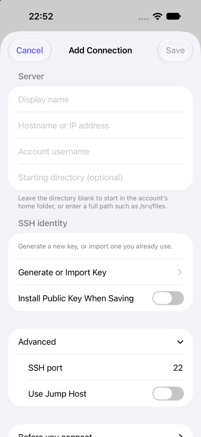

# Connections and security

[Documentation](README.md) · [RemoteFiles](../README.md)

Connect to an existing SSH/SFTP server, verify its identity, and understand how RemoteFiles handles credentials and local state.

## Before you connect

The connection form shows what every connection needs. **Advanced** holds the SSH port and jump host; it opens by itself when editing a connection that uses them. **Before you connect** summarises the requirements below, including a Tailscale tip. Connections saved with the former **Show Tailscale Setup Tips** option keep that stored value, which never changed how the app connects.



*Simulator screenshot of a new connection with Advanced expanded.*

You'll need:

- An SSH server with SFTP enabled and an account that can read the files you want.
- A network route from the device to the server.
- A supported SSH private key and a trusted way to check the server's host-key fingerprint.

RemoteFiles cannot turn on SSH or make the server reachable for you.

Browsing is read only. The optional [public-key installer](PUBLIC_KEY_INSTALLATION.md) is a separate operation that can add a key to the selected account's `~/.ssh/authorized_keys` after your confirmation.

<a id="connect-a-unix-system"></a>
## Set up a connection

1. **Enable SSH and SFTP.** On macOS, use **System Settings → General → Sharing → Remote Login**. On Linux or another Unix system, enable OpenSSH and its SFTP subsystem using that system's documentation. Keep the server awake and reachable, and ensure the account can read the project directory.

2. **Create or import an identity.** In RemoteFiles, choose **Add Connection → Generate or Import Key**. Prefer a dedicated generated Ed25519 identity and copy or share its **public** key. Append it to the account's `~/.ssh/authorized_keys` on the server (directory permission 700; file permission 600). Never copy a private key into that file.

   If the server already supports SSH password authentication, **Settings → SSH Keys → select identity → Install Public Key on Server** can append the public key after host verification and explicit confirmation.

3. **Check the network route.** For example, to use Tailscale away from home, install and sign in independently on both devices, then use the server's MagicDNS hostname or Tailscale IP. Tailnet policy must permit the SSH port (22 by default). This is ordinary OpenSSH over Tailscale, not the separate Tailscale SSH service; no router port forwarding is needed. RemoteFiles uses the network path iOS provides to the hostname you enter.

4. **Enter connection details.** Supply the server account's username, hostname, identity and optional absolute project directory. An empty starting directory uses the server's default directory; literal `~` is not expanded locally.

5. **Verify the host.** Compare the displayed server SHA-256 fingerprint through a trusted channel before accepting it. For example, on an OpenSSH server:

   ```sh
   ssh-keygen -lf /etc/ssh/ssh_host_ed25519_key.pub -E sha256
   ```

   Choose the public file for the algorithm presented and the server's configured host-key location. Accept trust only when the fingerprints match.

6. **Open a file.** Open a folder and choose **Folder actions → Add Favourite**. Open a `.md` report and try **Rendered / Source**, **Copy Source** and **Refresh** from its actions menu.

## If a connection fails

The first connection on a local network may require iOS Local Network permission. A timeout alone does not tell you what failed. Check that the server is awake, SSH and SFTP are running, the hostname and port are correct, any VPN or tunnel is connected, network policy permits access, and the app has Local Network permission if needed. See [device permissions and lifecycle](DEVICE_PERMISSIONS_LIFECYCLE.md) for permission recovery.

If the app says it and the server have no secure connection method in common, the server lacks at least one of the algorithm types RemoteFiles needs: AES-GCM encryption (`aes128-gcm@openssh.com` or `aes256-gcm@openssh.com`), Curve25519 or elliptic-curve Diffie-Hellman key exchange, or an Ed25519 or ECDSA host key. The SSH library does not report which one failed, and RemoteFiles does not fall back to weaker algorithms. A missing cipher is the usual cause: some servers, including Dropbear on routers and small storage devices, don't offer AES-GCM. The server's administrator has to enable what is missing. See [server compatibility](SERVER_COMPATIBILITY.md#nas-stand-ins-9-november-2026).

If a host key changes, stop and verify the new fingerprint through a trusted channel before resetting trust. A changed key can be legitimate, but can also mean you reached a different server.

## Keys and trust

Generated Ed25519 keys and verified OpenSSH Ed25519, RSA and ECDSA import formats are documented in [KEY_SUPPORT.md](KEY_SUPPORT.md). Imports accept extensionless files and explicit paste. Encrypted originals remain encrypted in Keychain; an unlocked key is retained only for the foreground session: explicit Disconnect and backgrounding lock it, and so does deleting the key. Editing or removing a connection, forgetting trusted host keys and entering or leaving Demo do not lock keys other connections use; after an edit or removal only a key no saved connection or jump host uses any more is locked. A connection edited to another host or account that keeps its key connects there without asking for the passphrase again, though host-key trust is still explicit. Passphrases are never persisted. Optional Face ID unlock keeps an unlocked copy readable only with the currently enrolled Face ID; see [Face ID unlock](KEY_SUPPORT.md#face-id-unlock). Keychain uses `kSecAttrAccessibleWhenUnlockedThisDeviceOnly`, with synchronisation disabled. This does not imply hardware-backed Ed25519 protection.

Unknown hosts require explicit trust. Changed host keys block before account authentication. A server behind a jump host has its own trusted key for that route (see [jump hosts](JUMP_HOSTS.md)). The reset flow removes trust and requires another verification; it does not silently accept the new key. Every reset, from a connection's settings or from the **Host Key Changed** sheet, also disconnects, stops downloads through that server, and removes what was kept from it on the device: the saved search indexes of each connection that reaches it, and previewed images, PDFs and media. Whatever is trusted next is not shown or searched as the server before it. Deleting a connection removes its previewed files too, and forgets its server's trusted key, and its jump host's, when no other connection uses them: a key can only be reset from a connection, so one left behind could never be removed. If the connection has downloads, deleting it asks whether to remove them or keep them in **Downloads**. A key used by a saved connection cannot be deleted.

Profiles, favourites, recent references, and public identity metadata are stored atomically in Application Support. A device backup includes them and the trusted host keys, so a restored device keeps its connections; it does not include private keys, which never leave the device's Keychain, so each key has to be imported again. Reading positions and each folder's sort choice hold remote paths and are kept out of backups; both are stored with complete file protection. Private material stays in Keychain unless you explicitly [export a private key](KEY_SUPPORT.md#export-a-private-key). Recent files are references, not persistent offline copies. Swipe a recent entry and choose **Remove from Recents** to remove its saved reference; the remote file and favourites remain. The same action is available to VoiceOver. **Disconnect** returns Home, clears the navigation stack and cancels pending session work. In-memory cache is bounded to 48 prepared directory listings (40,000 names) and at most four documents / 6 MiB. Everything is cleared on memory warnings or disconnect, and a connection failing a host-key or key check forgets its listings. Backgrounding releases documents and any listings read with a passphrase-protected key; the rest are checked with the server when next shown. Returning to a cached folder preserves its scroll position without a new listing; use pull-to-refresh or **Refresh** to check for remote changes. Browsing networking and unlocked-key caches are retired on backgrounding. A separately requested managed download may keep its already-authenticated SSH transport while iOS grants continued processing; it disconnects when finished, interrupted or explicitly disconnected. See [downloads](DOWNLOADS.md).

## Jump hosts

Connections can optionally reach the SFTP destination through one SSH bastion, with separate identity and fingerprint verification for each endpoint. See [jump-host setup and policy](JUMP_HOSTS.md).
