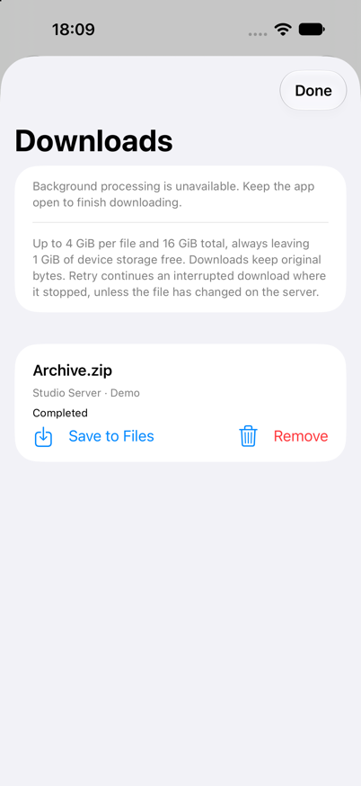
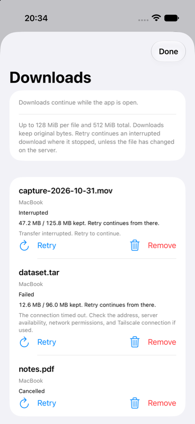

# Downloads and background SSH

Touch and hold a regular file in a remote folder and choose **Download**. Open **Downloads** on Home to see the queue, byte progress and results. **Save to Files** copies a completed download to the location you choose. **Cancel** stops queued or active work; **Retry** continues an interrupted or failed download from the bytes already received, or starts a cancelled one again ([resuming](#resuming-interrupted-downloads)); **Remove** deletes the app's copy and history entry.

Downloads preserve the original bytes of every supported regular file, including formats without a preview. Symbolic links resolved by the folder listing retain their selected filename. Files outside the connection's starting folder can be downloaded too. The SFTP transport rechecks regular-file status, and the file and its folder must still resolve to exactly the canonical paths you chose, so a file or folder replaced by a symbolic link leading elsewhere is rejected. Downloads cannot upload or modify remote files.

Downloads selected from a saved search index retain that index's canonical root through queue persistence, interruption and retry. Both the indexed root and file path must still resolve to their exact saved canonical names: replacing either with a symbolic link is rejected, even when its new target remains inside the connection's starting folder. The index root is the boundary for its results, including an index built outside the connection's starting folder; a result outside its index root is rejected. Adapters that cannot enforce canonical snapshot downloads fail closed rather than falling back to ordinary downloads.

The queue runs one transfer at a time, with a 4 GiB per-file limit, 16 GiB total storage budget and 100 history entries. A download also never leaves less than 1 GiB of free storage on the device: a file whose size would cross that reserve fails before any transfer opens, with a message to free up storage and Retry, and a file whose size the server doesn't report stops when it reaches that reserve. Kept bytes of the same download are reused, so they need no new free space. Completed downloads remain until removed. A fully received file awaiting final protection also counts toward the storage budget. Their private directory is excluded from backups; completed bytes and metadata use complete file protection. A partially written file is kept after an interruption so **Retry** can continue it, and deleted on cancellation, on a refusal such as a permission or limit error, and when a transport returns late after cancellation. Kept partial bytes count toward the storage budget. Cancellation does not free the worker slot until it drains. If the server doesn't confirm closing the transfer within 5 seconds, as when the network has gone, RemoteFiles closes that SSH connection so the transfer drains locally. If a local deletion fails, its history entry and quota remain; cleanup failures block further downloads until the affected item can be removed.

Simulator screenshot after a Demo download.

## Background behavior

Each foreground-initiated active transfer requests an iOS **continued processing task**. When iOS grants it, its system progress and cancellation interface accompanies the SSH transfer, which can continue when you switch apps. The Downloads screen states whether continuation is available. iOS can deny or end this work; if unavailable, keep RemoteFiles open. Simulator does not establish background execution acceptance.

System cancellation or expiration interrupts the active transfer and queued items; retry them explicitly in the foreground. If a transfer finishes receiving bytes while local protection still needs an unlock, its system task reports failure; Downloads retains the received bytes as Waiting for Unlock for that local step.

Only the already-started transfer continues in the background. Queued files wait for the app to return to the foreground, where host trust and key unlock can be handled. Downloads share one queue across windows, but each enqueue or retry uses the initiating window’s transport and trust/unlock UI. A background window does not pause work while another window is active. Download SSH connections are separate from browsing connections. Backgrounding still disconnects browsing, cancels previews and public-key installation, and clears unlocked session keys. Finishing a foreground download closes its SSH connection while preserving the foreground identity cache for subsequent files. Explicit Disconnect interrupts the download queue as well.

Managed SFTP transfers, including saved-index downloads, stop after 60 seconds without new network bytes; continued byte progress resets this inactivity deadline. Previews, one-off exports and offline snapshot transfers retain their existing 180-second total deadline. These limits, and cancellation, take effect without the network: a transfer whose connection stops answering ends about 5 seconds after its limit or cancellation, rather than when the network returns. This is not an unlimited SSH daemon or an upload queue. System cancellation, connection loss, unavailable protected data, force quit and process termination can interrupt downloads. When a fully received, validated file cannot acquire complete protection because protected data is unavailable, it remains **Waiting for Unlock**. Its bytes are retained, count toward quota and cannot be exported. RemoteFiles retries protection on the protected-data-available notification and on returning to the foreground; **Finish Download** also retries this local step without another SSH transfer. Unrelated protection errors and changed or missing files still fail closed.

The pending state survives reopening once its manifest write succeeds. If the protected manifest cannot be written while locked, RemoteFiles keeps the state in memory and retries that write after unlock. Process termination before that persistence succeeds can still leave an interrupted entry requiring a new transfer; crash-proof completion while locked is not guaranteed. After relaunch, previously queued or active transfers show **Interrupted** and require **Retry**; retries continue from the kept bytes when they can and never silently reconnect. A persisted pending-finalization entry instead retains its bytes and waits for local finalization. A changed connection profile must be downloaded anew so queued work cannot target a different host/account/root.

## Resuming interrupted downloads

When a transfer opens the remote file, RemoteFiles records the file's size and modification time in the protected download list before writing any of its bytes. If the transfer is interrupted, by a dead network, Disconnect, locking, iOS ending the background task, force quit or a crash, the received bytes stay in the download's private folder and Downloads shows how much is kept. **Retry** then continues from the end of those bytes only if all of these hold:

- the server still reports the same size and modification time;
- the kept file is no longer than the server's file; and
- its final 64 KiB match the server's bytes at the same offsets.

Otherwise the kept bytes are discarded and the file is downloaded from the beginning. The 64 KiB check catches a same-size rewrite within one modification-time tick near where the transfer stopped; a rewrite elsewhere within that tick that keeps the size can't be detected without a full download. A cancelled download, a refusal about the file itself (permission, a missing file, a redirected path, or a size limit) and a server or adapter that reports no size or modification time always start again. Kept bytes from older versions of RemoteFiles aren't continued.

Kept partial bytes count toward the 16 GiB storage budget. When a new download needs their space, other downloads' kept bytes are discarded first, oldest first, and those downloads start from the beginning on **Retry**. **Remove** deletes kept bytes along with the entry. The per-file 4 GiB limit applies to the whole file, kept bytes included.

Simulator screenshot with a seeded download list; no transfer ran.

## Validation

`DownloadManagerTests` covers resuming from kept bytes across relaunch, restarting a changed file, discarding kept bytes on cancellation and refusals, kept bytes counting toward and yielding storage, exact binary bytes, persistence/removal, removal failure and retained quota, configured root propagation, late cancellation/drainage, foreground queue scheduling, file and storage budgets, multi-gigabyte admission, the device free-storage reserve for known and unreported sizes and for resumed bytes, changed-profile retries, per-window transport/error ownership, scene aggregation, identity-cache retention, deferred protection with quota reservation and local finalization after unlock, rejection of unrelated protection failures, and recovery after relaunch. Indexed-download regressions also cover canonical-root persistence through relaunch/retry, backward-compatible manifests, unsupported adapter rejection, and real OpenSSH root/file redirects and combined connection/index boundaries. Against real OpenSSH, `testInterruptedManagedDownloadContinuesOnlyWhileTheRemoteFileIsUnchanged` stalls a transfer mid-file through a reply-holding proxy, then checks that a retry transfers only the missing bytes and that altered kept bytes, a changed modification time or an overlong kept file each start again. `AppModelLifecycleTests` also covers download trust/unlock presentation and another window entering the background. Real-device acceptance must separately exercise continued-processing admission, system progress/cancel, switching apps, locking, interruption and retry with a trusted test SSH server. No physical-device acceptance is implied by these unit tests or a simulator build.

The background API and system termination model are described in Apple’s [continued processing guide](https://developer.apple.com/documentation/backgroundtasks/performing-long-running-tasks-on-ios-and-ipados/).
