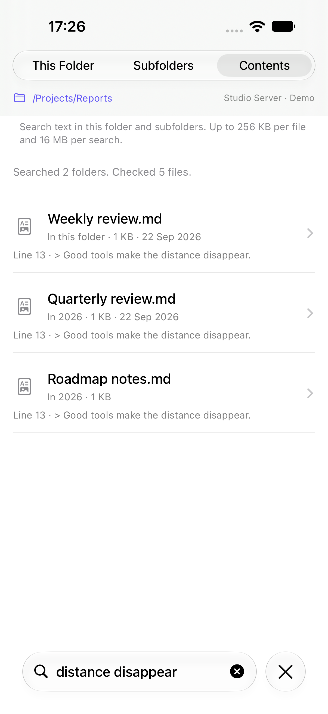
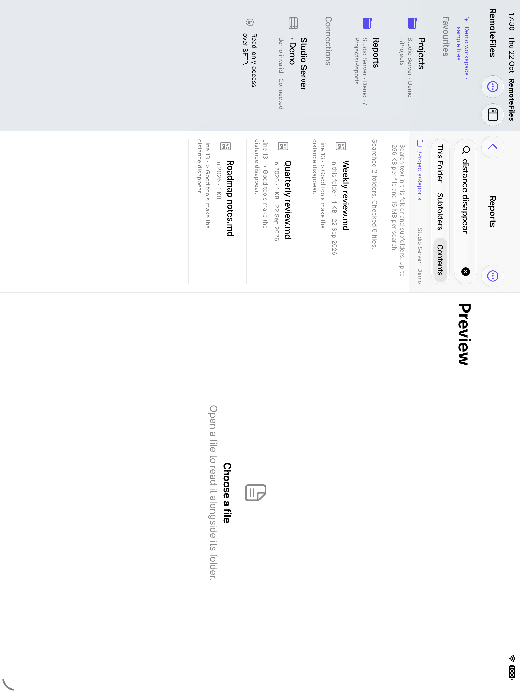

# Folder browsing

[Documentation](README.md) · [RemoteFiles](../README.md)

Folders list their contents with folders first. Use **Folder actions** to refresh, show hidden files, add a favourite, or choose how the folder is sorted. The search field filters this folder, searches names in its subfolders, or searches file contents.

| Linked folder | File and broken links | Sorted by size |
| --- | --- | --- |
|  |  |  |

*Screenshots from the demo workspace.*

## Symbolic links

While a folder is listed, RemoteFiles also looks up where each symbolic link points. Each link sends `REALPATH` and `STAT` together, and links are resolved in parallel, so a folder of links costs about one more round trip.

- **Link to a folder:** shown with a folder icon and **Link to folder**, sorted with the folders, and opened in one tap.
- **Link to a file:** shown like its target, for example **Link to file · 1 KB · 22 Sep 2026**, and opened in one tap. Saving the original keeps the link's own name.
- **Broken link:** the target is missing or the link is part of a loop. Tapping it checks the server again, so a repaired link still opens.
- **Unresolved link:** shown as **Symbolic link** and resolved when tapped. This covers permission errors, transport failures, and links after the first 256 in one folder.

Links open their canonical target, so the path bar shows where you actually are. Like the listing itself, a resolved target can become stale; **Refresh** lists the folder and its links again. Browsing is not confined to the starting folder, but document links, images and original-file export keep their canonical folder checks.

## Sorting

Choose **Folder actions → Sort By**:

- **Name** (default): natural order, so `Report 2` comes before `Report 10`.
- **Date Modified:** newest first.
- **Size:** largest first.
- **Kind:** grouped by file extension.

Folders, including links to folders, always come first. Size and date describe what a link opens. Entries without a size or date sort last, and ties fall back to the name. Filtering and hidden files apply before sorting.

The choice is remembered per connection and folder. Choosing **Name** removes the folder's saved choice, at most 200 choices are kept (the least recently changed is dropped first), and deleting a connection forgets its folders. Demo mode never saves sort choices.

## Searching subfolders

Type in the search field, then choose a scope:

- **This Folder:** filters the names already listed, instantly.
- **Subfolders:** searches names in this folder and every folder below it. Matching ignores case.
- **Contents:** searches source text in this folder and its subfolders. Results show the first matching line and a short snippet; matching ignores case and treats the query literally.

*Screenshot from the demo workspace.*

Subfolder and contents search automatically use a read-only helper on Linux servers with SSH command access, Python 3.7 or newer, and accessible procfs directory handles. SFTP-only accounts, macOS/BSD servers, restricted or unavailable procfs, missing interpreters, and incompatible helpers automatically use the existing SFTP search. No setup, server installation, persistent index, or account write access is required. Each result says where it was found, such as **In Reports/2026**, and opens like any other row. Results stay while you open one and come back.

- **SFTP fallback:** after typing pauses, the search lists folders four at a time and shows results nearest folder first, so nearer matches always count first towards the limit. It makes its own requests, so stopping it never cancels a folder you open. Changing the text or scope, refreshing, disconnecting or leaving the app stops it; coming back from a result shows the finished search again without repeating it.
- **What it skips:** links are matched by name but never followed, so the search stays inside the folder and can't loop. Hidden files and folders are skipped unless **Show Hidden Files** is on. A folder that can't be read, has gone, or times out is counted and skipped. In the SFTP fallback, a timeout closes the shared SFTP channel, so a folder whose listing fails with it is listed once more; if the connection has really ended, the search stops with an error.
- **Limits:** a search lists at most 1,000 folders, goes at most 16 levels down, shows at most 500 matches, and starts no new listings after 30 seconds, including recovery retries. If an interrupted listing needs a retry after that deadline, the search stops with the time limit and keeps results already reported; it does not count the interrupted folder as unreadable. The line above the results says how many folders were searched, how many couldn't be read, and which limit stopped it. To go further, open a subfolder and search from there.

### Server-assisted search

The helper borrows a directory descriptor held open by a dedicated SFTP channel and walks that folder breadth first, and filters out definite non-matches before transferring candidates. It uses the existing authenticated SSH connection and host-key trust, including jump hosts. A separate exec channel owns the search; cancellation, a deadline or excess output closes that channel while browsing remains connected. Unsupported command access is remembered until the connection is recreated. Trust failures, connection loss and timeouts remain errors.

Names search transfers candidate metadata only. Contents search reads supported files on the server and transfers candidate file bytes so the app can apply its existing Foundation matching, binary validation, line numbers and snippets. Unicode candidates are retained conservatively to avoid changing matching semantics; their data savings may be smaller. The query and folder are encoded as data in quoted arguments, never evaluated as shell syntax. The helper runs in memory with isolated Python imports and bytecode writing disabled.

Server results arrive together when the bounded scan completes. Results use the app's natural name ordering, with nearer folders first. The scan retains at most 500 final matches, but can inspect more candidates before the app applies that limit; folder/file/byte/time budgets still bound the work. At a file or time limit the subset can differ from the SFTP fallback because server directory ordering is independent of the device locale. The adapter binds the procfs process to the SFTP channel's kernel pipe/socket identity, then discovers the single new directory descriptor through SFTP procfs and verifies its canonical target before passing it to the helper. The helper requires the same Linux mount namespace, opens that held descriptor, and uses descriptor-relative, no-follow opens below it. It never opens the search root through an exec-visible absolute path and never follows a listed link. Identical path strings in different filesystem namespaces cannot establish this capability; when the handle cannot be bound, search falls back to SFTP. It checks regular-file status after opening and uses nonblocking opens to reject files replaced by special devices or FIFOs.

The helper has the same default depth, folder, file, byte and time budgets as SFTP search. It also caps directory metadata at 100,000 entries, candidate output at 10,000 entries and the SSH response at 24 MiB including stderr. An incompatible or over-budget response is discarded before falling back, so partial server results cannot be duplicated. The fallback gets its own normal search budget. Server file-read counts describe work done remotely, not bytes transferred over the network. Each SFTP fallback folder still takes at least one network round trip, four at a time.

## Searching file contents

Choose **Contents** after typing a phrase. This searches supported text files on the server when available and otherwise reads them over SFTP. It searches Markdown, source code, configuration files, HTML and SVG source, and the reader's other text candidates, including extensionless files. Only valid UTF-8 without binary control bytes is searched. PDFs, images, archives, audio and video are skipped. There is no OCR, regular-expression matching or rendered-text extraction.

| iPhone | iPad folder column |
| --- | --- |
|  |  |

*Screenshots from passing simulator tests using demo files.*

Results contain one match per file, nearest folder first and by name within each folder. SFTP fallback matches appear as each file is checked; server-assisted matches arrive together. The line number refers to the source; opening a result uses the ordinary reader and its existing reading position. Use **Find in Document** to move between matches there. Completed results stay when you return; refresh starts a new search. The same controls and results work in the iPad folder column.

The search lists up to 1,000 folders, descends at most 16 levels, reads at most 500 candidate files, and retains at most 500 matching files. Each file must fit within 256 KiB, with a conservative 16 MiB file-data read budget; directory listings and SSH protocol overhead are additional. Files advertised as larger are skipped without reading; unknown or stale sizes are still bounded by the transport. Failed reads reserve their entire possible transfer, including the EOF sentinel, so repeated failures cannot evade the budget. Reads run one at a time; the SFTP fallback also has a bounded directory-listing window. No new listing, read or recovery retry starts after the 30-second scheduling budget; requests already sent may finish within their own transport deadline. Results already found are retained when a limit is reached.

Hidden files/folders follow **Show Hidden Files**. Listed symbolic links are never read or traversed. Each file read rechecks canonical confinement to the selected search folder, so a file replaced by an outside link cannot supply results. A folder moved outside that boundary is skipped. Unreadable, missing and timed-out files are counted; an interrupted connection is retried once within the same budgets, and persistent connection or trust failures remain errors. Names search still makes no file-content reads.

Changing the query or scope, refreshing, navigating away from the folder, backgrounding or disconnecting cancels the search. The iPad folder can stay visible while you read a result, so its bounded search can continue there. File contents and snippets are not written to an index or search cache, and the query is sent only to the selected server when using its optional helper. Cellular data usage can be substantial: search from a narrower folder for faster results.
