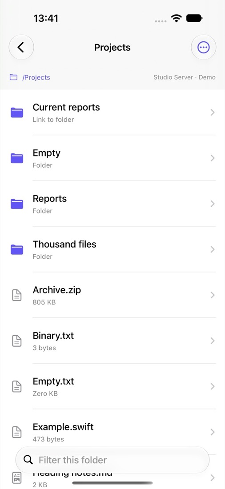
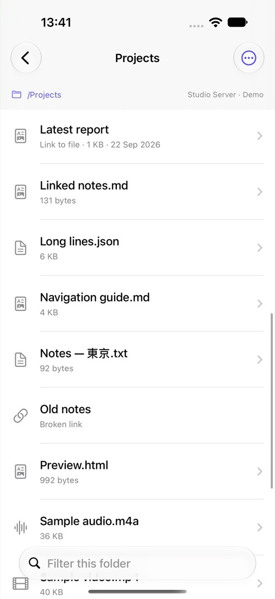
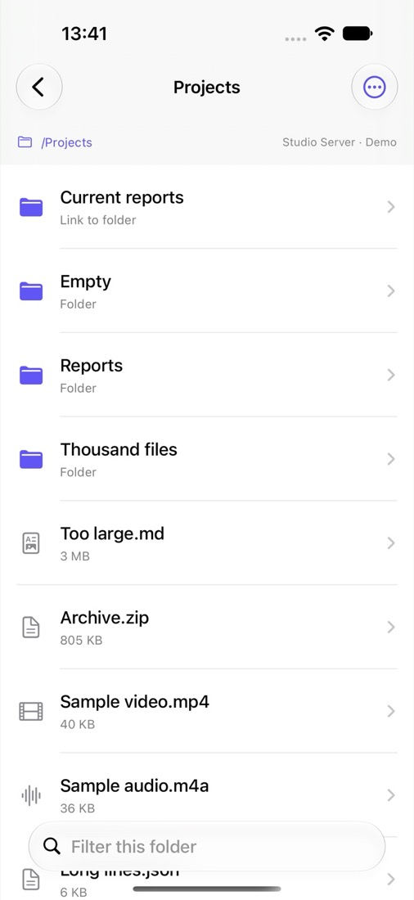
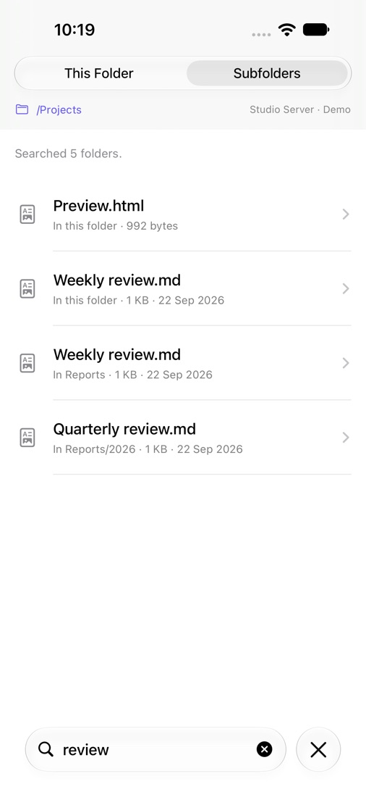

# Folder browsing

[Documentation](README.md) · [RemoteFiles](../README.md)

Folders list their contents with folders first. Use **Folder actions** to refresh, show hidden files, add a favourite, or choose how the folder is sorted. The search field filters this folder, or searches names in its subfolders.

| Linked folder | File and broken links | Sorted by size |
| --- | --- | --- |
|  |  |  |

*Screenshots from the demo workspace.*

## Symbolic links

While a folder is listed, RemoteFiles also looks up where each symbolic link points. Each link sends `REALPATH` and `STAT` together, and links are resolved in parallel, so a folder of links costs about one more round trip.

- **Link to a folder:** shown with a folder icon and **Link to folder**, sorted with the folders, and opened in one tap.
- **Link to a file:** shown like its target, for example **Link to file · 1 KB · 22 Sep 2026**, and opened in one tap. Saving the original keeps the link's own name.
- **Broken link:** the target is missing or the link is part of a loop. Tapping it checks the server again, so a repaired link still opens.
- **Unresolved link:** shown as **Symbolic link** and resolved when tapped. This covers permission errors, transport failures, and links after the first 256 in one folder.

Links open their canonical target, so the path bar shows where you actually are. Like the listing itself, a resolved target can become stale; **Refresh** lists the folder and its links again. Browsing is not confined to the starting folder, but document links, images and original-file export keep their canonical folder checks.

## Sorting

Choose **Folder actions → Sort By**:

- **Name** (default): natural order, so `Report 2` comes before `Report 10`.
- **Date Modified:** newest first.
- **Size:** largest first.
- **Kind:** grouped by file extension.

Folders, including links to folders, always come first. Size and date describe what a link opens. Entries without a size or date sort last, and ties fall back to the name. Filtering and hidden files apply before sorting.

The choice is remembered per connection and folder. Choosing **Name** removes the folder's saved choice, at most 200 choices are kept (the least recently changed is dropped first), and deleting a connection forgets its folders. Demo mode never saves sort choices.

## Searching subfolders

Type in the search field, then choose a scope:

- **This Folder:** filters the names already listed, instantly.
- **Subfolders:** searches names in this folder and every folder below it. Matching ignores case.

*Screenshot from the demo workspace.*

Subfolder search lists folders over the same SFTP connection, so it works on any SFTP account, needs no shell access, and stays read only. Each result says where it was found, such as **In Reports/2026**, and opens like any other row. Results stay while you open one and come back.

- **How it searches:** after typing pauses, the search lists folders four at a time and shows results nearest folder first, so nearer matches always count first towards the limit. It makes its own requests, so stopping it never cancels a folder you open. Changing the text or scope, refreshing, disconnecting or leaving the app stops it; coming back from a result shows the finished search again without repeating it.
- **What it skips:** links are matched by name but never followed, so the search stays inside the folder and can't loop. Hidden files and folders are skipped unless **Show Hidden Files** is on. A folder that can't be read, has gone, or times out is counted and skipped. A timeout closes the shared SFTP channel, so a folder whose listing fails with it is listed once more; if the connection has really ended, the search stops with an error.
- **Limits:** a search lists at most 1,000 folders, goes at most 16 levels down, shows at most 500 matches, and starts no new listings after 30 seconds. The line above the results says how many folders were searched, how many couldn't be read, and which limit stopped it. To go further, open a subfolder and search from there.

Each folder takes at least one round trip to list, four at a time, so searching a large tree over cellular or Tailscale is much slower than a server-side `find`. Searching file contents is not supported.
