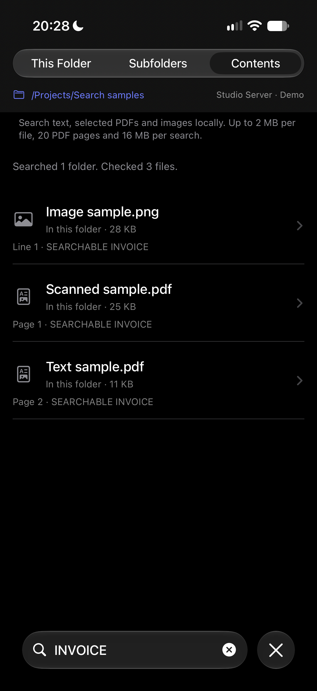
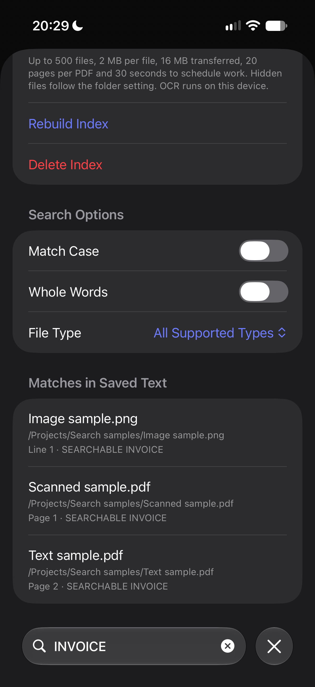
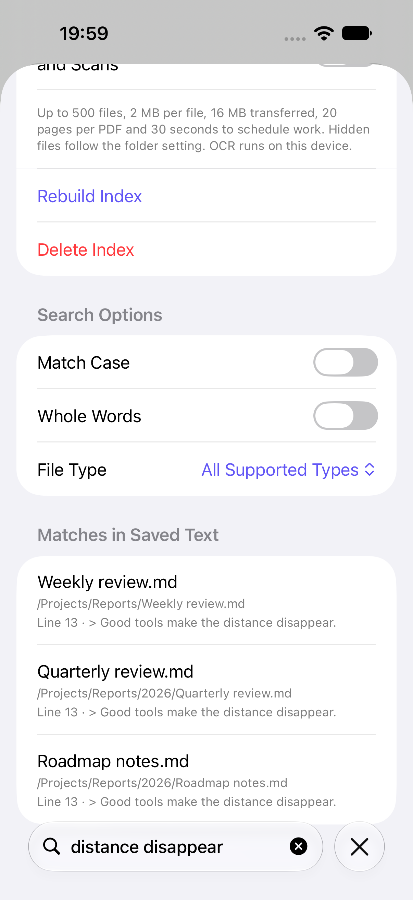

# Folder browsing

[Documentation](README.md) · [RemoteFiles](../README.md)

Folders list their contents with folders first. Use **Folder actions** to refresh, show hidden files, add a favourite, or choose how the folder is sorted. The search field filters this folder, searches names in its subfolders, or searches file contents. **Search Options** adds matching filters, PDF text and on-device OCR; **Saved Search Index** builds a local text snapshot for repeated searches.

A folder can contain up to 10,000 entries and 16 MiB of decoded name and attribute metadata. If it exceeds either limit, the app shows an error rather than a silently incomplete listing. Individual SFTP frames are capped at 1 MiB before their declared body is buffered.

| Linked folder | File and broken links | Sorted by size |
| --- | --- | --- |
|  |  |  |

*Screenshots from the demo workspace.*

## Symbolic links

While listing a folder, RemoteFiles looks up where its symbolic links point. It resolves links in parallel, sending `REALPATH` and `STAT` together for each, so a folder of links costs about one more round trip.

- **Link to a folder:** shown with a folder icon and **Link to folder**, sorted with the folders, and opened in one tap.
- **Link to a file:** shown like its target, for example **Link to file · 1 KB · 22 Sep 2026**, and opened in one tap. Saving the original keeps the link's own name.
- **Broken link:** the target is missing or the link is part of a loop. Tapping it checks the server again, so a repaired link still opens.
- **Unresolved link:** shown as **Symbolic link** and resolved when tapped. This covers permission errors, transport failures, and links after the first 256 in one folder.

Links open their canonical target, so the path bar shows where you actually are. Like the listing itself, a resolved target can become stale; **Refresh** lists the folder and its links again. Browsing is not confined to the starting folder, but document links, images and original-file export keep their canonical folder checks.

## Sorting

Choose **Folder actions → Sort By**:

- **Name** (default): natural order, so `Report 2` comes before `Report 10`.
- **Date Modified:** newest first.
- **Size:** largest first.
- **Kind:** grouped by file extension.

Folders, including links to folders, always come first. Size and date describe what a link opens. Entries without a size or date sort last, and ties fall back to the name. Filtering and hidden files apply before sorting.

The choice is remembered per connection and folder. Choosing **Name** removes the folder's saved choice, at most 200 choices are kept (the least recently changed is dropped first), and deleting a connection forgets its folders. Demo mode never saves sort choices.

## Searching subfolders

Type in the search field, then choose a scope:

- **This Folder:** filters the names already listed, instantly.
- **Subfolders:** searches names in this folder and every folder below it.
- **Contents:** searches source text in this folder and its subfolders, optionally including PDF text and OCR. Results show the first matching line or PDF page and a short snippet.

Matching is literal and ignores case by default. In **Folder actions → Search Options**, enable **Match Case** or **Whole Words**, or choose a **File Type** extension filter. Whole-word matching treats Unicode letters, numbers, combining marks and underscores as word characters: `report` does not match `report_2026`. These controls apply to all three scopes; a file-type filter excludes folder and link rows from matches while subfolder traversal continues. The picker offers `.md`, `.txt`, `.pdf`, `.png` and `.jpg`; each choice matches that extension, ignoring its case. There is no regular-expression syntax.

*Screenshot from the demo workspace.*

With the default search options, subfolder and contents search automatically use a read-only helper on Linux servers with SSH command access, Python 3.7 or newer, and accessible procfs directory identities (Linux 5.14 or newer). SFTP-only accounts, macOS/BSD servers, restricted or unavailable procfs, missing interpreters, and incompatible helpers automatically use the existing SFTP search. Case-sensitive, whole-word, extension-filtered, PDF/OCR and index-building searches use bounded SFTP traversal and local matching. No setup, server installation or account write access is required. Live searches do not require a saved index. Each result says where it was found, such as **In Reports/2026**, and opens like any other row. Results stay while you open one and come back.

- **SFTP fallback:** after typing pauses, the search lists folders four at a time and shows results nearest folder first, so nearer matches always count first towards the limit. It makes its own requests, so stopping it never cancels a folder you open. Changing the text or scope, refreshing, disconnecting or leaving the app stops it; coming back from a result shows the finished search again without repeating it.
- **What it skips:** links are matched by name but never followed, so the search stays inside the folder and can't loop. Hidden files and folders are skipped unless **Show Hidden Files** is on. A folder that can't be read, has gone, or times out is counted and skipped. In the SFTP fallback, a timeout closes the shared SFTP channel, so a folder whose listing fails with it is listed once more; if the connection has really ended, the search stops with an error.
- **Limits:** a search lists at most 1,000 folders, goes at most 16 levels down, shows at most 500 matches, and starts no new listings after 30 seconds, including recovery retries. If an interrupted listing needs a retry after that deadline, the search stops with the time limit and keeps results already reported; it does not count the interrupted folder as unreadable. The line above the results says how many folders were searched, how many couldn't be read, and which limit stopped it. To go further, open a subfolder and search from there.

### How server-assisted search works

The Linux helper is optional and runs over the existing authenticated SSH connection. When its safety checks or prerequisites are unavailable, the app falls back to SFTP. Real Linux transport validation and its reproducible fixture are documented in [Linux search acceptance](../Tests/LinuxSearchAcceptance/README.md).

A dedicated SFTP channel holds the selected directory open while the helper verifies its kernel identity and walks that folder breadth first, and filters out definite non-matches before transferring candidates. It uses the existing authenticated SSH connection and host-key trust, including jump hosts. A separate exec channel owns the search; cancellation, a deadline or excess output closes that channel while browsing remains connected. Unsupported command access is remembered until the connection is recreated. Trust failures, connection loss and timeouts remain errors.

Names search transfers candidate metadata only. Contents search reads supported files on the server and transfers candidate file bytes so the app can apply its existing Foundation matching, binary validation, line numbers and snippets. Unicode candidates are retained conservatively to avoid changing matching semantics; their data savings may be smaller. The query and folder are encoded as data in quoted arguments, never evaluated as shell syntax. The helper runs in memory with isolated Python imports and bytecode writing disabled.

Server results arrive together when the bounded scan completes. Results use the app's natural name ordering, with nearer folders first. The scan retains at most 500 final matches, but can inspect more candidates before the app applies that limit; folder/file/byte/time budgets still bound the work. At a file or time limit the subset can differ from the SFTP fallback because server directory ordering is independent of the device locale. The adapter identifies the single new directory descriptor through SFTP procfs, requires a live READLINK before resolving it, and reads its inode, mount ID and mount namespace. The helper opens the canonical path with no-follow operations and requires all three identities to match before listing or reading user data. SFTP retains the original handle until the helper finishes, preventing inode reuse. Traversal stays relative to the verified directory descriptor and never follows a listed link. This works with normal OpenSSH process-inspection protections: neither process reads another process's procfs descriptors. Identical path strings alone cannot enable the helper; unavailable identity metadata causes SFTP fallback. It checks regular-file status after opening and uses nonblocking opens to reject files replaced by special devices or FIFOs.

The helper has the same default depth, folder, file, byte and time budgets as SFTP search. It also caps directory metadata at 100,000 entries, candidate output at 10,000 entries and the SSH response at 24 MiB including stderr. An incompatible or over-budget response is discarded before falling back, so partial server results cannot be duplicated. The fallback gets its own normal search budget. Server file-read counts describe work done remotely, not bytes transferred over the network. Each SFTP fallback folder still takes at least one network round trip, four at a time.

## Searching file contents

Choose **Contents** after typing a phrase. By default, this searches supported text files on the server when available and otherwise reads them over SFTP. It searches Markdown, source code, configuration files, HTML and SVG source, and the reader's other text candidates, including extensionless files. Only valid UTF-8 without binary control bytes is searched. HTML and SVG remain source searches; scripts and linked resources are never loaded or executed.

To search documents and scans, choose **Folder actions → Search Options**:

- **Include PDF Text:** extracts embedded text from PDFs on the device. Results identify the matching page.
- **Recognize Text in Images and Scans:** uses on-device OCR for supported images. It also recognizes PDF pages: with **Include PDF Text** enabled, only pages without embedded text undergo OCR; with PDF text disabled, pages are rasterized for OCR. When both options are enabled, OCR does not supplement partially searchable pages.

Try **Explore Demo → Projects → Search samples** and search contents for `INVOICE`. The bundled synthetic examples include a PDF with embedded text on page 2, a scanned PDF, and an image. The [fixture generator](../Fixtures/generate-search-fixtures.swift) reproduces these samples.

| Live PDF/OCR search | Saved PDF/OCR search |
| --- | --- |
|  |  |

*Screenshots from a passing signed Release UI test on a physical iPhone 17 Pro running iOS 27.2, using only bundled synthetic samples.*

Both options are off for an ordinary live search. OCR uses up to three supported device-preferred languages, falling back to English when none match. If Vision's accurate model cannot run, its fast model gets one attempt within the original time budget; cancellation never starts that fallback. The fast model supports fewer languages and can be less accurate. OCR can miss or misread text, especially handwriting, small text, unusual layouts and low-quality scans. Only the first frame of a multi-frame image is searched. Archives, audio and video remain unsupported, and encrypted or invalid PDFs cannot be searched. No document bytes or recognized text are sent to an OCR service.

| iPhone | iPad folder column |
| --- | --- |
|  |  |

*Screenshots from passing simulator tests using demo files.*

Results contain one match per file, nearest folder first and by name within each folder. SFTP fallback matches appear as each file is checked; server-assisted matches arrive together. The line number refers to source text or recognized image text; PDF matches show a page number. Opening a result uses the ordinary reader and its existing reading position; PDF results do not yet jump to the matching page. Use **Find in Document** in supported text readers to move between matches there. Completed results stay when you return; refresh starts a new search. The same controls and results work in the iPad folder column.

The search lists up to 1,000 folders, descends at most 16 levels, reads at most 500 candidate files, and retains at most 500 matching files. The default file-size limit is 256 KiB; enabling PDF text or OCR raises it to 2 MiB for supported files. Every search retains the conservative 16 MiB file-data read budget; directory listings and SSH protocol overhead are additional. Files advertised as larger are skipped without reading; unknown or stale sizes are still bounded by the transport. Failed reads reserve their entire possible transfer, including the EOF sentinel, so repeated failures cannot evade the budget.

Extraction examines at most 20 pages per PDF and keeps at most 256 KiB of UTF-8 text per file, with a separate 16 MiB extracted-text budget. Images exceeding 40 million pixels or 32,768 pixels on either side are rejected before raster decoding. OCR images and rendered PDF pages are reduced to at most 2,048 pixels on either side. The progress summary reports files with truncated extraction so a missing match is not evidence that the rest of a document contains no match.

Reads run one at a time; the SFTP fallback also has a bounded directory-listing window. No new listing, read or recovery retry starts after the 30-second scheduling budget; requests already sent may finish within their own transport deadline. PDF/OCR extraction checks cancellation and time between stages, pages and recognition requests. Framework parsing and rasterization are synchronous, so the scheduling budget is not a hard CPU timeout. Results already found are retained when a limit is reached.

Hidden files/folders follow **Show Hidden Files**. Listed symbolic links are never read or traversed. Each file read rechecks canonical confinement to the selected search folder, so a file replaced by an outside link cannot supply results. A folder moved outside that boundary is skipped. Unreadable, missing and timed-out files are counted; an interrupted connection is retried once within the same budgets, and persistent connection or trust failures remain errors. Names search still makes no file-content reads.

Changing the query, options or scope, refreshing, navigating away from the folder, backgrounding or disconnecting cancels the search. The iPad folder can stay visible while you read a result, so its bounded search can continue there. Live searches do not write contents or snippets to an index or search cache. The query is sent only to the selected server when using its optional helper. Cellular data usage can be substantial: search from a narrower folder for faster results.

## Saved search indexes

*Saved-index results from the passing iPhone simulator demo test.*

Choose **Folder actions → Saved Search Index**, select the build options, then tap **Build Index**. PDF text is enabled by default in this view; OCR remains opt-in. Hidden files follow the folder's **Show Hidden Files** setting. Building reads supported files using the same canonical, read-only SFTP confinement as live content search and saves only their searchable text and file metadata on this device. It does not install anything on the server or save original files for offline reading.

The saved view shows when the index was built, how many files it contains, whether coverage is partial, and the PDF, OCR and hidden-file choices used. Search its saved contents with the same case, whole-word and file-type controls; these queries perform no remote reads. Indexes persist across app launches. There is no automatic or background refresh: choose **Rebuild Index** to reflect remote changes, or **Delete Index** to remove the saved text.

An index is a snapshot, not a current inventory. Unsupported or unreadable files, excluded pages, and exhausted limits can leave it incomplete; a **Partial index** message makes this explicit. A finished rebuild replaces the entire previous snapshot, including removing files no longer found. Cancellation or a fatal build error leaves the previous saved index intact. Opening a result reads the current remote file under the original canonical folder boundary, so the displayed contents may differ or the file may no longer exist. Text, PDF/image previews and their resources, **Save Original**, and **Keep Offline** reject a folder redirected after indexing. Saved-result media rechecks this boundary with a new download rather than reusing an ordinary preview cache. A saved index is not a substitute for [Keep Offline](OFFLINE_FILES.md).

Default builds cover at most 1,000 folders, 16 levels and 500 candidate files, with 2 MiB per file, 16 MiB of charged file-data reads, 20 pages per PDF, 256 KiB of extracted text per file, and 16 MiB of extracted text overall. The same 30-second scheduling and extraction-stage checks apply. Build from a subfolder when a larger tree exceeds these bounds. Rebuilding repeats the scan; it does not incrementally validate previously indexed files.

Storage is limited to eight indexes and 128 MiB per index library, with at most 500 documents, 16 MiB of text and 32 MiB of encoded data in one index. Saving another index evicts the oldest saved indexes when necessary. Saves replace files atomically; the index directory is excluded from backups and index files use complete file protection on iOS. Each index is isolated by the full connection profile and canonical root. Editing or deleting a connection, or resetting its host or jump-host trust, removes its indexes. Demo indexes use a separate library.
