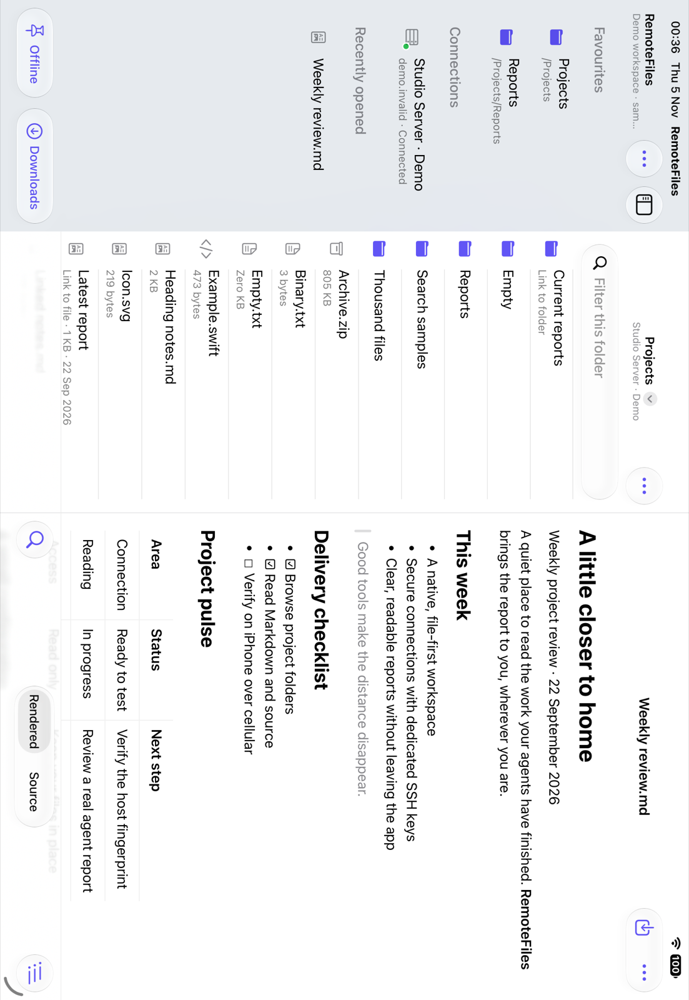

# iPad workspace

*Passing iPad Pro simulator UI journey using bundled demo files.*

When both size classes are regular — an iPad window or an unfolded iPhone Duo — RemoteFiles uses three native split-view columns:

- **Library:** connections, favourites and recents, with the existing settings and connection actions.
- **Folder:** the selected folder, with search, sorting, breadcrumbs and a Previous Folder button for nested navigation.
- **Reader:** the selected file, including the existing rendered/source controls, Find, document links and export actions.

Opening another file replaces the preview while keeping its folder mounted. Selecting a new folder clears the old preview. Opening a recent file shows its containing folder alongside it. The sidebar toggle and native column sizing let the system accommodate smaller windows.

A window too narrow for three columns, such as an unfolded iPhone Duo, slides the library — and in portrait the folder too — over the reader. While no folder is chosen the library opens itself, so the window never starts on two empty placeholders. Choosing a folder closes a library overlay and leaves the folder; opening a file closes the overlays covering the reader. Columns that sit side by side are never closed. The app detects overlays by comparing column frames, since SwiftUI’s requested visibility does not tell it whether a column is tiled or overlaid. When the window widens again, the columns closed this way come back if they fit.

A compact width or height, such as a folded iPhone Duo or a landscape iPhone, uses the existing stack navigation. The layout follows size classes, not the device idiom. Both layouts use the same route state, so the current folder and file stay put when the window changes size or the device folds or unfolds.

Editing or deleting the visible connection clears its selected routes so old-server content is not shown under changed settings. Disconnect returns all columns to their initial state. Backgrounding retains location while closing connections and clearing unlocked keys. Demo uses the same workspace without contacting a server.

Automated navigation tests cover route projection, preview replacement, folder history, recents, disconnect and the size-class layout decision. Simulator UI journeys include assertions for the workspace and adaptive overlays; consult their results for the build being tested. Simulator results do not establish physical iPad, iPhone Duo or Stage Manager behavior.

## Keyboard shortcuts

With a hardware keyboard, hold ⌘ to list these shortcuts, or open the iPad menu bar. They act on the folder and reader on screen, in the workspace and the stack alike; a command that doesn't apply there is greyed out.

| Shortcut | Command | Menu |
| --- | --- | --- |
| ⌘F | Find: opens Find in Document (in Source for HTML and SVG) | Edit › Find |
| ⌘G / ⇧⌘G | Find Next / Find Previous while Find is open | Edit › Find |
| ⇧⌘F | Search Folder: focus the folder's search field | Edit |
| ⌥⌘U | Show Source / Show Rendered | View |
| ⇧⌘. | Show or Hide Hidden Files | View |
| ⌘R | Refresh Document | View |
| ⇧⌘R | Refresh Folder | View |
| ⌘[ | Back: Previous Folder in the workspace, or the previous screen in the stack and Offline Files | Go |
| ⌘↑ | Enclosing Folder | Go |
| ⇧⌘J | Headings | Go |
| ⌥⌘L | Downloads | Go |
| ⇧⌘O | Offline Files | Go |

Find, Find Next and Find Previous are the system's own Edit › Find items, which the app answers for the reader on screen; Find and Replace and Use Selection for Find stay unavailable. In the Find field, Return moves to the next result and Escape closes Find. Offline copies support every reader shortcut except Refresh Document, since updating a saved copy needs a connection and is chosen in Offline Files. While a sheet such as Downloads, Headings or a folder's search index is open, the reader and folder beneath it ignore shortcuts. Folder rows don't yet take arrow-key selection; use ⇧⌘F to filter the folder, then tap the row.
