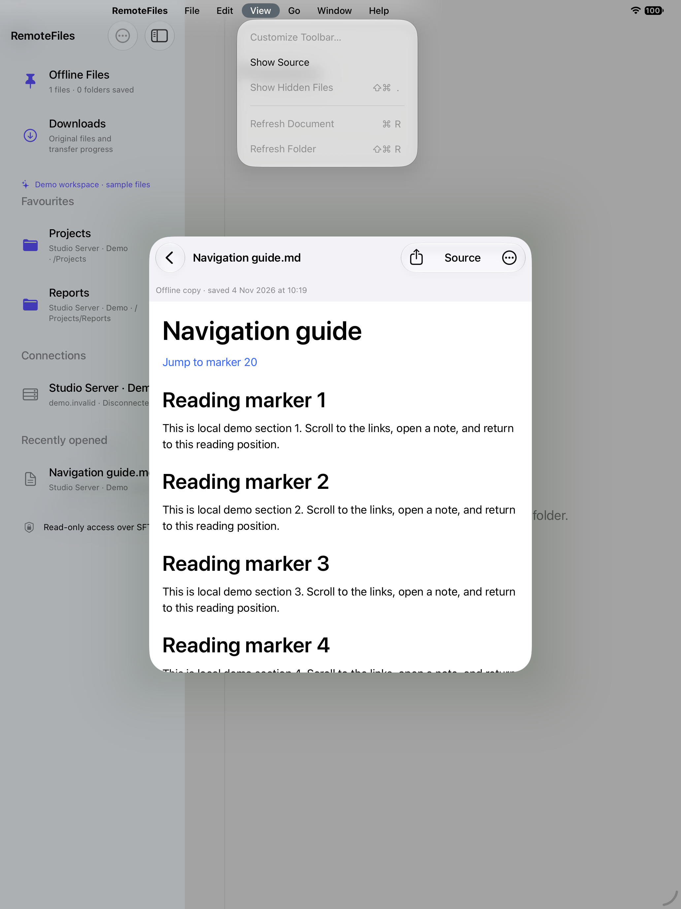

# iPad workspace

*Passing iPad Pro simulator UI journey using bundled demo files.*

When both size classes are regular — an iPad window or an unfolded iPhone Duo — RemoteFiles uses three native split-view columns:

- **Library:** favourites, connections and recents, with settings and adding a connection in its toolbar, and Offline Files and Downloads in its bottom bar.
- **Folder:** the selected folder, with search, sorting, a title menu of its ancestors and a Previous Folder button for nested navigation.
- **Reader:** the selected file, with Find, Rendered/Source and Headings in its bottom bar, plus document links and export actions. Rendered Markdown stops at a comfortable line length in wide windows.

Opening another file replaces the preview while keeping its folder mounted. Selecting a new folder clears the old preview. Opening a recent file shows its containing folder alongside it. The sidebar toggle and native column sizing let the system accommodate smaller windows.

A window too narrow for three columns, such as an unfolded iPhone Duo, slides the library — and in portrait the folder too — over the reader. While no folder is chosen the library opens itself, so the window never starts on two empty placeholders. Choosing a folder closes a library overlay and leaves the folder; opening a file closes the overlays covering the reader. Columns that sit side by side are never closed. The app detects overlays by comparing column frames, since SwiftUI’s requested visibility does not tell it whether a column is tiled or overlaid. When the window widens again, the columns closed this way come back if they fit.

A compact width or height, such as a folded iPhone Duo or a landscape iPhone, uses the existing stack navigation. The layout follows size classes, not the device idiom. Both layouts use the same route state, so the current folder and file stay put when the window changes size or the device folds or unfolds.

Editing or deleting the visible connection clears its selected routes so old-server content is not shown under changed settings. Disconnect returns all columns to their initial state. Backgrounding retains location while closing connections and clearing unlocked keys; an edit leaves the keys other connections use unlocked. Demo uses the same workspace without contacting a server.

Automated navigation tests cover route projection, preview replacement, folder history, recents, disconnect and the size-class layout decision. Simulator UI journeys include assertions for the workspace and adaptive overlays; consult their results for the build being tested. Simulator results do not establish physical iPad, iPhone Duo or Stage Manager behavior.

## Several windows

Each window browses on its own connection and has its own folder, reader and search. They share one library: a connection, key, favourite or recent added, changed or removed in one window appears in the others, and no window saves an older copy of the library over a newer one. Trusted host keys and reading history are shared the same way, so a host whose trust is reset in one window must be accepted again in every window. A connection edited or removed in one window closes its folders and readers in the others, as it does where it was edited. Downloads, offline files and saved search indexes were already shared. Editing or removing a connection, or forgetting a host key, interrupts only the downloads it affects, in every window; entering Demo in one window leaves the others' downloads running ([Downloads](DOWNLOADS.md#background-behavior)).

## Keyboard shortcuts

With a hardware keyboard, hold ⌘ to list these shortcuts, or open the iPad menu bar. They act on the folder and reader on screen, in the workspace and the stack alike; a command that doesn't apply there is greyed out.

| Shortcut | Command | Menu |
| --- | --- | --- |
| ⌘F | Find: opens Find in Document (in Source for HTML and SVG) | Edit › Find |
| ⌘G / ⇧⌘G | Find Next / Find Previous while Find is open | Edit › Find |
| ⇧⌘F | Search Folder: focus the folder's search field | Edit |
| ⌥⌘U | Show Source / Show Rendered | View |
| ⇧⌘. | Show or Hide Hidden Files | View |
| ⌘R | Refresh Document | View |
| ⇧⌘R | Refresh Folder | View |
| ⌘[ | Back: Previous Folder in the workspace, or the previous screen in the stack and Offline Files | Go |
| ⌘↑ | Enclosing Folder | Go |
| ⇧⌘J | Headings | Go |
| ⌥⌘L | Downloads | Go |
| ⇧⌘O | Offline Files | Go |
| ↓ / ↑ | Select Next / Select Previous row in the folder or its search results | ⌘ list only |
| Return | Open Selection, as tapping the row would | ⌘ list only |
| Escape | Close Find, whether or not its field has focus | ⌘ list only |

Find, Find Next and Find Previous are the system's own Edit › Find items, which the app answers for the reader on screen; Find and Replace and Use Selection for Find stay unavailable. In the Find field, Return moves to the next result and Escape closes Find. Offline copies support every reader shortcut except Refresh Document, since updating a saved copy needs a connection and is chosen in Offline Files. In Offline Files, Escape closes an open Find and otherwise closes the sheet as before. Focused values published inside that sheet never reach the scene's commands, so its shortcuts (⌘[, ⌘F, ⌘G, ⇧⌘G, ⌥⌘U, ⇧⌘J and Escape) are key commands installed on the sheet while it shows. The menu bar observes the same actions for Back, Show Source/Rendered and Headings, and the system Find items act on its reader too. Menu availability and the source title update as you navigate, switch modes or find matches; Refresh Document remains unavailable for saved copies. While a sheet such as Downloads, Headings or a folder's search index is open, the reader and folder beneath it ignore shortcuts.

### Selecting rows with the arrow keys

Down selects the folder's first row and Up its last; each press then moves one row and the list scrolls to keep the selection visible. Return opens the selected folder or file, beside the folder in the workspace and pushed onto the stack on iPhone, and the selection stays when you come back. The keys also walk filtered rows and Subfolders or Contents search results, where Return opens a PDF match at its page as a tap does. The selection is a highlight with the VoiceOver Selected trait; taps and context menus are unchanged.

A text field keeps its own keys: while the folder's search field or the reader's Find field has focus, the arrows and Return edit or submit there. Press Return to leave the search field, then use the arrows. An alert, menu or picker shown over the window keeps Escape, Return and the arrows too. On iPad, Tab still moves keyboard focus between the sidebar, search field and reader; once Tab has put focus in the sidebar, the arrows and Return move and open there, as elsewhere in iPadOS, until focus leaves it.

Escape, Up, Down and Return are UIKit key commands on the window's root view controller (Escape is also on the Offline Files sheet), so they appear in the ⌘ list but not the menu bar. They ask for priority over system behaviour, since the iPad focus engine otherwise takes the arrows to focus the sidebar, and decline as each key arrives while anything else is presented. XCTest types Return and Escape as text instead of sending hardware key presses, so UI tests cover the arrow keys, and opening and Escape were checked on iPhone and iPad simulators with hardware key events. UIKit registers the app's shortcuts with the system only while a hardware keyboard is attached. XCTest attaches a new virtual keyboard for each key it sends, and sends the key at once. So in UI tests, the first ⌘F, ⌘G or ⇧⌘G after launch reaches SpringBoard, which registers those keys too, and does nothing. Other shortcuts reach the app. UI tests therefore start with another shortcut, and check that it acts. A keyboard that is already attached when the app starts is not affected, but this hasn't been checked on a device ([investigation](CI_HISTORY.md#9-november-2026-first-shortcut-after-launch)).
