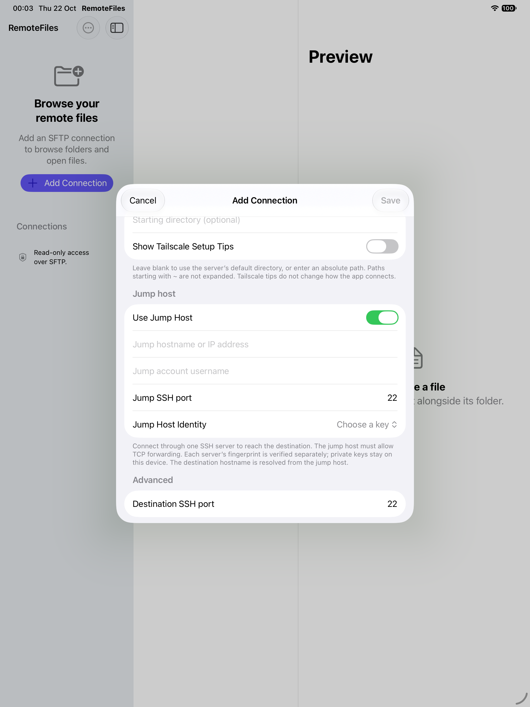

# Jump hosts

*Empty-account setup on the iPad simulator; no credentials or live server details are shown.*

A connection can use one SSH jump host (bastion) to reach a destination that is not directly reachable from the device. In **Add/Edit Connection**, turn on **Use Jump Host**, then enter the bastion hostname, SSH port, account and identity. The server fields above it always describe the final SFTP destination. Either endpoint may use any supported imported identity, and they may use different identities or the same one.

RemoteFiles authenticates the bastion, opens an SSH `direct-tcpip` channel, then performs a separate SSH handshake with the destination inside that channel. The destination hostname is resolved by the bastion. There is no local listening port, shell command, SSH-agent forwarding or private-key upload. The destination must provide SFTP; the bastion only needs SSH TCP forwarding (`AllowTcpForwarding local` or `yes`, with `PermitOpen` allowing the destination).

Both servers use the existing host-key trust flow. Verify each hostname/port and fingerprint independently. A changed key blocks that endpoint before its account authentication. Unlock prompts identify the specific key needed at either hop. Reset Trusted Host Key forgets the saved destination; **Reset Trusted Jump Host Key** forgets only the saved bastion, including when the form has unsaved edits. Trust is indexed by hostname/port, so profiles sharing an endpoint share its trust record.

The complete connection attempt has the existing connection deadline, covering both handshakes. During connection setup, cancellation, timeout or failed trust closes both the forwarded channel and the outer connection. Disconnect also closes the entire chain. After setup, the existing per-operation SFTP cancellation and channel-retirement rules apply. Successful browsing reuses the destination SSH/SFTP session. Backgrounding clears unlocked keys and disconnects as before.

Resource caches include the jump endpoint, account and identity as well as the destination, preventing cached bytes from crossing routes when private hostnames overlap. Direct cache keys are unchanged.

Saved profiles remain compatible: older profiles without `jumpHost` connect directly. No passwords or private material are stored in profile JSON. Identities used only by a jump host cannot be deleted while referenced.

This release supports one hop, not chains or imported SSH configuration. Public-key installation remains a separate direct connection with explicit confirmation; it does not use a browsing profile's jump host.

## Verification

The isolated OpenSSH launcher starts two loopback-only servers with different host keys and authorized identities. Integration regressions cover independent trust, changed destination trust before authentication, key selection, connection/channel reuse, disconnect/reconnect, and cancellation/deadline of a silent destination. These are automated local fixtures, not physical-device or production bastion acceptance.
