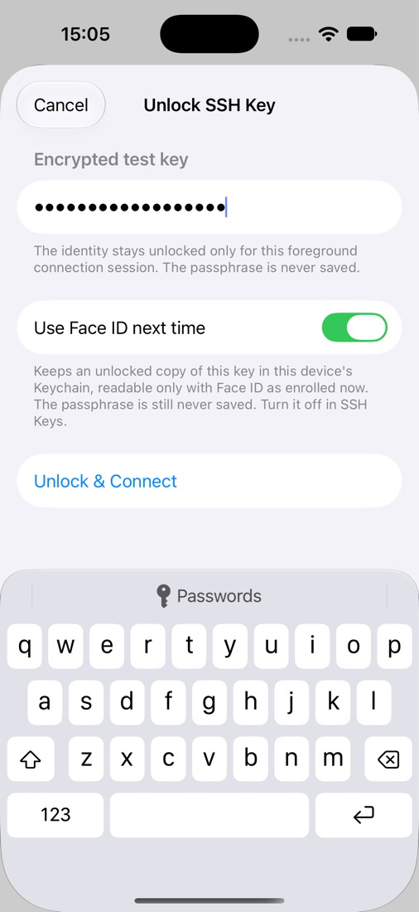
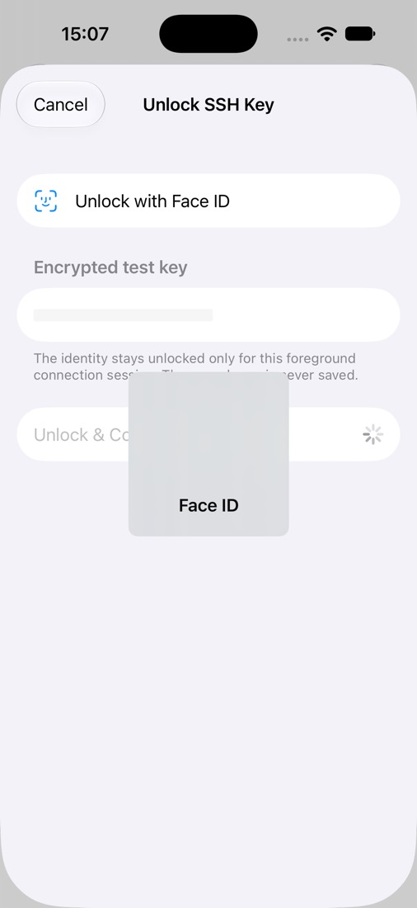
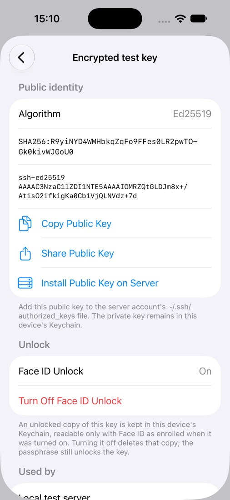

# SSH identity and server-key support

RemoteFiles generates dedicated Ed25519 keys with Swift Crypto and imports single-key OpenSSH Ed25519 private files. Private-key decryption uses Citadel; the app's small container-header reader only identifies formats and rejects unsupported configurations before decryption. File extensions are not used to identify keys.

The implementation is based on [Citadel's pinned OpenSSH parser](https://github.com/orlandos-nl/Citadel/blob/ae8562f895de06ccb86fdb1cbb65fd99c8976e12/Sources/Citadel/OpenSSHKey.swift). Its bcrypt restriction is a dependency limit, not a recommendation for choosing protection on existing keys.

| Identity format | Preview behaviour |
| --- | --- |
| Generated Ed25519 | Supported; private seed stored only in Keychain |
| OpenSSH Ed25519, unencrypted (`none`) | Supported; original private representation stored only in Keychain |
| OpenSSH Ed25519, AES-256-CTR + bcrypt 1–31 rounds | Supported; includes ordinary `ssh-keygen` defaults in the tested matrix |
| OpenSSH Ed25519, AES-128-CTR + bcrypt 1–31 rounds | Supported |
| bcrypt rounds 32 or greater | Rejected with an unsupported-configuration message |
| AES-CBC, other encryption/KDF formats | Rejected |
| RSA, ECDSA, security-key identities, PEM/PKCS#8, multiple keys | Deferred; rejected |
| Public key only | Explicitly identified; cannot authenticate without its private identity |

The host's installed `ssh-keygen` generates temporary test keys at runtime. Tests cover unencrypted and default encrypted import, AES-128-CTR, missing/wrong passphrases, unsupported bcrypt-32 and AES-CBC, malformed/public-only input, public-key/fingerprint parity with `ssh-keygen`, encrypted representation preservation, and foreground session clearing. These tests prove parsing/storage contracts; SSH authentication against a server is a separate transport integration test. See `PREVIEW_STATUS.md` for actual execution results and SDK/device limitations.

The preview does not ask users to remove protection from existing keys or silently substitute account passwords. If an existing encrypted key is unsupported, generate a dedicated app identity and manually authorise its public key instead.

## Secret lifecycle

Only non-secret identity metadata (ID, name, algorithm, canonical public key, fingerprint, encrypted flag, and an opaque Keychain account reference) appears in the metadata JSON. Private material is stored as a generic-password Keychain item under the app's service, with `kSecAttrAccessibleWhenUnlockedThisDeviceOnly` and `kSecAttrSynchronizable = false`. No key material is stored in UserDefaults or ordinary files. Keychain failure is an error, never a fallback to plaintext storage. This is device-local Keychain protection; it is not a claim of hardware-backed Ed25519.

An encrypted import retains its original encrypted representation in Keychain. Its passphrase is used for validation/unlock but is never retained by `IdentityStore` or persisted. An unlocked cryptographic key may be cached during the active foreground connection session. Disconnect/background clears that cache and invalidates in-flight unlocks. Swift memory management cannot promise forensic zeroisation of every temporary string or framework copy. Import validation itself does not seed the session cache. The UI must clear its passphrase field after completion or dismissal, and the transport must close its authentication/session references on disconnect.

## Face ID unlock

Face ID unlock is opt-in per encrypted identity. After unlocking with the passphrase, choose **Use Face ID next time** (Touch ID on devices that have it):

- **What is stored:** a second Keychain item holds the unlocked Ed25519 key, never the passphrase. The encrypted original is unchanged.
- **Where:** a separate service, with `kSecAttrAccessibleWhenPasscodeSetThisDeviceOnly` and `kSecAttrSynchronizable = false`. It never leaves the device, and it is unreadable when the device has no passcode.
- **Who can read it:** access control `.biometryCurrentSet`, so only the faces or fingers enrolled when it was saved. Adding or removing one makes the item unreadable, and the device passcode cannot read it.

On the next connection the unlock sheet asks for Face ID automatically.

| Turning it on | Next connection | SSH Keys |
| --- | --- | --- |
|  |  |  |

*Simulator screenshots with a throwaway test key and simulated Face ID.*

- **Cancelled or failed Face ID:** the passphrase field stays available.
- **Unusable copy** (enrolment changed or item missing): the sheet says so, and the passphrase unlocks the original; Face ID can be turned on again from the same sheet.
- **Copy that doesn't match the identity's public key:** never used, and deleted.

A Face ID unlock fills the same foreground-session cache as a passphrase unlock, so backgrounding still clears it, and an unlock interrupted by backgrounding caches nothing. **SSH Keys → identity → Turn Off Face ID Unlock** deletes the copy. Deleting an identity deletes its Face ID copy first and keeps the identity if that fails.

At rest this copy is protected by Face ID rather than by the passphrase. Generated identities have no passphrase, so their key is protected by the device unlock alone.

Tests use a fake biometric store for the unlock rules, and the hosted iOS suite stores, detects without prompting, and deletes a real item. Three opt-in checks need extra setup:
- **`testSimulatedFaceIDReadsTheStoredKey`:** reads a stored item through a real Face ID prompt. The Simulator needs Face ID enrolled, and the host sends `com.apple.BiometricKit_Sim.pearl.match` via `xcrun simctl spawn … notifyutil -p`.
- **`testCancellingFaceIDDismissesThePromptWithoutReading`:** same setup without sending a match; cancelling must close the prompt without reading the item.
- **`testSimulatedEnrolmentChangeInvalidatesTheStoredKey`:** needs a physical device. The Simulator's biometric domain state does not change when enrolment is toggled, so it cannot show the invalidation.

## Public keys and host trust

Public keys use NIOSSH's canonical OpenSSH serialisation, including the SSH algorithm and length-prefixed wire representation. SHA-256 fingerprints hash that full SSH public-key wire representation; they do not hash a raw Curve25519 public byte array.

Fingerprints and public keys are shown in monospaced, selectable text typeset as non-linguistic content (`zxx`). Long values wrap between any two characters without the hyphen iOS otherwise adds to wrapped English words, so every visible character belongs to the value. Copied text and VoiceOver labels use the unchanged string. `FingerprintWrapTests` checks the laid-out glyphs at narrow widths and large Dynamic Type sizes.

Trust is scoped to normalised hostname/address and port. Unknown keys block connection and expose a fingerprint for explicit acceptance. Trusted keys persist atomically in a separate versioned metadata document. A changed key blocks and cannot be overwritten by the unknown-key acceptance method. Reset removes trust; a subsequent connection must still be independently verified and explicitly accepted. A corrupt trust document blocks loading rather than silently discarding previous trust. The asynchronous transport validator completes without holding a networking event loop open for UI interaction.
