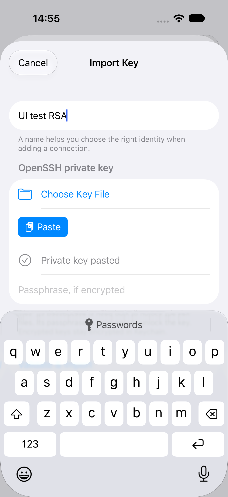
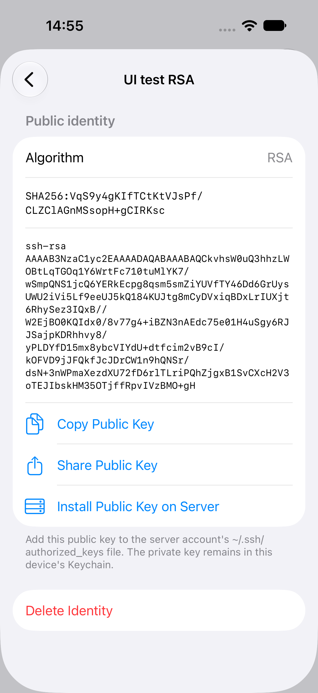
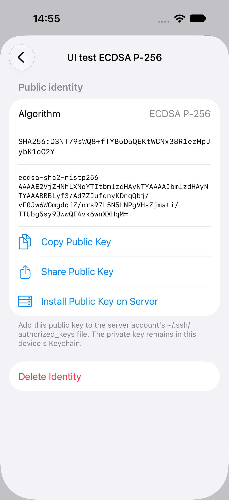

# SSH identity and server-key support

RemoteFiles generates dedicated Ed25519 keys with Swift Crypto and imports single-key OpenSSH Ed25519, RSA and ECDSA private files. Private-key decryption uses Citadel; the app's small container-header reader only identifies formats and rejects unsupported configurations before decryption. File extensions are not used to identify keys.

The implementation extends [Citadel's pinned OpenSSH parser](https://github.com/orlandos-nl/Citadel/blob/ae8562f895de06ccb86fdb1cbb65fd99c8976e12/Sources/Citadel/OpenSSHKey.swift). Its bcrypt restriction is a dependency limit, not a recommendation for choosing protection on existing keys.

| Identity format | Preview behaviour |
| --- | --- |
| Generated Ed25519 | Supported; private seed stored only in Keychain |
| OpenSSH Ed25519, RSA 2048–8192 bits, ECDSA P-256/P-384/P-521, unencrypted (`none`) | Supported; original private representation stored only in Keychain |
| Any supported OpenSSH key above, AES-256-CTR + bcrypt 1–31 rounds | Supported; includes ordinary `ssh-keygen` defaults in the tested matrix |
| Any supported OpenSSH key above, AES-128-CTR + bcrypt 1–31 rounds | Supported |
| bcrypt rounds 32 or greater | Rejected with an unsupported-configuration message |
| AES-CBC, other encryption/KDF formats | Rejected |
| RSA below 2048 or above 8192 bits, DSA, security-key identities, PEM/PKCS#8, multiple keys | Rejected |
| Public key only | Explicitly identified; cannot authenticate without its private identity |

RSA authentication uses [RFC 8332](https://www.rfc-editor.org/rfc/rfc8332) `rsa-sha2-512`, then `rsa-sha2-256` if the first offer is rejected; SHA-1 `ssh-rsa` signatures are never offered. Its public key still starts with `ssh-rsa`, so existing authorized keys and fingerprints stay valid. The exact pinned NIOSSH source is vendored with a narrow authentication-algorithm patch; see [provenance](../Vendor/swift-nio-ssh/UPSTREAM.md). Ed25519 remains the only generated key type; RSA/ECDSA support imports existing OpenSSH files.

The host's installed `ssh-keygen` generates temporary test keys at runtime. Tests cover RSA 2048/4096, each ECDSA curve, unencrypted and default encrypted import, AES-128-CTR, missing/wrong passphrases, unsupported bcrypt-32 and AES-CBC, malformed/public-only input, public-key/fingerprint parity with `ssh-keygen`, encrypted representation preservation, and foreground session clearing. Portable ECDSA regressions reject mismatched curves/points, non-canonical scalars, extra public data and damaged padding. RSA component corruption is also rejected. The isolated OpenSSH fixture authenticates every imported algorithm and reads a document, with SHA-1 RSA explicitly disabled. Set `REMOTEFILES_TEST_PUBKEY_ALGORITHMS=ssh-ed25519,rsa-sha2-256,ecdsa-sha2-nistp256,ecdsa-sha2-nistp384,ecdsa-sha2-nistp521` to exercise SHA-256 fallback. See `PREVIEW_STATUS.md` for actual execution results and SDK/device limitations.

The preview does not ask users to remove protection from existing keys or silently substitute account passwords. If an existing encrypted key is unsupported, generate a dedicated app identity and manually authorise its public key instead.

## Importing existing identities

Choose **Settings → SSH Keys → Import Key**, then choose a file or use the native **Paste** control. Give the identity a name and enter its passphrase if encrypted. Validation finishes before anything is saved. The details screen shows the actual algorithm, canonical public key and SHA-256 fingerprint.

| Import | RSA | ECDSA |
| --- | --- | --- |
|  |  |  |

*Simulator screenshots from the passing import UI test, using disposable keys generated in memory.*

The disposable RSA/ECDSA UI fixtures share their generator with `IdentitySecKeyFixtureTests`,
which generates 32 fresh SecKey RSA keys, checks their OpenSSH component invariants, imports
both algorithms, and imports the exact UTF-8 text the UI test pastes. The UI journey validates
each fixture before launching the app, uses a local-only pasteboard item, and checks the
clipboard without logging private text. On a physical device the background UI-test runner
can't write the general pasteboard (`PBErrorDomain` 10/11), so the app would paste stale text
and rightly reject it as malformed; the journey's paste step is skipped there, and
`IdentitySecKeyFixtureTests` covers the same keys on the device. On 31 October 2026 those passed
on an iPhone 17 Pro (iOS 27.2, Release), and importing real encrypted RSA and Ed25519 files
through the Files picker worked by hand.

## Secret lifecycle

Only non-secret identity metadata (ID, name, algorithm, canonical public key, fingerprint, encrypted flag, and an opaque Keychain account reference) appears in the metadata JSON. Private material is stored as a generic-password Keychain item under the app's service, with `kSecAttrAccessibleWhenUnlockedThisDeviceOnly` and `kSecAttrSynchronizable = false`. Key material is never stored in UserDefaults. The explicit export flow below is the only way to save a private-key file outside Keychain. Keychain failure is an error, never a fallback to plaintext storage. This is device-local Keychain protection; it is not a claim of hardware-backed Ed25519.

An encrypted import retains its original encrypted representation in Keychain. Its passphrase is used for validation/unlock but is never retained by `IdentityStore` or persisted. An unlocked cryptographic key may be cached during the active foreground connection session. Disconnect/background clears that cache and invalidates in-flight unlocks. Swift memory management cannot promise forensic zeroisation of every temporary string or framework copy. Import validation itself does not seed the session cache. The UI must clear its passphrase field after completion or dismissal, and the transport must close its authentication/session references on disconnect.

## Export a private key

Choose **Settings → SSH Keys → identity → Export Private Key**. Review the protection status, acknowledge the warning, then choose **Authenticate & Save to Files**. Device-owner authentication requires Face ID, Touch ID or the device passcode before Keychain is read. The native Files picker chooses the destination; private bytes are never placed on the clipboard or sent to a sharing service by the app.

- **Imported identities:** export preserves the original OpenSSH file byte-for-byte, including its encryption and passphrase. It does not decrypt the original, export a biometric copy, change the passphrase, or unlock the connection session.
- **Generated Ed25519 identities:** export creates a standard **unencrypted** OpenSSH private-key file. RemoteFiles currently does not add a passphrase during export. The acknowledgement explicitly identifies the unencrypted file.
- **Lifecycle:** the prepared document exists in memory until the native exporter finishes or is cancelled. Backgrounding or dismissing the view cancels authentication and drops the app's document reference. The native exporter manages its own staging; the app requests owner-only permissions and complete file protection on its file wrapper. A chosen Files provider controls protection and synchronization of the destination copy.

An exported copy can outlive the app and can sync through the selected Files provider. Deleting the identity from RemoteFiles does not revoke or delete that copy. Store it securely. Swift/framework copies are not guaranteed to be forensically erased.

Regression coverage checks generated-key round trips, interoperability with system `ssh-keygen`, original-byte preservation for encrypted and unencrypted Ed25519/RSA/ECDSA imports, mismatched metadata rejection, deleted secrets, cancellation, and absence of an unlocked session after export. Physical-device authentication, Files-provider behavior and lock/background acceptance remain manual checks.

## Face ID unlock

Face ID unlock is opt-in per encrypted identity. After unlocking with the passphrase, choose **Use Face ID next time** (Touch ID on devices that have it):

- **What is stored:** a second Keychain item holds the unlocked signing key (Ed25519, RSA or ECDSA), never the passphrase. The encrypted original is unchanged. Existing Ed25519 secrets and biometric copies remain readable; no reimport or migration is needed.
- **Where:** a separate service, with `kSecAttrAccessibleWhenPasscodeSetThisDeviceOnly` and `kSecAttrSynchronizable = false`. It never leaves the device, and it is unreadable when the device has no passcode.
- **Who can read it:** access control `.biometryCurrentSet`, so only the faces or fingers enrolled when it was saved. Adding or removing one makes the item unreadable, and the device passcode cannot read it.

On the next connection the unlock sheet asks for Face ID automatically.

| Turning it on | Next connection | SSH Keys |
| --- | --- | --- |
|  |  |  |

*Simulator screenshots with a throwaway test key and simulated Face ID.*

- **Cancelled or failed Face ID:** the passphrase field stays available.
- **Unusable copy** (enrolment changed or item missing): the sheet says so, and the passphrase unlocks the original; Face ID can be turned on again from the same sheet.
- **Copy that doesn't match the identity's public key:** never used, and deleted.

A Face ID unlock fills the same foreground-session cache as a passphrase unlock, so backgrounding still clears it, and an unlock interrupted by backgrounding caches nothing. **SSH Keys → identity → Turn Off Face ID Unlock** deletes the copy. Deleting an identity deletes its Face ID copy first and keeps the identity if that fails.

At rest this copy is protected by Face ID rather than by the passphrase. Generated identities have no passphrase, so their key is protected by the device unlock alone.

Tests use a fake biometric store for the unlock rules, and the hosted iOS suite stores, detects without prompting, and deletes a real item. Three opt-in checks need extra setup:
- **`testSimulatedFaceIDReadsTheStoredKey`:** reads a stored item through a real Face ID prompt. The Simulator needs Face ID enrolled, and the host sends `com.apple.BiometricKit_Sim.pearl.match` via `xcrun simctl spawn … notifyutil -p`.
- **`testCancellingFaceIDDismissesThePromptWithoutReading`:** same setup without sending a match; cancelling must close the prompt without reading the item.
- **`testSimulatedEnrolmentChangeInvalidatesTheStoredKey`:** needs a physical device. The Simulator's biometric domain state does not change when enrolment is toggled, so it cannot show the invalidation.

## Public keys and host trust

Public keys use NIOSSH's canonical OpenSSH serialisation, including the SSH algorithm and length-prefixed wire representation. SHA-256 fingerprints hash that full SSH public-key wire representation; they do not hash a raw Curve25519 public byte array.

Fingerprints and public keys are shown in monospaced, selectable text typeset as non-linguistic content (`zxx`). Long values wrap between any two characters without the hyphen iOS otherwise adds to wrapped English words, so every visible character belongs to the value. Copied text and VoiceOver labels use the unchanged string. `FingerprintWrapTests` checks the laid-out glyphs at narrow widths and large Dynamic Type sizes.

Trust is scoped to normalised hostname/address and port. Unknown keys block connection and expose a fingerprint for explicit acceptance. Trusted keys persist atomically in a separate versioned metadata document. A changed key blocks and cannot be overwritten by the unknown-key acceptance method. Reset removes trust; a subsequent connection must still be independently verified and explicitly accepted. A corrupt trust document blocks loading rather than silently discarding previous trust. The asynchronous transport validator completes without holding a networking event loop open for UI interaction.
