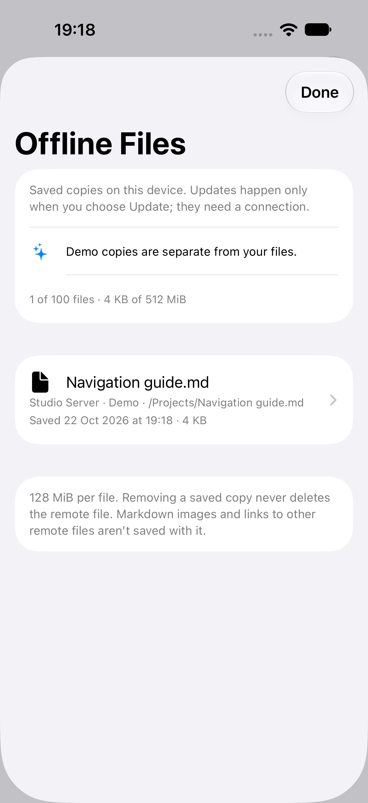
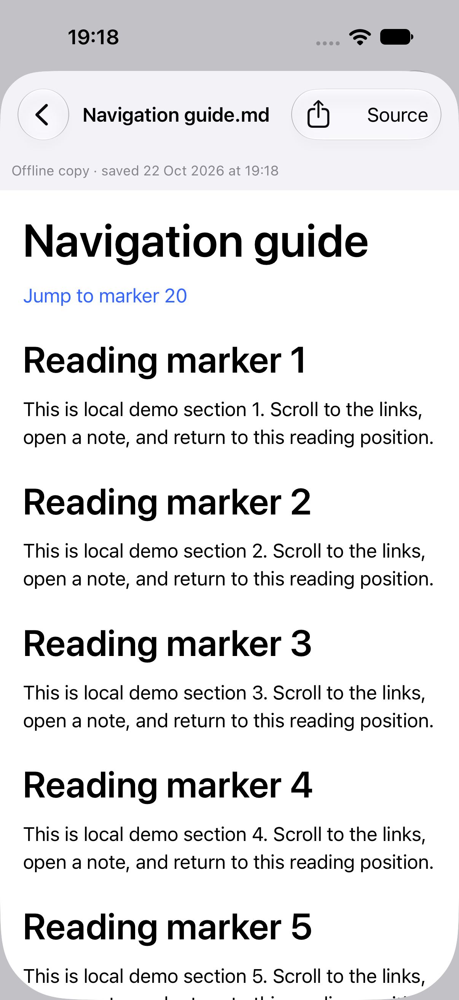
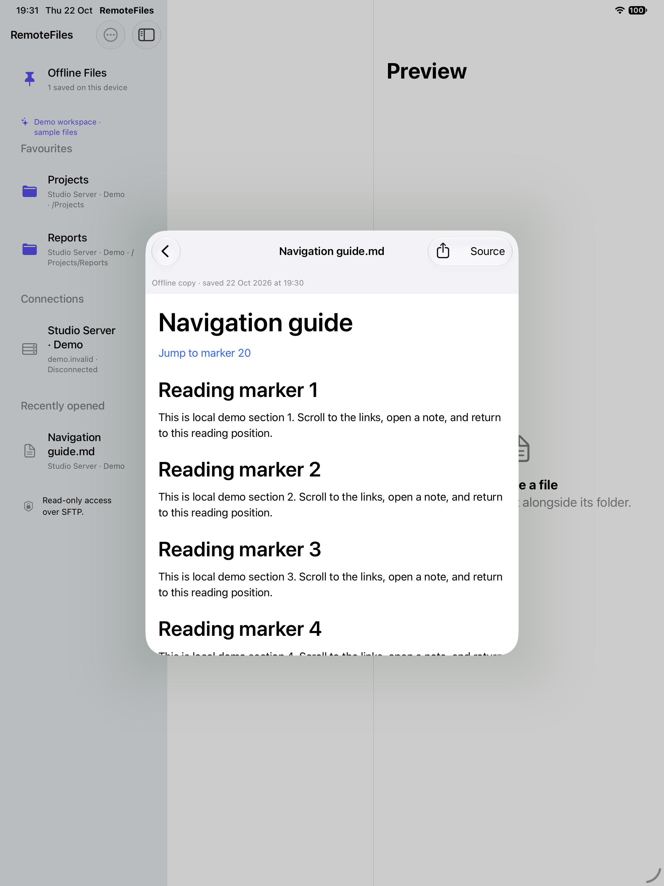

# Offline files

[Documentation](README.md) · [RemoteFiles](../README.md)

Choose **Keep Offline** in a file’s **Document actions** menu, or long-press a regular file in its folder. The app saves its original bytes and filename on this device. Pinning applies to individual files, not folders. The save shows byte progress and a Cancel action; only one offline save runs at a time.

Open **Offline Files** from the library, even without a connection. Each copy shows the connection label, original path, byte count and saved date. The offline reader identifies the copy as offline; it never silently substitutes saved bytes for an online reader. Copies survive app relaunch, disconnects, connection edits and connection deletion. Demo has its own separate offline library. Saved-file counts and actions update across open windows when a copy is added, refreshed or removed.

Long-press a saved file (or swipe its row) to **Update Offline Copy** or **Remove Offline Copy**. Updating explicitly uses the network. It requires the saved connection to retain the same host, port, account, SSH key, starting folder and jump-host configuration; changing its display name is fine. If that route changed or was deleted, the old copy stays readable: save a new copy from the current connection. Removing a copy never deletes anything on the server. There is no automatic synchronization or background SSH transfer.

## Local previews and sharing

Markdown, UTF-8 text/code, static HTML/SVG, images, PDF, audio and video reuse the existing preview policies and native media controls. Text previews remain limited to 2 MiB; images use bounded downsampling, and codec support depends on the device. Unsupported/binary files can still be saved and shared. **Share Original** shares the saved original bytes and filename, including files too large for a text preview.

Resolved links keep their selected filename for sharing and their canonical source format for previews.

Only the selected file is saved. Markdown images become readable placeholders, and links to other remote documents do not navigate from an offline copy. No SFTP resolver or remote image loader is given to the offline reader. Static HTML/SVG retain their resource blocking; media assets forbid external references. Explicitly tapped, policy-approved HTTP/HTTPS links may still open the browser. Offline copies do not yet have the online reader’s Find, heading navigation, image zoom viewer or saved reading positions.

## Storage and lifecycle

- At most **100 files**, **128 MiB per file**, and **512 MiB of committed originals**. Receive-time and actual-file checks enforce the byte limits, including unknown or stale server size metadata. Files are not evicted automatically.
- Copies live under Application Support in `Offline-v1`, outside disposable preview caches. The directory is excluded from backups, uses owner-only permissions, and requests iOS **Complete** file protection on directories, originals and the index. These are device-local copies, not iCloud/Files synchronization. Protection while locked requires physical-device acceptance; a simulator is not proof of Data Protection behavior.
- A download must finish and validate within the original exporter’s 180-second deadline before publication. It uses canonical connection-root confinement. Atomic index replacement publishes a complete file; failure, cancellation or interruption leaves the last committed copy intact. Backgrounding and disconnect cancel saves and drain their private transfer output. A cancelled future-backed transport keeps its slot until it actually stops.
- Each copy stores a SHA-256 digest. Opening verifies regular-file type, size and digest before producing a local lease. The lease also retains the saved date and filename of those exact bytes across a concurrent refresh. The index is capped at 2 MiB before publication; a corrupt index fails closed and preserves existing files rather than silently resetting the library. Recognized abandoned transfer/lease output is cleaned when the store starts.
- Backgrounding preserves the offline library/reader navigation, while releasing protected preview resources and stopping playback. Returning to the app reopens the saved file locally; it does not reconnect or resume playback automatically.
- Up to four live local leases keep a preview/share valid while a pin is updated or removed. Temporary disk overhead is bounded separately: one in-progress replacement and up to four leased prior versions can coexist with committed originals. Native playback can retain its existing bounded local playback copy until stopped. Uninstalling the app removes its offline library.

## Verification

`OfflineFileTests` covers original bytes, relaunch, digest/symlink rejection, atomic refresh and index failure, count/byte/reader limits, cancellation with late writers, and removal during refresh. `AppModelLifecycleTests` covers background cancellation, retained offline presentation, cross-window updates and Demo isolation, connection deletion and changed-route refresh rejection. The UI pin/disconnect/relaunch/remove flow runs against synthetic Demo data on iPhone and iPad; it also checks that the remote original remains readable after removing its local copy.

Physical-device locked-file protection and real-server/network-loss acceptance remain separate from simulator results.

## Simulator examples

| iPhone library | iPhone saved reader | iPad saved reader |
| --- | --- | --- |
|  |  |  |

Synthetic Demo files only; screenshots do not establish physical-device acceptance.
