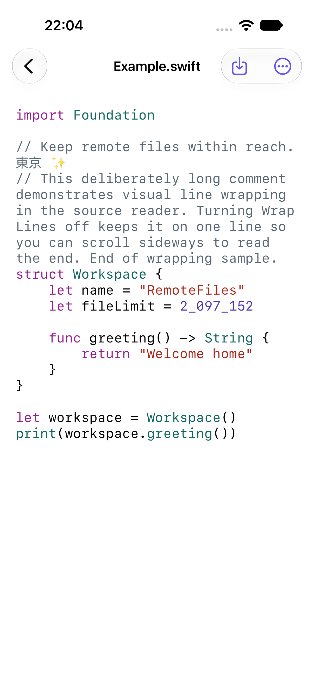

# Reading and previewing files

[Documentation](README.md) · [RemoteFiles](../README.md)

Select a file in a folder to open its preview. The reader does not edit the server file. Use **Refresh** to fetch the current version. If refresh fails, the previously loaded content stays visible and is labelled as such.

## What can I open?

| File | Preview and limits |
| --- | --- |
| Markdown | UTF-8 text up to 2 MiB, as a rendered document or original source. Tables and code blocks scroll within the document. |
| Text, configuration and source code | UTF-8 text up to 2 MiB. Empty, binary and unsupported files get an explanation. |
| HTML / HTM | UTF-8 text up to 2 MiB, as a static rendered preview or source; scripts and linked resources do not load. See [HTML previews](HTML_PREVIEWS.md). |
| SVG | A restricted static rendering or source. See [SVG previews](#svg-previews). |
| Images | JPEG, PNG, HEIC/HEIF, GIF, TIFF, WebP and BMP. Tap to zoom or share; animated images show their first frame. |
| PDF | Native scrolling and zooming. |
| Audio and video | Playback and seeking after download. Compatibility depends on the device and codec; see [audio and video](AUDIO_VIDEO.md) for the full format list. |

> **Download limit:** Image, PDF and media downloads are limited to 128 MiB per file. Even when a file has no supported preview, you can [save its original bytes](#save-the-original).

Images are downsampled for display. Playback stops when you leave the preview or the app goes into the background.

Markdown images load as needed over SFTP, relative to the document directory. They have bounded caches, retry, zoom and Share controls. Web, file and data image URLs never load; see [remote images](REMOTE_IMAGES.md). Tapping an HTTP or HTTPS document link may open it externally. Relative document links stay within the connection's canonical starting folder; unsafe URL schemes are blocked. See [document links](DOCUMENT_LINKS.md) for the boundary and offline behavior.

## Find your place

- **Find:** Choose **Document actions → Find in Document** to search rendered Markdown or plain text and move between matches. In Source mode it searches the literal source; HTML and SVG offer **Find in Source**. Search is local, case- and diacritic-insensitive, and limited to 1,000 results.

- **Headings and links:** **Headings** lists parsed Markdown headings. You can also follow same-document and relative-file heading links. Repeated headings have suffixes such as `details-1`. Native Back returns to the previous reader. Missing headings and unsupported query links show an explanation and leave the current document open.

- **Reading position:** Text readers remember separate Rendered and Source positions across launches. History contains text locations, block positions, fallback coordinates and a content fingerprint, not document contents, for up to 200 connection/path pairs. Markdown prose and Source restore the same text location after width or text-size changes; images and overflow blocks restore a proportional position within the block. A changed document starts at the top. Older coordinate-only history and positions without an available text/block anchor retain approximate coordinate restoration. Static HTML retains coordinate restoration. Positions save after scrolling pauses and when leaving or backgrounding. Demo does not write reading history.

## Read source

*Bundled demo source on the iPhone 18 Pro simulator, iOS 27.2.*

Use **Source** where offered to see the original text. Supported languages are highlighted locally using the filename, including Swift, JavaScript/TypeScript, Python, JSON, YAML, shell, HTML/CSS and SQL. Selection and **Copy Source** retain the original text. For unfamiliar formats or large or complex sources, the reader displays plain text instead: highlighting is limited to 256 KiB and 16,000 tokens. The same limits apply to rendered Markdown code fences; they fall back to plain code without losing content. The text-preview limit remains 2 MiB.

Lines wrap by default. Choose **Document actions → Wrap Lines** to turn wrapping off and scroll horizontally; the preference is remembered. Very long lines and large documents use a width-bounded read-only view to avoid an oversized layout surface. The actions menu explains when this limit applies. Malformed JSON remains readable as source.

Source uses a selectable native text viewport for both short and long documents. Highlighting is prepared off the main actor; plain text appears first. The local token cache holds at most two documents within an estimated 2 MiB, and clears on disconnect, backgrounding or memory warning. No remote scripts are loaded for highlighting.

## Save the original

Choose **Save Original to Files** in the reader toolbar to save a copy through the native Files picker. Preparation streams the original file, up to 128 MiB, preserving its exact bytes and selected filename and extension. You can cancel preparation. Temporary exports expire after ten minutes and are removed on dismissal, navigation away, disconnect or backgrounding. See [original export](ORIGINAL_EXPORT.md) for confinement and lifecycle details.

For an on-device copy available without SFTP, choose **Document actions → Keep Offline**. To save a folder tree, choose **Folder actions → Keep Folder Offline**. Offline copies update only when requested. See [offline files and folders](OFFLINE_FILES.md) for limits, local links and preview differences.

## SVG previews

Rendered SVG supports a static subset (paths, shapes, groups, gradients, local references and text), up to 512 KiB, 10,000 elements and 64 levels. An unsupported, malformed or overly complex SVG shows an explanation while keeping source available.

Scripts, event handlers, animation, embedded images, HTML and external resources are rejected. Only reserialized, allowlisted SVG enters a nonpersistent WebKit view with JavaScript disabled, a restrictive content security policy, resource blocking and external navigation denied. The rendering copy is separate from Source and Save Original.

When the app becomes inactive or backgrounded, an opaque window-level privacy cover sits above readers and presented sheets for the app switcher snapshot. Returning removes the cover without changing navigation or reader position.

## Reader memory

Leaving a connected reader releases its decoded preview and parsed navigation index. Backgrounding unmounts the renderer and releases its parsed index, while retaining the selected reader’s bounded original text so a failed reconnect can still show the previous copy. Returning prepares them again from the bounded raw-byte cache when available and revalidates with the server. Offline readers release their local preview and verified lease when inactive. Reading anchors remain small and contain no document text.

Markdown overflow geometry retains at most 64 entries within an estimated 2 MiB budget. It clears on reader detachment, inactivity and memory warnings. Oversized entries are not cached; their content still renders. This is an accounting budget for cached geometry keys, not a bound on the renderer's total resident memory. The active document still needs its parsed text and native layout. Physical-device memory and layout acceptance remain separate from simulator checks.
