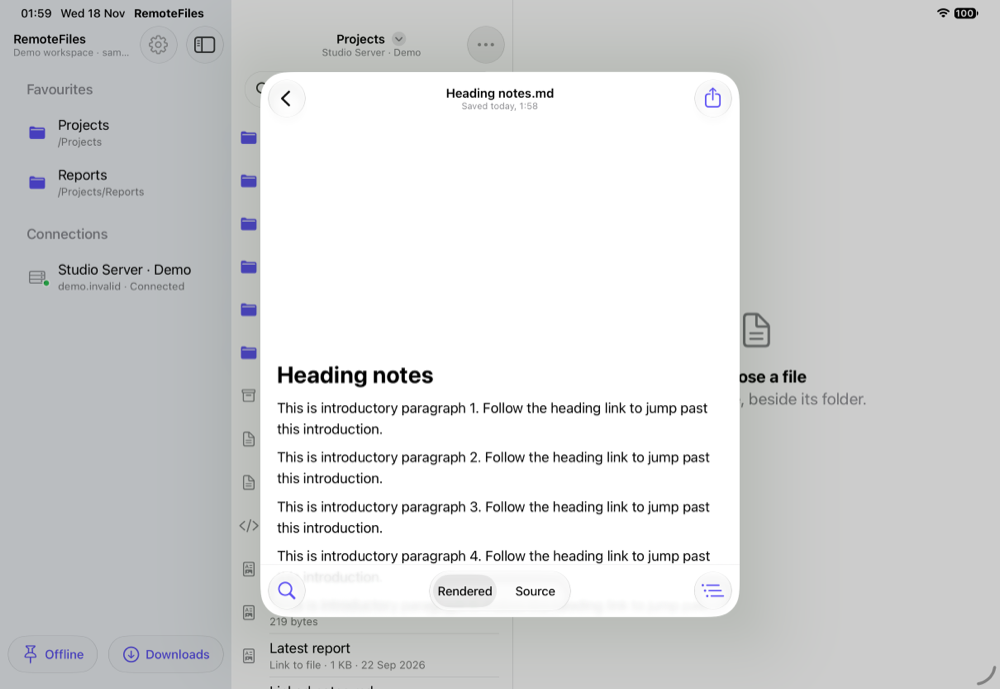
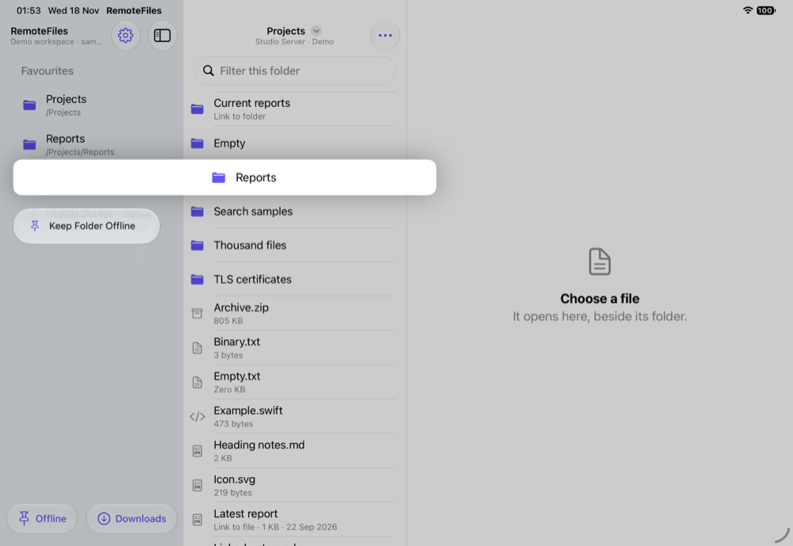
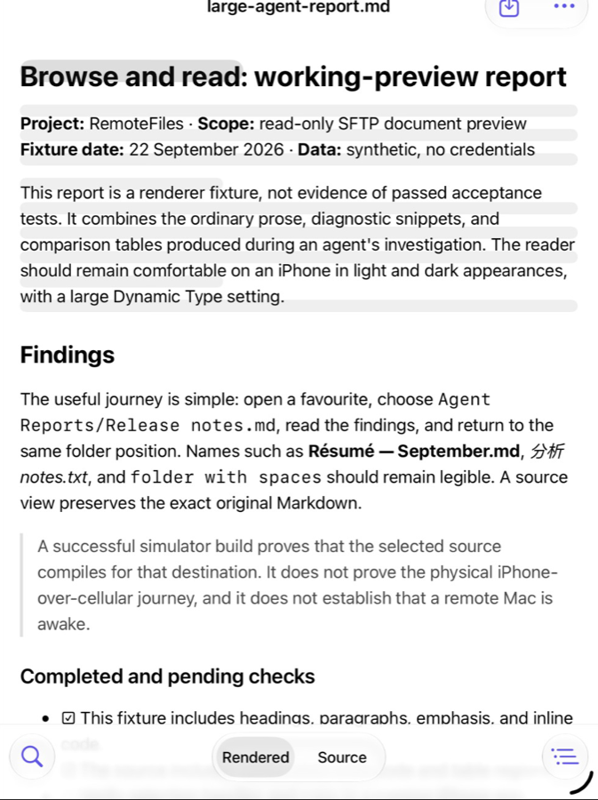

# Real Mac server acceptance

On 22 September 2026, the physical iPhone 17 Pro connected from RemoteFiles to
this Mac's existing OpenSSH service, using the Mac's Tailscale address on port 22.
This was the normal app and actual account/filesystem, not Demo or a loopback fixture.

## Setup retained for use

- Saved connection: **My MacBook**, account `iris`, starting directory
  `/Users/iris/Developer/RemoteFiles`, also saved as a favourite.
- Dedicated identity: **RemoteFiles iPhone - MacBook**, generated inside the
  iPhone app. Its private key remains in the phone's device-only Keychain.
- With explicit user approval, the public key was appended to the Mac account's
  `~/.ssh/authorized_keys`, preserving its existing entries. The entry is tagged
  `remotefiles-iphone-macbook` and uses `restrict` plus a forced
  `/usr/libexec/sftp-server -R -d /Users/iris/Developer/RemoteFiles` command.
  This forces read-only SFTP and disables shell/forwarding. The starting directory
  is **not** a filesystem jail: the account's other readable files remain readable.
- To revoke this phone's authorization, remove only the authorized_keys line
  carrying that tag. Deleting the app's saved connection alone does not revoke it.
- Existing Remote Login and Tailscale services were already running; no SSH
  host keys, tailnet policy, router ports, or other authorization entries changed.

## Verified journey

1. Create the dedicated identity through the physical app's UI; read only its
   public key for server authorization.
2. Create and save the real connection through the UI.
3. Compare the displayed Ed25519 host fingerprint with the Mac's independently
   read `/etc/ssh/ssh_host_ed25519_key.pub`, then accept the matching key.
4. Browse the actual project and `Fixtures` directory, and open
   `Live-server-report.md` with its initial revision.
5. Open Source, update that file on the Mac only after the iPhone confirms the
   first read, and Refresh. Assert the new revision in Source and Rendered.
6. Return to the real directory successfully.
7. Relaunch the app, reopen the saved connection, save the project favourite, and
   open the actual `docs/READER_PERFORMANCE.md` report from the Mac. This separate
   test passed in 15.242 seconds at 15:10:15 local time.

The browse/read/changed-file-refresh test **passed**, zero failures, in 38.164
seconds at 15:08:30 local time. This includes UI automation overhead and is not
an SFTP latency measurement. [Initial rendering](screenshots/real-server-initial.png)
and [refreshed rendering](screenshots/real-server-refreshed.png) were exported
from the actual device test. The refreshed rendering was visually inspected.

The endpoint used the Tailscale IP and the Mac's route to the phone was `utun11`.
The device screenshots display 5G. This establishes real SFTP via Tailscale with
cellular status visible, not an independently controlled off-site-network test
or proof of the complete physical acceptance matrix.

## Repeatable checks

`RealServerUITests` are opt-in and skip ordinary test runs. Enable them with
`TEST_RUNNER_REMOTEFILES_REAL_SERVER=1`. The initial journey additionally requires
`TEST_RUNNER_REMOTEFILES_REAL_HOST`, `..._USER`, `..._DIRECTORY`, and
`..._FINGERPRINT`; these are forwarded to the runner without the `TEST_RUNNER_`
prefix. Never pass private keys/passwords through these variables. `testRelativeLargeAndMissingImages`
reads `..._REAL_HOST` too when it has to create its "Image checks" connection.

Build the signed Release test target with `ENABLE_TESTABILITY=YES` as documented
in [READER_PERFORMANCE.md](READER_PERFORMANCE.md). Run only the intended test with
`xcodebuild test-without-building -only-testing:RemoteFilesUITests/RealServerUITests/TEST_NAME`.
The connection and identity are intentionally retained. The refresh check requires
resetting the dedicated fixture to revision 1, then changing it to revision 2 after
`REMOTEFILES_READY_FOR_SERVER_UPDATE` appears in the test log.

## Cellular and Tailscale evidence

`scripts/test-cellular-tailscale.py` runs one `RealServerUITests` method on a
cabled iPhone and records, on the Mac, which path its SSH traffic took. The cable
carries only the Xcode test session; the app's traffic uses the phone's own network.

Before running, turn the iPhone's Wi-Fi off in Settings (Control Center only
disconnects it for a while), turn off Personal Hotspot, connect the cable and open
Tailscale on the phone. The saved connection must use the Mac's MagicDNS name or
Tailscale IP. Export the `TEST_RUNNER_REMOTEFILES_REAL_*` variables a test needs,
then run:

```sh
/usr/bin/python3 -B scripts/test-cellular-tailscale.py --device DEVICE_UDID \
  --output /private/tmp/remotefiles-cellular-NEW_RUN --build
/usr/bin/python3 -B scripts/test-cellular-tailscale.py --device DEVICE_UDID \
  --output /private/tmp/remotefiles-cellular-NEW_RUN --manual
```

Use Apple's `/usr/bin/python3`: macOS hides the TCP socket table from netstat when
uv or Homebrew Python launches it, and the script stops if it cannot see that table.
The first form defaults to `testSavedConnectionReopensRealProject`; choose another
method with `--test`, and omit `--build` to reuse `DerivedData-device`. `--manual`
skips the device test and samples until you press Return, for checks such as
interrupting the network during a refresh. Record the screen with QuickTime
(New Movie Recording, iPhone as the camera) because iPhone Mirroring needs the
phone's Wi-Fi. If several iOS devices are online in the tailnet, pass `--peer`.

Add `--require-direct` to fail unless every sample taken during the phone's SSH
session uses a direct route to a public address, not a DERP relay. If the route
stays relayed, first run `tailscale ping` from the Mac to another peer and read
the `tailscale status` health warnings. A relay to every peer means the Mac is the
cause, not the carrier.

The script stops before testing if Xcode reaches the phone over the local network
or Tailscale routes to it through a private address, an address inside one of
the Mac's interface networks (such as a shared global IPv6 prefix) or the Mac's
own public address. While it runs, it samples `tailscale status`, established
`netstat` sockets on the SSH port, whether the iPhone is still on USB and the
`sshd` log. `summary.md` passes only when sampling continued to the end, the
phone stayed on USB, the route was never local, an SSH session arrived from the
phone's tailnet address, WireGuard traffic flowed and the device test passed
rather than skipped. A DERP relay route counts as cellular-consistent; it is weaker
evidence than a direct route to a carrier address. Passing establishes the
cellular/Tailscale path for that run, not an off-site trip, movement between cells
or a Wi-Fi/cellular handoff.

On 30 October 2026 the physical iPhone 17 Pro (iOS 27.2) passed this check, with
Wi-Fi off in Settings, 5G connected and the cable attached. The signed Release
build of the commit adding this record ran `testSavedConnectionReopensRealProject`,
which passed in 33.2 seconds. It opened **My MacBook** at its tailnet address, browsed
the real project's `docs` folder and rendered `READER_PERFORMANCE.md`. All 42
samples showed the iPhone on USB and a Tailscale DERP relay route (`lhr`), never
a local one. An SSH session from the phone's tailnet address was
established in 26 samples, and 43,648 WireGuard bytes were exchanged. Because the
route was relayed, this does not show a direct path to a carrier address. Evidence:
`/private/tmp/remotefiles-cellular-run3/` (`summary.md`, `samples.jsonl`,
`sshd.log`, `tests.xcresult`).

Two earlier runs that day didn't count as passes. In the first, the test waited for
`READER_PERFORMANCE.md` before scrolling to it in the lazy folder list. It now
scrolls until the row exists. In both runs, netstat started from a uv-installed
Python showed no TCP sockets, so the phone's SSH session went undetected even
though `sshd` logged it. The script now refuses to run without the TCP table.

Later that day `--require-direct` first failed because of the Mac. Its Tailscale
reported "The MagicSock function ReceiveIPv4 is not running", and it reached every
peer through DERP. After Tailscale restarted (updating to 1.105.140), that warning
cleared. The same test then passed in 33.4 seconds with every check, including
`direct_route`. All 40 samples used one direct WireGuard route to an O2 UK carrier
address, different from the Mac's public address. The phone's SSH session appeared
in 25 samples, and 42,320 WireGuard bytes were exchanged. `tailscale ping` round
trips were about 80–150 ms direct and 75–170 ms relayed. Those are a few samples,
not a latency benchmark. Evidence: `/private/tmp/remotefiles-cellular-direct1/`.

## 31 October 2026 iPhone session

A hands-on session on the physical iPhone 17 Pro (iOS 27.2) against **My MacBook**
over Tailscale. Builds were signed Release with `ENABLE_TESTABILITY=YES` from
[PR #46](https://github.com/eyeb0l/RemoteFiles/pull/46): `aa1daa9` for the
automated run and the first PDF check, then `844dced`, which fixed the rotation
drift that check found, for everything else. Until the network recordings, the
phone used Wi-Fi and the route was not recorded. All fixtures were synthetic files
added to `Fixtures/` for the session and removed afterwards; the phone's own key
was not exported.

### Automated

The demo `RemoteFilesUITests` class passed 28 of 29 methods in about 20 minutes,
including both PDF search journeys. `testImportRSAAndECDSAKeysShowsTheirAlgorithmsAndPublicKeys`
failed twice: the app rejected the RSA key the test generates and pastes as
malformed, so the ECDSA case never ran. Importing a real encrypted RSA file through
the UI worked, so the failure is specific to the test's generated key or paste path.
Evidence on the Mac mini: `/private/tmp/remotefiles-pdfnav-device-ui1.xcresult` and
`/private/tmp/remotefiles-pdfnav-device-key2.xcresult`.

### Passed by hand

- **PDF navigation** ([step 13](MANUAL_ACCEPTANCE.md)): a 12-page PDF with a phrase
  only on page 9. Live and saved-index results opened at page 9. A mid-page position
  returned after Back, relaunch and rotation, the last after the `844dced` fix. After
  the file was replaced on the server, Refresh opened revision 2 at the top, and a
  stale saved-index result still opened the current file at page 9.
- **Managed downloads:** three 120 MiB random files. Transfers continued in the
  background; a queued item did not start while backgrounded or locked, and started
  after unlocking. System cancellation, lock, force quit and Disconnect each exposed
  Retry, and retries started from zero. A completed download saved to iCloud Drive
  matched the server's SHA-256. Resource expiration could not be forced.
- **Save Original:** the PDF saved from the reader matched the server's SHA-256, and
  cancelling the picker kept the reader usable.
- **Offline file** (step 9): opened in Airplane Mode after Disconnect and relaunch;
  Share Original matched revision 1 byte-for-byte; Update Offline Copy fetched
  revision 2; an update interrupted by Airplane Mode kept the old copy and saved
  time; removing the copy left the server file unchanged. The offline reader has no
  Find or Headings controls.
- **Offline folder** (step 10): nested and empty folders saved with hidden files
  excluded and two symbolic links counted; browsing, sharing and relaunch worked in
  Airplane Mode. An update picked up an added, a deleted and an edited file. With a
  member made unreadable, the update failed and the previous snapshot stayed complete.
  An 18-level folder failed at the 16-level limit with nothing published.
- **Offline links** (step 11): sibling, nested, parent and heading links, and Back
  position, worked in Airplane Mode. Missing, hidden, symbolic-link, unsupported,
  query and outside-folder links each explained the failure and kept the reader.
- **Keys** (step 4, in part): encrypted RSA 3072 and Ed25519 files imported with the
  expected fingerprints, and exports matched the originals byte-for-byte. Cancelling
  authentication and the Files picker saved nothing. Both identities survived locking.
  A connection using the encrypted key prompted for the passphrase, a swipe-dismiss
  connected nothing, and after relaunch it prompted again. These keys were disposable
  and never authorized; the server rejected them as expected.
- **Appearance and accessibility** (step 6): selection and copy in Rendered and
  Source, horizontally panned code blocks and tables, light/dark, the largest
  accessibility text size, Reduce Motion, Reduce Transparency, VoiceOver continuous
  reading, the Headings rotor, focus returning to the opened row, and the PDF's page
  announcement.

### Network recordings

Both used `scripts/test-cellular-tailscale.py --manual` on the MacBook, with the
phone cabled to it and Wi-Fi off in Settings. Evidence on the MacBook:
`/private/tmp/remotefiles-net-run1/` and `/private/tmp/remotefiles-net-run2/`.

- **Interruption, 19:14–19:28, PASS.** 744 samples, all wired, with a direct route to
  an O2 UK carrier address (briefly relayed), never local, and 146 MB of WireGuard
  traffic. A refresh interrupted by Airplane Mode showed an error banner within
  seconds and kept the previous copy; the next refresh worked. Two transfers did not
  fail promptly, as described below.
- **Handoff, 19:28–19:35.** 333 samples, all wired. The route moved from the carrier
  to the home LAN when Wi-Fi joined at 19:29:51, and back through a London relay to
  the carrier at 19:31:37–38. A managed download in progress across each switch
  stalled for a few seconds and then completed; browsing worked after each. The
  summary's `path_never_local` failure is the intended Wi-Fi leg. Tailscale keeps the
  tunnel address, so this does not show a non-Tailscale handoff.

### Found

- **A dead network isn't noticed during transfers.** In Airplane Mode a managed
  download stopped moving at 19:16:54, and the Mac dropped its socket at 19:17:34,
  but the app showed no failure until the network returned at 19:19, despite the
  documented 60-second inactivity limit. An offline-copy update in the same state
  showed nothing, and its Cancel took effect only after about 3 minutes (the
  180-second limit), again without an explanation.
- **Linked offline readers exhaust preview leases.** Following links back and forth
  in a saved folder eventually showed "Close another offline preview before opening
  this file." Returning to Offline Files cleared it. Each stacked reader keeps one of
  the four leases.
- **RSA paste in the device UI test**, as above.

### Still outstanding over cellular

These runs establish the network path for one journey: saved-connection reopen,
folder listing and a rendered report, over both a relayed and a direct route. The
following remain unverified over cellular:

- **Changed-file refresh.** `testRealServerBrowseAndRefresh` needs the Mac fixture
  changed after `REMOTEFILES_READY_FOR_SERVER_UPDATE`. The script doesn't drive that
  update, and this journey hasn't run over a recorded cellular path.
- **Network interruption.** A refresh and a managed download were interrupted on
  [31 October](#31-october-2026-iphone-session); the refresh passed, but transfers
  don't notice the dead network promptly. A recursive search remains unchecked.
- **Wi-Fi/cellular handoff.** Passed in both directions over Tailscale with a
  download in progress on [31 October](#31-october-2026-iphone-session). A reader
  left open across the switch, and handoff without Tailscale, remain unchecked.
- **Off-site use.** Repeat away from home, ideally with the Mac behind a different
  network, and while moving between cells or in weak signal. A cabled run at home
  shows the same packet path but not radio conditions.
- **Background and lock over cellular.** Background teardown and foreground refetch
  passed over Tailscale ([lifecycle evidence](DEVICE_PERMISSIONS_LIFECYCLE.md)) but
  without a recorded cellular path. Background transfers, locking and relaunch
  remain unchecked over cellular.
- **Performance.** No timing compares relayed and direct cellular with Wi-Fi.
  Instruments profiling of the 1,000-entry folder and large report on cellular
  remains outstanding; `tailscale ping` samples aren't a benchmark.
- **Other carriers and networks.** Only O2 UK 5G has been recorded. Carriers that
  block UDP or use harder NAT may only ever relay.

Local evidence:

- `/private/tmp/remotefiles-real-identity2.xcresult`: successful on-phone key generation.
- `/private/tmp/remotefiles-real-journey.xcresult`: successful actual-server journey.
- `/private/tmp/remotefiles-real-reopen.xcresult`: saved-connection reopen and real project report.
- Adjacent `.log` files record the UI steps and assertions.

Denied Local Network access, permission recovery, and actual-network background
teardown/foreground refetch now pass on the physical iPhone; see
[device lifecycle evidence](DEVICE_PERMISSIONS_LIFECYCLE.md).

Still outstanding: preserved scroll position for a long folder, a recursive search
during network loss, and representative large report/directory performance. Stale
rendering after an interrupted refresh, the encrypted-key lifecycle and the
accessibility/selection matrix passed on [31 October](#31-october-2026-iphone-session). Read-only enforcement here is an OpenSSH command
restriction; this UI test deliberately did not attempt remote writes.

## 2 November 2026 download resume

A hands-on check of resuming interrupted downloads ([PR #61](https://github.com/eyeb0l/RemoteFiles/pull/61))
on the physical iPhone 17 Pro (iOS 27.2) against **My MacBook**. The build was a
signed Release of `main` at `64495cf`, installed from the Mac mini. The network route
was not recorded. The fixture was a 125,829,120-byte random file added to the
MacBook's `Fixtures/` for the session and removed afterwards. Each finished download
was saved to iCloud Drive and its SHA-256 compared on the Mac mini.

- **Airplane Mode, file unchanged: passed.** About a minute after Airplane Mode went
  on, the download failed and showed its kept amount. After the network returned,
  Retry continued from that amount, and the result matched the server
  (`697016bc…14c4`).
- **Airplane Mode, file replaced: passed.** With a second download interrupted the same
  way, the file was replaced on the server with new random bytes of the same size and
  a later modification time. Retry started from zero, and the result matched the new
  file (`ae9177cf…ac62fac`).
- **Locked: completed.** A download started before locking finished in the background
  while locked and matched the server. The transfer never stopped, so this did not
  exercise resuming.
- **Force quit: passed.** After RemoteFiles was swiped away mid-transfer and reopened,
  the row showed **Interrupted** with 8.5 MB of 125.8 MB kept. Retry continued from
  there, and the result matched the server.

Not checked: iOS ending a background transfer (resource expiration), which could not be
forced, and resuming over a recorded cellular route.

## 7 November 2026 media and certificate pass

A hands-on check of photo and video viewing ([PR #84](https://github.com/eyeb0l/RemoteFiles/pull/84)),
certificate previews ([PR #85](https://github.com/eyeb0l/RemoteFiles/pull/85)) and hidden private keys
([PR #86](https://github.com/eyeb0l/RemoteFiles/pull/86)) on the physical iPhone 17 Pro (iOS 27.2,
24B119) against the MacBook server. The build was a signed Release of `73c2359`, installed from the
Mac mini. The network route was not recorded. The fixtures were generated media, certificates and
throwaway keys in a temporary `Fixtures/iphone-pass` folder on the MacBook, removed afterwards; no
fixture key was authorised anywhere.

The tester worked from a checklist and reported the results as a whole, with no problems, rather
than item by item. The checklist covered the photo viewer's gestures, video controls and fullscreen,
a saved video in Airplane Mode, each certificate state, and each way of hiding a key.

- **Photos: no problems.** Crops of a system wallpaper, then real photographs from outside the
  fixture folder.
- **Rotated video: passed, with a screenshot.** A 1920×1080 track with 90-degree rotation metadata
  appeared upright in a portrait frame, with the controls beneath it.
- **VoiceOver on hidden keys: passed.** A line of dots reads as a count, such as "70 dots" for a
  70-column key line, rather than every dot.
- **Crash reports: none.** The phone held no report naming RemoteFiles dated 6 or 7 November, read
  with `devicectl` after the session.

Not checked: iPad, and Escape on a hardware keyboard. Reduce Motion wasn't on the checklist.

## 18 November 2026 iPad session

The first session on a physical iPad: an iPad Pro 11-inch (M5) (iOS 27.2.1, 24B156) against
the MacBook Air's OpenSSH service, over Wi-Fi with a direct Tailscale route to the Mac's MagicDNS
name. The first hosted core run used a signed Debug build of `d883793` (`main`). The runs after the
store-key fix, the demo UI journeys and the Face ID check used a signed Debug build, and the
hands-on pass a signed Release build, of the tree committed as `a3344ae`, before the offline reader
and folder preview fixes. Fixtures were synthetic, generated for the session in a
dedicated folder outside the repository and listed under [Setup](#ipad-setup).

### iPad setup

- Saved connection **My MacBook (iPad)**, starting in the dedicated fixture folder.
- Dedicated identity **RemoteFiles iPad - MacBook**, generated in the iPad app. Its public key
  was appended to the Mac account's `authorized_keys`, with explicit approval, tagged
  `remotefiles-ipad-macbook` and restricted like the iPhone's: `restrict` plus a forced
  `/usr/libexec/sftp-server -R -d` on the fixture folder. To revoke the iPad, remove only that line.
- The host fingerprint the app showed matched the Mac's `/etc/ssh/ssh_host_ed25519_key.pub`.
- Fixtures: the 1,000-entry folder and 191,002-byte report from `Fixtures/generate-fixtures.py`,
  the format samples, a wide Markdown file, a content-search tree with a phrase only inside files
  and 600 filler files, an offline tree with every link case, a long standalone HTML page with a
  script and remote resources, a 12-page PDF, ten media files, a 160 MiB folder of 40 random files
  and a 120 MiB download.

### Automated on the device

- **Hosted core suite** (`RemoteFilesTests`, `d883793`): 842 ran, 48 skipped (fixture-server, benchmark and
  opt-in Face ID cases), 17 failed. The physical-only checks passed:
  `testTrustStoreWritesUseCompleteFileProtection`, `testDeviceKeychainPersistenceAndAccessibility`
  and `testBiometricKeychainItemIsStoredWithoutPromptingAndRemovable`.
  - Ten failures, about several windows and shared stores, came from the app's shared stores keying files by
    `standardizedFileURL.path`, which drops `/private` only once the shorter path exists. They
    are fixed; see [CI history](CI_HISTORY.md#18-november-2026-shared-stores-on-a-device). With the
    fix (`a3344ae`) the six affected suites passed on the iPad (166 tests, three opt-in Face ID skips).
  - Seven reading-position tests failed in both runs, explained and fixed in the
    [follow-up](#18-november-2026-ipad-follow-up): two HTML
    `HTMLReadingPositionTests` and five Markdown `OverflowViewportTests`. By hand, an HTML position
    held through the reader's text size, rotation and window resizing (step 12 below), which
    corresponds to the root-zoom test; nothing recorded matches the page-zoom test
    (`WKWebView.pageZoom`) or the Markdown tests.
- **Demo UI journeys** (`RemoteFilesUITests`): 13 passed, 22 failed, 1 skipped (the key import,
  which already skips on devices). The iPad workspace journey passed. Most failures are journeys
  written for the iPhone's stack navigation. Two looked iPad-specific: Subfolders → This Folder,
  which passed by hand, and the keyboard journey, whose first ⌘F did not open Find in time.
- **Face ID enrolment change** (`testSimulatedEnrolmentChangeInvalidatesTheStoredKey`): a control
  read before any change matched Face ID and read the item (the test failed, as expected). After
  an alternate appearance was added, the prompt appeared and matched, and the read was still
  refused with `biometricsUnavailable`: passed.

### Passed by hand

- **Workspace:** three columns; preview replacement with the folder kept; folder scroll position
  kept; a new folder clears the reader; rotation slides the columns over the reader and back;
  Stage Manager from three columns through overlays to the stack and back with the same folder
  and file; Split View and Slide Over.
- **Several windows:** independent folders and readers; a favourite added in one window appears in
  the other; renaming a connection closes its routes in the other window; closing a window leaves
  the other untouched.
- **Accessibility** ([step 6](MANUAL_ACCEPTANCE.md)): selection and copy in Rendered and Source,
  horizontal panning without widening, light and dark, the largest accessibility size in both
  orientations, Reduce Motion, Reduce Transparency, VoiceOver landing, continuous reading, the
  Headings rotor, focus returning to the opened row, the PDF page announcement, and VoiceOver
  reaching and closing the library overlay in a narrow window.
- **Contents search** (step 8): line 13 and line 5 snippets; the hidden-file choice; results kept
  while reading; a file edited on the Mac found on refresh; cancellation on backgrounding and on
  Disconnect; Stage Manager, accessibility sizes and VoiceOver. The 600 filler files stopped the
  search at 500 files with "Stopped after 500 files. Search from a subfolder to go further."
- **Offline files** (steps 9–11): saved date, position, Find, Headings and image zoom after
  Airplane Mode and relaunch; the offline sheet's shortcuts; Share Original byte-identical to the
  server; Update Offline Copy and removal; a saved folder with hidden files excluded and two links
  skipped; every link case in Airplane Mode; eight link hops without running out of previews; and
  removing a 160 MiB saved folder in one window while another window updated it. It never
  reappeared, including after relaunch, and the other saved copies were unaffected.
- **Locked-file protection:** with the iPad locked, copying the trust file, library, offline index
  and three saved originals from the app's container over CoreDevice failed each time with
  `EPERM`; unlocked, the same six copies succeeded and the original matched the server's file.
- **HTML reading position** (step 12): scripts and remote resources blocked; position kept through
  rotation, text size and Stage Manager resizing; independent Rendered and Source positions;
  changed content opens at the top; touch, keyboard and VoiceOver scrolling during restoration;
  backgrounding and Back.
- **Changed host key** (step 4): a disposable OpenSSH server on another port, with its own host
  key, was trusted and browsed. After its key was replaced the app showed **Host Key Changed**
  with both fingerprints and only **Reset Saved Trust**. The server logged three connections, each
  closed before authentication ("connections without attempting authentication"), and no
  accepted key. The Mac's own host keys were not touched.
- **Media:** H.264/AAC in MP4 and MOV, HEVC, a 90-degree rotated video (upright), M4A, MP3, WAV,
  FLAC, AIFF and ADTS AAC all played, with full screen.

### Keyboard through Universal Control

The Mac's keyboard drove the iPad through Universal Control; iPadOS listed no hardware keyboard
under Modifier Keys, so these results may differ from an attached keyboard.

- Passed: ⌘F as the first shortcut with the keyboard present at launch, then ⌘G, ⇧⌘G and Escape;
  ⌥⌘U, ⇧⌘J and layered Escape; ⇧⌘F, the arrows and Return; ⌘[, ⌘↑, ⇧⌘R, ⌘R, ⇧⌘., ⌥⌘L and ⇧⌘O;
  shortcuts ignored under a sheet.
- Holding ⌘ showed no list. iPadOS 26 replaced that list with the menu bar, which showed Edit,
  View and Go.
- **Search field:** with the cursor in the folder's search field, Return did not leave it (only
  Escape did), and the arrows moved the row highlight although the field was being edited.
- **Tab** only reached the folder's search field, never the library or the reader. This is the
  state the [9 November investigation](CI_HISTORY.md#9-november-2026-portrait-library-overlay-tab-report-pr-66)
  could not settle. A diagnostic build with a wired keyboard explained both ([follow-up](#18-november-2026-ipad-follow-up)).

### Found

- **Blank band in Offline Files readers.** Every saved text file opened with about half the sheet
  blank above it. Fixed: the reader's frame reached each view of a `Group`, so the empty
  hidden-character notice took as much height as the document.
- **Folder row previews and focus rings spread across columns.** The folder column's cells run on
  under the floating library. The long-press preview now has its own shape; the keyboard focus
  ring, which the Simulator does not draw, stayed within the column with a wired keyboard ([follow-up](#18-november-2026-ipad-follow-up)).
- The keyboard and reading-position test findings above.

| Offline reader before | Offline reader after |
| --- | --- |
|  |  |

| Folder preview before | Folder preview after |
| --- | --- |
|  |  |

*Demo data on an iPad Pro 11-inch (M5) Simulator (iOS 27.2), reproducing what the device showed.*

### Not done

- **Instruments profiling** (step 7). A 120-second SwiftUI and Allocations recording attached to
  the app over the network connection held no process data, and later attempts, including over
  the cable, timed out waiting for the device. The build was profileable (`get-task-allow`).
- Cellular, managed downloads and encrypted-key unlock on the iPad, and an attached hardware
  keyboard.

All of these were done in the [follow-up](#18-november-2026-ipad-follow-up).

Evidence is on the external SSD attached to the MacBook Air, in
`remotefiles-ipad-tmp-evidence/remotefiles-ipad-20261118/` (moved there from `/private/tmp` on 19 November). It holds the build and test
logs, `core.xcresult` (first core run), `fix2.xcresult` (affected suites after the fix),
`web.xcresult` (reading-position rerun), `ui.xcresult`, the four Face ID result bundles, `band-fixed` and
`band-unfixed` (the offline regression with and without its fix), `session-log.md` (the hands-on
record), the fixture and fixture-server scripts, `cold.trace`, and the iPad screenshots in
`evidence/`, including the fixture server's log after the key change.

## 18 November 2026 iPad follow-up

The same iPad, connection, identity and fixtures as the [first iPad session](#18-november-2026-ipad-session),
later the same day, to close what that session left open. Builds, all signed Release:

- **Profiling:** `e510e81` (`main`).
- **Hands-on checks** (keyboard, cellular, downloads, offline, encrypted key, the report's loading
  view and the second folder trace): `8e0a9b0`, plus the change later committed as `4a050d8`, a
  temporary patch that logged key presses and focus changes, and a folder-list change that was
  then reverted.
- **Hosted reading-position tests and the HTML text-size check:** `80ef359`.

### Hosted reading-position tests

All seven failures from the first session are explained and fixed. On the iPad, the five
Markdown `OverflowViewportTests`, the two HTML `HTMLReadingPositionTests` and two new regression
tests passed: 9 of 9, none skipped.

- **Markdown reading anchor (product bug).** The rendered reader centres a 760-point column in a
  wide window, but Textual sampled its reading anchor 30 points from the viewport's edge. In a
  full-width iPad window that point is empty margin, so no anchor was captured. After a fast jump
  through a large document, the visible line moved by hundreds of points, and Source/Rendered
  switches fell back to raw offsets. The anchor is now sampled inside the content's column
  ([provenance](../Vendor/Textual/UPSTREAM.md)). `testReadingAnchorIsFoundInACentredColumnOfAWideWindow`
  hosts the reader in a 1,180-point window, so CI's iPhone simulators catch a regression; with the
  fix reverted it fails there.
- **HTML text size (product bug).** WebKit's recommended content mode is desktop on an iPad, even
  in a narrow view, and there it kept text at its unzoomed size under the reader's text size: only
  the margins grew. HTML previews now request mobile content, which an iPhone already resolves
  ([details](HTML_PREVIEWS.md)). The first session's hand check recorded only that the position
  held after a text-size change, not whether the text grew. On a simulator in desktop mode the text
  kept its size and only the margins changed, so a position check can pass despite the defect.
- **Prose-boundary test (test assumption).** Its 40-section fixture was 3.3 viewports tall in an
  iPad Pro 11-inch window, and the test looks for a scroll view at least four viewports tall. It
  now uses 100 sections.
- On an iPad Pro 11-inch (M5) Simulator, `testLargeFastJumpKeepsVisibleProseAnchorAndSourceReturnRestoresSameCharacter`
  still failed 3 times in 13 runs. The same character landed 36 points high after the jump, and
  in one run about 88 points away after returning from Source. It passed on the device. The
  36-point failures were the test's: it read the position after a fixed two-second sleep, which
  could fall between a code block's layout and the next frame's correction. It now waits for the
  corrections to finish ([18 November investigation](CI_HISTORY.md#18-november-2026-a-fixed-sleep-read-a-reading-anchor-mid-correction)).
  The return from Source did not fail in 36 runs since, 16 of them with the test host slowed, so
  its cause is still not established.

### Profiling (step 7)

Instruments recorded on the iPad over the cable once `xcrun devicectl device info ddiServices`
had run; until then `xctrace` listed the iPad as offline. The SwiftUI template, with or without
Allocations, saved empty CPU, hitch and SwiftUI-update tables on this device, which explains the
first session's empty trace. The Animation Hitches and Allocations templates recorded normally.
Instruments writes its raw kernel trace to the Mac's temporary folder whatever output path it is
given, and a 180-second Animation Hitches and Allocations recording grew past 19 GB, so the hitch
recordings were kept to 60 seconds. Each opened a folder or report, scrolled it to the end, went
Back and repeated.

- **1,000-entry folder:** opening, Back and reopening stalled the main thread for 80–100 ms each.
  Scrolling to the bottom dropped runs of consecutive frames: a 0.4-second cluster in one run, and
  clusters of 0.2-0.75 seconds in another, in both its first and second scroll. In each cluster a
  quarter to a third of the main thread's samples were in SwiftUI's List, finding each new cell's row for its separator
  (`UICollectionViewListCoordinator.separatorConfiguration` → `ListDiffable.rowIndex(at:)` →
  `ShadowRowCollection.index(after:)`), a walk that grows with the row's position. Skipping
  refreshes that return identical rows did not help, so that change was reverted; the cause in
  the folder's List is still open ([performance](PERFORMANCE.md)).
- **191,002-byte report:** it renders in WebKit. Opening it stalled the main thread for 93 ms, with
  one 92 ms render hitch. Scrolling dropped single frames (8 ms at 120 Hz) about every 0.6 seconds,
  without clusters.
- **Memory** (Allocations, 180 seconds of the same steps on both): at the end, 38.7 MB of heap was
  live in 187,112 allocations, after 12.4 million transient allocations (1.83 GB) during the run.
  Anonymous VM was 2.9 GB of address space, of which 2 GB was one JavaScriptCore reservation and
  737 MB render surfaces (IOSurface). Allocations reports address space, not the app's footprint,
  and inactive HTML reader memory was not profiled separately.

### Found and fixed

- **Loading view over the report.** Opening the large report showed the "Rendering Markdown…"
  skeleton lying over real text for about a second: WebKit paints before it reports a page
  finished. Markdown and HTML web views now stay hidden until they finish, as SVG previews
  already did. Two opens on the device then showed no overlap.

| Report opening before | Report opening after |
| --- | --- |
|  |  |

*Physical iPad, reader column only.*

### Keyboard with a wired keyboard

A temporary build logged each key press, focus change and keyboard-command decision on the iPad.

- **Without focus:** Down, Up and Return moved and opened the app's row selection.
- **Tab** put focus in the folder's search field and began editing. Ten further presses reached
  the system, which left focus in the field. The library and the reader were never reached.
- **In the search field:** the app declined Down, as designed, and iPadOS then moved keyboard focus
  from the field to the first result row; Return, also declined, opened the focused row. The caret
  kept blinking in the field throughout. Escape ended editing, after which the app's arrows and
  Return acted again. So nothing in the app overrides the field: the arrows that seemed to act
  through it in the first session were the system's focus moving into the results.
- **Focus width:** the focused row's frame started at the window's left edge, under the library,
  but its highlight was drawn only within the folder column. The over-wide ring from the first
  session, seen through Universal Control, did not appear.

### Passed by hand

- **Cellular** (step 2): Wi-Fi off in Settings; the iPad's own cellular data reached the Mac
  through a Tailscale relay (DERP). The fingerprint was accepted unchanged, the folder and
  report opened, Back kept the folder position, Refresh reloaded, and Airplane Mode during a
  further refresh left the previous copy readable and labelled. `scripts/test-cellular-tailscale.py --manual`
  passed: 79 samples, the route always the relay, never local, and 63 samples with SSH sockets
  from the iPad's tailnet address.
- **Managed downloads**, over cellular, with the 120 MiB file: Downloads said background
  continuation was available. The transfer continued in another app, with a Live Activity, and
  while the iPad was locked. Cancelling from the Live Activity, Disconnect, and force-quitting
  each stopped it; each time Retry continued from the kept bytes. The finished file copied out
  of the app's container matched the server's SHA-256 (125,829,120 bytes). This covers iOS
  stopping a background transfer at the person's request; iOS expiring one by itself was not seen.
- **Offline** (step 9): a saved 12-page PDF reopened at page 7 after a force quit, in Airplane
  Mode. An update of a saved 64 MiB file, interrupted with Airplane Mode, explained the failure
  after about three minutes, the offline transfer limit, as on the iPhone. The saved copy kept its
  date, and its bytes in the container still matched revision 1. In a narrow Stage Manager window
  the Offline Files library, a saved file, the saved folder and the PDF all fitted and worked, and
  VoiceOver read the library and a saved file sensibly.
- **Encrypted key** (step 4): a throwaway passphrase-protected Ed25519 key, pasted from the Mac
  through Universal Clipboard, imported with the expected fingerprint. It signed in to a
  disposable unprivileged `sshd` with its own host key, `authorized_keys` and read-only SFTP, on
  a separate port; the Mac account's `authorized_keys` was not touched. Cancelling and
  swiping away the passphrase prompt each left the connection unopened. The passphrase was asked
  again after Disconnect, after backgrounding and after locking, and the server log showed one sign-in
  per passphrase entry. The fixture server was then stopped and deleted.
- **HTML text size** (`80ef359`): the long HTML page looked as before, with no desktop layout or
  sideways scrolling. Raising the system text size from Control Center enlarged the text itself
  and kept the reader at about the same paragraph; so did lowering it again and rotating.

### Not done

- Inactive HTML reader memory (step 12), the storage and depth limits for saved folders on the
  iPad (step 10), and the other-window and other-route link cases (step 11).
- The demo UI journeys that assume the iPhone's stack (22 in the first session) were not adapted.
  Later the same day, on an iPad simulator, nine of the 22 passed and thirteen were recorded as
  iPhone-only ([UI journeys on an iPad](AUTOMATED_ACCEPTANCE.md#ui-journeys-on-an-ipad)).

The three hand checks were done in the [evening checks](#18-november-2026-ipad-evening-checks).

Evidence is on an external SSD attached to the MacBook Air, in `remotefiles-ipad-20261119/`: the
traces (`folder.trace`, `report.trace`, `folder-fixed.trace`; the Allocations run is
`remotefiles-ipad-tmp-evidence/remotefiles-ipad-20261119/profile-1000-report.trace` on the same SSD), their exported tables, the key
log (`keydiag-1.log`) and its patch, the cellular capture (`cellular/`), the downloaded file and
the offline copy after the interrupted update, the device test result `readpos-device.xcresult`,
the encrypted-key fixture's server log and `session-log.md`.

## 18 November 2026 iPad evening checks

The same iPad and connection, the hand checks the [follow-up](#18-november-2026-ipad-follow-up)
left open, on a signed Release build of `ad679dd` (`main`). The same evening's measurements of
folder scrolling and Tab focus are in [Performance](PERFORMANCE.md#scrolling-deep-in-a-large-folder-18-november)
and [iPad](IPAD.md#known-differences-on-a-physical-ipad).

- **Saved-folder limits** (step 10). Four synthetic folders, each just over one limit: 20 nested
  levels, 257 folders, 10,001 files, and five 110 MiB files of random bytes (550 MiB, over the
  512 MiB for all offline copies). **Keep Folder Offline** on each was refused with that limit's
  message, the storage one after downloading up to the space left. None of the four appeared in
  Offline Files, and the copies saved before were unchanged.
- **Links after another window changes the source** (step 11). In two windows, window A opened
  `index.md` from the saved `offline-tree`. Window B updated the saved folder; a link in A then
  said "This saved document was updated or removed. Reopen it from Offline Files before following
  its links." After A reopened it, B removed the folder, and a link in A said the same. Neither
  reconnected or downloaded anything.
- **Links between individual copies and routes** (step 11). A second connection to the same Mac,
  with the same account and key but its own starting folder, is a different route. With `from.md`
  saved through one connection and its link target `to.md` saved only through the other, the
  saved `from.md`'s link said "This linked file isn't saved here. Save it with the same
  connection, or include it in this saved folder, then try again." Once `to.md` was saved through
  the same connection too, the link opened it. (Opened from the live folder rather than Offline
  Files, the same link opens `to.md` from the server, as a connected reader should.)
- **Inactive HTML reader memory** (step 12). Instruments' Activity Monitor template recorded each
  process's physical footprint about every three seconds, because an HTML reader's page lives in a
  WebKit content process that Allocations on the app doesn't see. Opening `long-anchor.html`
  started a content process at 43 MB, 50 MB after scrolling. On the Home Screen it shrank to 36 MB
  and then ended. Returning rendered the page again in a new content process (40 MB), which ended
  within about three seconds of opening another file. The app's own footprint was 41–46 MB with the
  reader open and 68–70 MB after it had been in the background; what that growth is wasn't
  established (the app-switcher snapshot and privacy cover are likely, but unmeasured). The Markdown
  report opened afterwards took 103 MB in its own content process, with the app at 92–98 MB.

Evidence is on the external SSD, in `remotefiles-followup-20261118/`: the Activity Monitor trace
`device-traces/html-memory.trace` and its exported table. The limit fixtures were generated under
`limits/` in the fixture folder and are not kept.

## 21 November 2026 transfers on iPad

Uploads, copies between servers and several servers at once ([what they do](TRANSFERS.md)), on the
iPad Pro 11-inch (M5) and then the iPhone 17 Pro, over Wi-Fi and Tailscale. The server was a throwaway OpenSSH daemon on the
MacBook Air from `scripts/test-openssh.sh`, not the Mac's own SSH service: a folder with a 96 MiB
file of random bytes and an empty `inbox`, reached through `scripts/latency_proxy.py` on the Mac's
Tailscale address, held to 16 Mbit/s so that a transfer lasts long enough to interrupt. The Mac
could stop and restart that relay. The app was a signed Debug build of the working tree on
`3ccc272`, under a separate bundle identifier so the installed app and its data were left alone.
The daemon was started again twice, each time with a new folder and host key, after the job that
ran it reached its time limit; the iPhone's trial app was removed and set up again for the second.

- The identity was generated in the trial app by `testPreparePublicIdentity`, and its public key
  added to the throwaway daemon's `authorized_keys` with `restrict`. Nothing was added to the Mac
  account's own keys.
- The journeys check that the fingerprint the app shows is the daemon's before trusting it.

Three opt-in journeys in `RealServerUITests`, on the iPad first. After each, `cmp` on the Mac
compared the copy with the source, and the folder held no `.rf-upload-….part` file.

- `testTransferStopsWhenItsNetworkIsCutAndRetryContinuesIt`. A watcher on the Mac stopped the relay
  when the partial file reached 25,329,664 bytes and restarted it 25 seconds later. The transfer
  stopped with "25.3 MB / 100.7 MB. Retry continues from there." and Retry, tapped until the relay
  was back, finished it.
- `testTransferLeftInTheBackgroundGoesOnOrStopsAndCanBeFinished`, twice. In the first build the
  continued-processing task's name still began with the app's usual bundle identifier, which iOS
  refuses for another identifier: the partial file stopped growing at 11,730,944 bytes within three
  seconds of the Home button, stayed there for the 30 seconds away, and grew from that size after
  Retry. With the name matching, the partial file grew by about 6 MB every three seconds throughout
  the 30 seconds away, from about 27 MB to 87 MB, and the copy finished about six seconds after the
  app returned, with no Retry.
- `testTwoServersStayConnectedWhileAFileCopiesBetweenThem`. A second connection to the same daemon,
  starting in `inbox`. Both rows read Connected, before the copy and after it; the first server's
  folder was on screen at the test's first look after its row was tapped; the copy ran from one
  connection to the other without a Retry. Passed again on the build with the drop fix below.

The same three on the iPhone 17 Pro, on the build with the drop fix:

- The cut: stopped at "25.5 MB / 100.7 MB. Retry continues from there.", the relay down for 25
  seconds, finished on Retry.
- The background: the partial file grew from 24.7 MB to 85 MB during the 30 seconds away and the
  copy finished about six seconds after the app returned, with no Retry.
- Two servers: failed at first, the first server reading Disconnected once the second had been
  added and opened (below). Passed on the build with that fixed.

All three passed once more on the iPhone on that evening's last build, after the review fixes to then: the cut at
"25.2 MB / 100.7 MB", the background with no Retry, and two servers. The inbox then held three
copies, `big.bin`, `big 2.bin` and `big 3.bin`, each identical to the source. The iPad was asking
for its passcode before allowing UI automation by then, so the journeys were not repeated on it
after the review fixes.

Hosted on the iPad, on the same build: `AppModelTransferTests` (11) and `FolderRowSectionTests`
(2) passed, the first including a real push and pop of two lists with a drop target each.

Three more journeys, on the iPhone simulator first and then on the iPhone, each compared on the
server afterwards with the partial file's size sampled there every two seconds:

- `testTransferStoppedByDisconnectKeepsItsBytesAndRetryContinuesIt`. Disconnect from the folder's
  actions stopped the copy at 23,232,512 bytes and went Home. Transfers showed "22.7 MB / 100.7 MB.
  Retry continues from there." and the partial file grew from that size after Retry.
- `testTransferCutShortByAForceQuitIsKeptAndRetryContinuesIt`. The app was terminated with
  21,299,200 bytes on the server and launched again. Transfers showed "19.5 MB / 100.7 MB. Retry
  continues from there." and the partial file grew from 21,299,200 after Retry.
- `testUploadFilesSendsAFileChosenInTheSystemPicker`. The trial build alone shows its Documents
  folder in Files, so that a test file could be put there with `devicectl` and chosen without
  touching anything else on the phone. The picker was taken to On My iPhone and that folder, the
  5 MiB file chosen, and it arrived in `inbox` identical, with its modification time, and appeared
  in the folder on screen without a refresh.

The inbox then held four copies from the copy journeys, `big.bin` to `big 4.bin`, each identical
to the source.

Two more on the iPhone simulator only, on 22 November, for what a personal device can't be asked:

- `testUploadPhotosSendsAnItemChosenInTheSystemPicker`. The simulator's library holds only stock
  photos. The first one in the system picker was chosen and arrived as `IMG_0111.heic`, 2,808,983
  bytes, identical to the library's original (`IMG_0006.HEIC`) and dated 30 March 2018 as the photo
  is.
- `testTransferLeftWhileTheDeviceIsLockedGoesOnOrStopsAndCanBeFinished`. The simulator has no
  passcode, so the test can wake it again. Locked for 30 seconds, the copy stopped at 45,875,200
  bytes and stayed there; after unlocking, Retry continued from that size to an identical file. A
  simulator grants no background time and does not protect files while locked, so this shows only
  that a copy which stops on a lock keeps its bytes.

On the iPad Pro 11-inch (M5) simulator (iOS 27.2), by hand through the device panel and a
throwaway XCTest for the cross-app drag, against the same daemon on loopback:

- **Upload Files…** opened the system picker; a 5 MiB file chosen under On My iPad was uploaded,
  appeared in the folder without a refresh, and was identical on the server.
- With Files in a window beside RemoteFiles, a 3 MiB file and a text file were dragged onto a
  folder holding files, and the text file onto an empty folder of a second server. Each arrived
  under its own name and was identical on the server. A drag made while the second server's
  host-key question was on screen was declined, as it should be.
- On the morning's build of 22 November, the drags were repeated onto an empty folder and a folder with files, and a
  5 MiB file was then dropped three more times: after switching to the second server, after
  opening a subfolder of the first, and after going back from it. It arrived in the second
  server's folder, in the subfolder and in its parent respectively, identical each time, and in
  no other folder. The drop target was then changed once more, to stay on its list while another
  screen covers it, and three drags were made on that code: onto the folder, onto its subfolder
  once opened, and onto the folder again after going back. Each arrived where it was dropped,
  identical.

### 22 November: both devices again

Both devices were unlocked for this, and the owner agreed to one of their photos being chosen. The
daemon was started once more, so both trial apps were removed and set up again. Each copy was
compared with the source by `cmp`, and no partial file was left.

The code changed twice during the day, both times only in how the list of transfers is saved, so
each run below says which code it was on: the code of the morning; the code with the second file
(below), on which a newer file was told by its date; and the code as reviewed after that, on
which it is told by a save count.

On the iPhone 17 Pro, on the morning's code except where said:

- `testUploadPhotosSendsAnItemChosenInTheSystemPicker`. The first photo the system picker showed
  was chosen and arrived under its own name, a 186 KB PNG dated as the photo is. It was not opened,
  and was deleted from the Mac after the run.
- The Files picker, two servers (the first server's folder back 1.9 seconds after its row was
  tapped), Disconnect ("25.3 MB / 100.7 MB. Retry continues from there."), a force quit (16.8 MB),
  the background (went on, no Retry) and the cut (25.6 MB) all passed again.
- `testTransferLeftWhileTheDeviceIsLockedGoesOnOrStopsAndCanBeFinished` with
  `REMOTEFILES_TRANSFER_LOCK=leave`: the side button was pressed with 63 MB of the copy on the
  server and the phone left locked. The partial file went on growing at the relay's full rate and
  the copy finished about 20 seconds later, still locked, identical. The list then told a
  different story (below), and on the code with the second file
  `testEveryTransferIsListedAsFinishedAndStaysSoAfterARelaunch` passed: the copy was listed as
  finished, and still was after the app had been closed and opened again.

On the iPad Pro 11-inch (M5):

- `testAFileDraggedFromFilesIsUploadedToTheFolderOnScreen`. The test shrinks Files to a window
  over RemoteFiles and drags a 3 MiB file from the trial app's own folder onto the folder's list.
  It was uploaded under its own name, identical.
  That and the next three were on the morning's code.
- The Files picker, the cut (25.9 MB) and two servers (1.5 seconds) passed, and then, on the code
  with the second file: Disconnect (42.3 MB), a force quit (35.7 MB), the background (went on, no
  Retry), and a cut made late, with 98,762,752 of the file's 100,663,296 bytes on the server
  ("98.2 MB / 100.7 MB. Retry continues from there.").
- On the code with the save count, with the trial app removed and set up again: a force quit
  (35.8 MB kept), Disconnect (25.5 MB), the background (went on, no Retry), two servers (1.5
  seconds) and the cut (the relay stopped at 25,067,520 bytes for 25 seconds; "24.7 MB / 100.7
  MB. Retry continues from there."). Five copies, `big.bin` to `big 5.bin`, each identical. By
  then each journey clears finished rows from Transfers before its copy and passes only when
  the list holds that one copy, finished.

Also on the code with the save count, on the iPad: the lock journey, left locked. The side button
was pressed a few seconds into the copy, with 2.5 MB on the server; the partial file went on
growing at the relay's full rate and the copy finished about 50 seconds later as `big 6.bin`,
of the source's 100,663,296 bytes, with the iPad still locked and asking for its passcode. This
one copy was not compared byte for byte: the daemon's folder went when its job reached its time
limit, before that was done. The trial app was no
longer running when the owner unlocked the iPad, so nothing had saved the list since.
`testEveryTransferIsListedAsFinishedAndStaysSoAfterARelaunch`, told to expect `big 6.bin`, then
passed: opened afresh, Transfers held that one row, "Copied · inbox on Transfer fixture", and
held it again after the app was closed and opened. On the iPhone earlier that day, before there
was a second file, the same sequence had listed the copy as interrupted.

Not run on the code with the save count: anything on the iPhone, which was no longer connected
to the Mac; and the pickers and the drag, which the change doesn't touch. The photo picker
was never run on the iPad.

One iPad run looked like a transfer that had stopped for good, and was not. A Disconnect journey
waited eight minutes with nothing moving and was stopped. Its own log shows why: from 25 seconds
after Retry the list offered neither Retry nor Cancel but **Name Taken**. An earlier run that had
been stopped half-way had left a copy of the same file interrupted; Retry reached that one first,
it finished and took the name `big.bin`, and this run's copy to the same name then stopped to ask
whether to replace it or keep both, as it must. The journey had no answer for that question and
went on waiting. The helper now fails at once and says so. Two checks made on the way there
stay: a journey that leaves one copy interrupted by a force quit and a second by Disconnect, then
retries both, finished both; and `testATransferWhoseConnectionIsClosedUnderItFailsAndDoesNotWait`
shows that a transfer whose connection is closed without cancelling it fails within seconds.

On the iPad the Disconnect journey could not always reach **Folder actions** during a copy, and
the runs' screen recordings show why: iOS's own banner for a transfer that may go on in the
background, "Copying file" with its progress, lay over the top of the folder's column, covering
its title, its Transfers button and **Folder actions**. XCTest could find no point on the button
to tap ("Computed hit point {-1, -1}") and the menu was never asked to open.

That banner is how the test iPad showed a continued processing task, the task that lets a
transfer outlive the app's time on screen; managed downloads have asked for the same kind of
task since before this change. An Apple engineer says on the developer forums that an app has
no control over how such a task is presented, and that it should be shown over an app in front
only while other apps' tasks are running. Other developers there report a banner that appears
at once every time, stays until swiped away, and stops appearing after the app has been killed
from Xcode until the device is restarted
([thread 804515](https://developer.apple.com/forums/thread/804515),
[thread 805088](https://developer.apple.com/forums/thread/805088)). What was measured here
agrees with those reports. A journey written to time it sampled **Folder actions** every third
of a second from 10 to 40 seconds into a copy:

- Early on 23 November the banner covered it at every sample in six copies running, on two
  installations of the trial app, the first copy of the second among them.
- The force-quit journey then closed the app during a copy, as XCTest also does whenever a
  journey starts while the last one's copy is still running. Not one of the next fourteen copies
  had the banner, over two hours: not after a lock and unlock, a new installation, the Files
  picker, the photo picker, a drag from Files or a copy between two servers.
- The owner then restarted the iPad, and the banner was back at every sample in the next six
  copies. A touch elsewhere on the screen, 16 seconds in, did not put it away, and nor did
  leaving the banner's text alone in place of rewriting it with each step of progress.
- Over the evening of 22 November, 19 copies were watched: in twelve the bar was clear, in one
  it was covered for about seven seconds, and in six, one after another, at every sample. As far
  as the logs show, each run of clear copies came after a journey that had ended with its copy
  still running, which the next launch then closed.
- On the afternoon of 23 November, the iPad restarted again, a journey looked at the banner
  itself and then tried to put it away. It lay across the top of the screen, 556 points wide
  and 66 high, showing the copy's progress and a stop button, over the folder's title, its
  Transfers button and **Folder actions**, and was there at each of six looks over 13 seconds
  with nothing touched. One swipe up on it put it away and left a small indicator in the status
  bar. **Folder actions** then opened its menu, and the banner had not come back at four looks
  over the next 20 seconds of the same copy. Locked 43 seconds in, at about 52 MB, the copy went
  on and finished, and the file on the server was identical to its source by `cmp`. In a run
  before that one, a tap on the banner where **Folder actions** lies beneath it also put it
  away, without opening the menu.
- Three copies were then queued one behind another and SpringBoard's own list of what is on
  screen read every three seconds. Nothing touched, the banner stayed for the whole of the
  first copy, 40 seconds, and a second banner came up beside it as the second copy began.
  Swiped away 37 seconds into the second copy, it came back for about seven seconds as that
  copy completed, showing it complete, and then there was none for any of the third copy. The
  app closed and opened again, the next copy had a banner at once.
- Three copies of a 300 KB file, each over in under a second, each brought the banner up: it
  lay over the folder's bar for three to four seconds every time.

So on the test iPad the banner covered the folder's title, its Transfers button and **Folder
actions** at every sample from 10 to 40 seconds into a copy, in each run that had it, and one
swipe up put it away for the rest of that copy as far as it was watched; the library's own
Transfers button, beside it, stays in reach. Fourteen copies after a force quit during a copy
had no banner, and the copies after each restart had it again; on the earlier days it came
back some hours after such a close without a restart that is known of. None of these
explained its coming and going: the Files app being open or closed, another window on the
screen (a capture of the whole screen shows RemoteFiles alone), the owner's own RemoteFiles app
(closed by the owner for the purpose, and the banner stayed), or how the app starts and ends the
task, which a trace showed the same every time (asked for, started by iOS within a tenth of a
second, ended as finished). The journey now waits for the bar to be clear and says so if it
isn't.

**A way round it, tried and not taken.** The task was asked for as the app left the screen and
not as the transfer started, in a build made for the purpose. With the banner showing for
every copy under the app as it is, checked again between the runs, that build showed none: not
in four copies watched in the app, and not in two watched after leaving for the Home Screen and
coming back with the copy still running. Left for the Home Screen for 30 seconds, a copy went
on and finished without a Retry, twice, iOS having started the task as the app left; a download
left for 25 seconds finished too. Locked by the test's press of the side button, it did not.
The copy stopped where it was, at 28 MB and at 41 MB in two runs, and the trace of one has
iOS's answer to the request made as the screen locked: "Task cannot be submitted because the
required application is not in the foreground."

A second build asked earlier still: in UIKit's own notice that the scene is about to be left
(`UIScene.willDeactivateNotification`), with nothing between the notice and the request, and
the app at that moment still counting itself active. Locked in the same way, iOS refused that
request within a hundredth of a second with the same answer, and the copy stopped at 39 MB. So
no request made once a lock has begun was accepted, however early in it.

The app as it is carried the tested copies on through a lock on both devices, and through one
more on the iPad after its banner had been swiped away. A transfer that stops when the iPad is
locked is a worse fault than a banner that one swipe puts away. So a transfer with much to move
still asks for the task as it starts, and has the banner; one that will be over in a moment
[no longer asks](#23-november-no-banner-for-a-transfer-over-in-a-moment). The choice was put to
the owner that evening, with a setting to turn the task off and never asking on an iPad as the
other two, and the owner kept it as it is.

### 22 November, evening: every journey again

With both devices unlocked again, the owner agreeing to a photo from each, a new daemon and
both trial apps set up afresh, every journey was run again. Each copy made that evening was
compared with the source by `cmp`, and no partial file was left. The code changed once more
during it, in how a folder's list takes a drop and in what is said of a dropped file that can't
be read (below), so each group of runs below says which code it was on, and the section ends
with a pass over both devices on the code as it stands.

On the iPad Pro 11-inch (M5):

- The photo picker, twice. The first photo was chosen and a file of 908,475 bytes arrived on the
  server, and was deleted there unopened. The first time, the journey's own look for the new row
  was satisfied by a row of the library, which on iPad is on screen beside the folder; with the
  check corrected and the owner's agreement to the same photo once more, its row appeared in the
  folder without a refresh.
- The Files picker (identical), and the drag from Files, once the journey had learned to raise
  a Files window that an earlier run had left low on the screen (3 MiB, identical).
- Two servers (1.5 seconds), Disconnect ("25.5 MB / 100.7 MB. Retry continues from there."), a
  force quit (19.5 MB), the background (went on, no Retry) and the cut (the relay stopped at
  25,493,504 bytes for 25 seconds; 25.2 MB).
- The drag from Files again, onto a folder of nine files, where it had so far only been dropped
  on folders that were empty or nearly so: nothing happened (below). With that put right, on the
  code as it stands, a 3 MiB file dropped on a row of that folder was uploaded, identical, and
  so was one dropped on an empty folder.
- The lock, left locked, on the code as it stands: the side button was pressed with about 39 MB
  on the server, and the copy went on and finished half a minute later as `big.bin`, identical
  by `cmp`, with the iPad locked and the trial app no longer running. Once the owner had
  unlocked it, `testEveryTransferIsListedAsFinishedAndStaysSoAfterARelaunch`, told to expect
  `big.bin`, passed: one row, "Copied · inbox on Transfer fixture", and the same after a
  relaunch. (Its first two attempts could not begin: XCTest could not switch on automation on
  the iPad for a few minutes after the unlock.)

On the iPhone 17 Pro:

- The photo picker: the photo arrived, 908,475 bytes, and its row appeared in the folder
  without a refresh. Deleted from the Mac unopened.
- The Files picker (identical), two servers (1.9 seconds), Disconnect (25.8 MB), a force quit
  (19.5 MB), the background (went on, no Retry) and the cut (stopped at 25,067,520 bytes; 24.5
  MB). Five copies, each identical.
- The lock, left locked: the side button was pressed with about 22 MB on the server, the copy
  went on and finished 47 seconds later as `big 6.bin`, identical, with the phone locked. The
  trial app was not running when the owner unlocked the phone.
  `testEveryTransferIsListedAsFinishedAndStaysSoAfterARelaunch`, told to expect `big 6.bin`,
  passed: one row, "Copied · inbox on Transfer fixture", and the same after a relaunch.

Last, on the code as the review left it, with a new daemon and both trial apps set up afresh
once more:

- iPad: a file dragged from Files onto an empty folder, and onto a row of a folder of seven
  files; the Files picker; two servers (1.5 seconds); Disconnect ("25.1 MB / 100.7 MB. Retry
  continues from there."); a force quit (19.7 MB); the background (went on, no Retry); the cut
  (the relay stopped at 25,427,968 bytes; 25.2 MB). Every file identical.
- iPhone: the Files picker; two servers (1.9 seconds); Disconnect (24.5 MB); a force quit (15.9
  MB); the background (went on, no Retry); the cut (25,133,056 bytes; 25.7 MB). Every file
  identical.

Then, early on 23 November, with the owner's agreement to one more photo from each and both
devices unlocked for it, the rest on the same code:

- The photo picker on both: the first photo was chosen and its row appeared in the folder, a
  HEIC of 4,361,478 bytes each time, deleted from the Mac unopened.
- The lock, left locked, on both: on the iPad the copy finished as `big 6.bin` and on the iPhone
  as `big.bin`, each identical by `cmp`, each with the device locked and the trial app no longer
  running. Once the owner had unlocked them,
  `testEveryTransferIsListedAsFinishedAndStaysSoAfterARelaunch`, told each name, passed on both:
  one row, "Copied · inbox on Transfer fixture", and the same after a relaunch.
- On the iPad again, in the course of timing the banner above: a drag onto an empty folder,
  identical; and a drag onto a row, two servers and a force quit, which passed and whose files
  were not compared this time.

Four runs failed for reasons of the harness and passed when repeated: the last pass's first
drag failed before reaching Files, the connection form's first field not yet on screen in a
newly installed app;  the iPhone's first photo
run could not start its test runner; the iPad's cut was made before the journey had connected,
by a watcher that took a partial file orphaned by reinstalling the trial app for the journey's
own; and a drag took a file from a Files window still listing the trial app's folder as it was
before the app was removed and installed again, a file with nothing behind it. The drag journey
now starts Files afresh. That last run is what showed the second fault below.

### 23 November: no banner for a transfer over in a moment

The measurements above showed a banner for every copy, a 300 KB one included, so that afternoon
the app was changed: a transfer with less than 8 MiB to move asks for no continued processing
task as it starts, and holds the short time iOS gives any app as it leaves the screen
([the rule](TRANSFERS.md#connections-and-background-behavior)). On the iPad, with the change:

- Three copies of the 300 KB file, SpringBoard's list read about every 0.7 seconds for 14
  seconds after each: no banner at any of 45 looks. The 100 MB copy that followed had its
  banner at the first look.
- A 7 MiB copy through a relay held to 1 Mbit/s, in a build that looked at a short transfer
  every four seconds: no banner at first, and the banner at 4.3 seconds, iOS having granted
  that request; it can refuse one. The look was then made
  every two seconds, and this was not timed again.
- A 7 MiB copy at 4 Mbit/s, locked as it started, went on and finished 15 seconds later,
  identical. On the final code the same was done on both devices: finished 17 seconds after the
  lock on the iPad and 16 on the iPhone, identical.
- Under XCTest the short time never ran out. 7 MiB copies at 1 and at 0.3 Mbit/s, locked as
  they started, ran on for 62 and 213 seconds and finished. A test session seems to keep an app
  awake, so those two runs say nothing of what iOS allows an app by itself.

**By hand, with nothing attached.** So the owner did two things on the iPad, the trial app
opened from the Home Screen, while the server's side was watched on the Mac:

- The owner copied the 100 MB file at 16 Mbit/s and, by their account, locked the iPad a few seconds
  in. What the server saw: the copy began at 15:47:44; the app's browsing connection closed at
  15:48:05, as it does when the app leaves the screen, and a new one opened at 15:48:46.
  Between the two the copy went on at the relay's rate, from about 35 MB, and finished at
  15:48:40, identical to its source.
- With the relay held to 0.3 Mbit/s the owner copied the 7 MiB file and, by their account, locked the
  iPad within about a second, for three minutes. What the server saw: the copy began at
  15:49:49, the browsing connection closed at 15:49:50, and the transfer's connection closed
  at 15:50:15, with 131 KB of the partial file on the server. Unlocked, the owner read the row as
  interrupted, stopped by iOS, with Retry. The relay was put back to 16 Mbit/s, the owner chose
  Retry, and the copy finished, identical.

The moment of the lock and the moment the short time ran out were not themselves recorded.
What was is the 25 seconds between the browsing connection closing and the transfer's closing,
that once; the row's words and the Retry say the app stopped the transfer because its short
time had run out, and in order. The larger copy, which asks for its task as it starts, went on
for the 35 seconds the app was away from the screen and finished.

That evening the owner did the second of these on the iPhone, twice, the relay again at 0.3 Mbit/s.
The first time, by their account, the owner was not quick enough with the lock. What the server saw:
the copy began at 17:34:47, the browsing connection closed at 17:34:49.9, about 2.9 seconds
later, and the copy went on for over three minutes after that and finished at 17:38:11,
identical. That is consistent with the other branch of the rule, a short transfer found slow
at its look, two seconds in, asking for the task and the task carrying it. Neither the look
nor the lock nor a task was recorded on the device; what there is beside the server's times
is that the short time alone ran out in under half a minute both times it was seen. The second
time the copy began at 17:39:00 and the browsing connection closed at 17:39:01.6, about 1.6
seconds later; the transfer's connection closed at 17:39:28.6, 27 seconds after that, with
655 KB of the partial file on the server. The owner read the row as interrupted, stopped by iOS; with the
relay back at 16 Mbit/s the owner chose Retry, and the file in the folder was identical.

**Timed on the device.** To have the order of things from the device itself, a copy of the app
built for that alone wrote a line with the time for each of UIKit's notices of the app going
and coming and for each step of the rule: the short time taken, each look, the task asked for,
granted or refused, the short time running out. The owner then did both copies again by hand
on the iPad, at 0.3 Mbit/s, and the file was read back from the iPad.

- Locked once the banner showed: the short time was taken at 17:51:39.56; the look came 2.08
  seconds later and found nothing moved; the task was asked for and granted four thousandths
  of a second after; about 1.9 seconds after the grant the app entered the background; and
  the copy finished at 17:55:03.83, three minutes and twenty seconds after that, the server's
  log agreeing to the hundredth.
- Locked at once: the short time was taken at 17:55:30.97, the app was in the background at
  17:55:31.50, and the short time ran out at 17:55:57.85, 26.4 seconds later. The row was
  marked interrupted, and the server saw the connection close 65 thousandths of a second after.

That second copy showed a fault besides, [fixed below](#found-and-fixed), in two things seen
separately. The server saw the app's browsing connection close at the lock and a new one open
in the same thousandth of a second, with the iPad locked. And on the iPad, 1.56 seconds after
UIKit reported the background, the copy's look found the app in front and asked for a task,
which iOS refused as "not in the foreground". With the
fix, the owner locked and unlocked the iPad seven times: three of the seven locks passed through
active on the way to the background, and each time the app recorded that it had not acted on
it; after every lock the connection closed and none opened until the unlock, when one did
within a third of a second. The seventh was the copy again, locked 1.4 seconds in: thirteen
looks, each finding the app away, nothing asked for, and the short time out 26.3 seconds
after the app went to the background.

**The journeys once more, after the fix.** With the fix reviewed, and before the Downloads
sheet's last line was put right, every journey was run again on both devices, in the build
that writes the times: on the iPhone two servers, Disconnect, a
force quit, the background, the cut, the Files picker, the photo picker and the lock, eight of
eight; on the iPad the same and the drag from Files, nine of nine; every file identical, each
locked copy finished about 32 seconds into its lock and read back as finished after the unlock
and after a relaunch. The iPad's own record of that pass has two entries to the background,
one return overtaken and not acted on, which it does not place at either, and no task refused.

A first attempt at the iPad's pass had failed at Disconnect: the banner was showing again, some
hours after it had last been seen, and the journey waited its 30 seconds for **Folder actions**
and gave up, leaving an interrupted copy that the four journeys after it rightly refused to
start over. The journeys were then given what a person does: where the button they are about
to tap has stayed unhittable for six seconds, they swipe up where the banner lies. The pass
above ran with that, and on neither device was the swipe made, the banner not showing. After
the pass, at a reviewer's asking, the swipe was limited to when `BannerNotification` is
anywhere in SpringBoard's list of what is on screen; the journeys as they are in the tree have
that condition and have not run on a device with it. The gesture itself is the one the timing
journey made earlier in the day, which put the banner away. That repeat of the iPad's set also ran
the photo picker once more than the owner had agreed to; the item, a screenshot, was removed
from the server unopened like the others, and the owner was told. The pass above had the owner's agreement.

**A last session, on the iPad restarted.** Three things had not been measured on a device, and
two of them then were, the banner showing again after the restart.

- Downloads. Three 300 KB files were downloaded one after another, SpringBoard's list read
  about every 0.7 seconds for ten seconds after each: no banner at any of 11 looks, three times
  over. The 100 MB file then had the banner at each of 9 looks, was left for the Home Screen
  for 25 seconds, and was listed as completed with the others. The iPad's own record has the
  small download taking the short time with 307,200 bytes to come and finishing half a second
  later with no task, and the large one asking for its task as it started and being granted it.
  A download was not locked on.
- The journeys' swipe, in a journey. With the banner over **Folder actions** during its copy,
  the Disconnect journey, with the condition that SpringBoard has a banner up, made the swipe,
  found the button hittable, and went on to pass, the file identical.
- That session showed one thing to put right. Choosing **Download** opens the Downloads sheet,
  and its last line, which says what the background allows, still read "This download has a
  short time to finish in the background" with every download finished. Nothing had ever put
  that line back once a transfer ended; before this change it could be left reading that a
  transfer could continue in the background. It now returns to "Downloads continue while the
  app is open" as a transfer ends, and what iOS stopped stays said until the next transfer
  starts. On the iPad with that: after a small download the line was the idle one, during the
  100 MB download it said the transfer could continue in the background, and after it the idle
  one again.

The journey sets above were run before that last change to the line. After it, two things
were run on a device, both on the iPad: the Disconnect journey that met the banner, and the
three readings of the sheet's last line. The looks for a banner over the downloads were made
before it.

**A download locked on**, early on 24 November, the relay at 8 Mbit/s. Two runs under XCTest
came first and told less than they seemed to. In each the iPad was locked a few seconds into
the 100 MB download, the server sent every byte, and the row afterwards read as interrupted:
the test had ended, and the app with it, while the iPad was still locked. A download that
finishes on a locked device waits for the unlock to be secured, and if the app is ended before
that waiting has been saved, the next launch can list it as interrupted
([why](DOWNLOADS.md#background-behavior)). What an undisturbed run does, these two left open. The second of the two was meant to wait
for the owner's unlock and did not, XCTest reporting the app as in front with the device
locked.

So the owner did it by hand, the app opened from the Home Screen. The iPad's own record and the
server's agree: the task was asked for at 02:27:18.41 and granted 76 thousandths of a second
later; the iPad was locked at 02:27:24, passing through active, which was not acted on; the
server had sent the last of 100.8 MB and closed the connection at 02:28:59.55; the owner unlocked at
02:29:51 and read the row as completed.

The iPad's record showed one thing to reconsider in that, older than this change and written
into the downloads guide as intended: at 02:28:59.55, with every byte in, the app told iOS
that the task had not succeeded. It judged by the row saying completed, which on a locked
device it can't yet say. The owner, asked, chose the other way: a download whose bytes have
all arrived now counts as its task's success, and the guide says so. With that in the build, under XCTest,
a download whose app went to the background 9.5 seconds after its task was granted had the
server's last byte at 02:35:38.163, and the iPad recorded the app reporting the task's success
at 02:35:38.166.

**The journeys again, on the code with the new rule.** This was before the lock fault was
found and before the Downloads sheet's last line was put right. On the iPhone: two servers, Disconnect, a force
quit, the background, the cut, the Files picker, the photo picker (with the owner's agreement;
the photo removed from the server unopened) and the lock, eight of eight, every file identical.
On the iPad the same and the drag from Files, onto an empty folder, nine of nine in the end:
the two-servers journey did not finish at its first run and the Disconnect journey after it
could not be started, and both passed when run again. On each device the copy locked on, at
about 37 MB, finished some 30 seconds later, and the list opened afresh after the unlock
showed it finished, and again after a relaunch.

That first two-servers run is not explained. With the first server connected and the form for
the second open, XCTest waited its full minute at every step for the app to become idle, from
65 seconds into the run to 450, and the run was ended by its time limit. During those waits XCTest
went on issuing input, and typing into the directory field completed without an error, which
it does not where the field lacks the keyboard's focus; whether the text appeared was not
checked. What did not come was XCTest's word that the app's animations had finished.
Nothing was being
transferred; the server's log shows the one connection open and quiet throughout. The app then
went to the background and came back within a second, for a reason not known, and was idle at
once. The launch that failed straight after was refused by iOS as "the Developer App
Certificate is not trusted", which the next launch, 30 seconds later, was not. The same journey
passed on the iPhone and on the iPad's second run, and three times on the iPad earlier that day.
It was then run four times more on the iPad as it had been that first time, straight after a
new installation of the app, with each step of the forms timed: four passes, the slowest step
2.5 seconds, each file identical. So it happened once in nine runs on the iPad that day and
could not be made to happen again. Fourteen runs of the journey on an iPad simulator that
night, meant to catch it with a recording, told nothing: none got as far as the second form.
Eight stopped at the first form's **Advanced** row, the app being in a small window on that
simulator; after the simulator was erased, one failed to type into the first form and
five failed to tap **Add Connection** for the second server, which was not looked into. The
Mac's load average was between 5 and 294 as they began, other work running on it.

The iPad had no keyboard attached that day and showed its own on screen, which the journeys
had not met before: it moves a form's sheet as it comes up, so a tap made meanwhile misses, it
covers the foot of the sheet, and the row for the server's port then lies below the sheet,
where a tap closes it. The journeys' form steps were altered for it in the course of the day,
and the final runs on both devices used them as they now are in the tree.

### Found and fixed

- **A locked device could leave the app taking itself to be in front.** Found by the timed
  copies of 23 November, and in the app before this change too. As a device locks, iOS reports
  the window active for a few hundredths of a second between inactive and the background. The
  app's answer to becoming active waited for the closing-down that the background starts and
  then checked that the window was still active, but checked a value kept from the moment it
  began, so it always went ahead: the window was marked in front again, its two queues with
  it, and its folders told to connect, with the device locked. Whether that happened depended
  on which of the two got in first, so not every lock showed it. Each change of the window's
  state is now numbered: becoming active is acted on only if nothing has happened since, once
  the closing-down begun before it has finished, and closings-down are carried out one after
  another.
- **A file dropped on a row of a folder was not uploaded.** Every drag before the evening of 22
  November had been let go over a folder that was empty or nearly so, on the list's empty space.
  Dropped on a row, in a folder of nine files, the file flew back and nothing was said. The
  list's collection view has a drop interaction of its own, which SwiftUI gives a delegate that
  forbids a drop on a row, and the app's interaction beside it lost to that wherever there was a
  row: its callbacks were enter, one update, exit, and no drop. Putting it first made no
  difference. The app now answers as the list's own drop delegate, in front of SwiftUI's, so
  there is one interaction; it takes files while the folder can take them, wherever in the list
  they are let go, and hands everything else to SwiftUI's delegate.
- **A dropped file that couldn't be read was called something that wasn't a file.** The file
  with nothing behind it was answered with "One item wasn't a file and wasn't uploaded. Folders
  can't be uploaded yet.", which is what a folder is told, and what a file in iCloud that failed
  to arrive would have been told. It is now "One file couldn't be read and wasn't uploaded."
- **A copy that finished while the phone was locked was listed as interrupted.** The list is
  saved with complete file protection, so it can't be written while the device is locked, and
  what happened then was kept in memory to be saved when the app next came to the front. The
  lock journey closed the app before that, as iOS may: the list came back from before the lock,
  "Interrupted, 40.6 MB", though the server held the whole file. What can't be saved is now also
  written to a second file of a kind that may be created while locked and is closed to reading
  again as soon as it is written (`transfers-unsaved.json`). The next launch opens whichever of
  the two was saved later, told by a count each carries and not by their dates, and the second
  file is removed once the list itself is saved ([what is kept](TRANSFERS.md#connections-and-background-behavior)). Found on the iPhone; a simulator doesn't protect files.
- **Dragged files were never offered to the folder.** The first drag carried the file over the
  folder and let go, and it flew back to Files: the SwiftUI `onDrop` around the folder was not
  offered a drag held over the folder's list, which fills the screen. The drop interaction is now
  on the list's collection view, found within the folder's own screen so that a push or pop,
  which has two folders' lists in one place for a moment, can't hand it another folder's list.
  Only the code that reads a dropped file had been tested before.
- **A transfer the app was closed on came back showing nothing sent.** The force-quit journey
  failed on the simulator: the list is saved when a transfer changes state, and progress was not,
  so after a relaunch the copy showed no bytes and didn't say Retry would continue, though the
  server held 21 MB and Retry would have continued from them. Progress is now saved every two
  seconds while a transfer runs.
- **Adding a connection disconnected every server.** Saving a connection ended every session,
  which an edit needs and a new connection doesn't. On the iPad the folder on screen reconnected at
  once and nothing showed; on the iPhone, at Home, the first server read Disconnected. A
  connection being added now leaves the others alone.
- Four faults in the new journeys themselves: the SSH port field is read with its row's label, so
  its label only begins with "SSH port"; a tap in the middle of the row doesn't reach the field at
  its trailing edge; a list of finished copies from an earlier run satisfied a count of them; and
  a Name Taken question was waited on and never reported.

### Not done

- What iOS shows on the Lock Screen for a task that ends while the device is locked, told of
  success or not: the screen was not looked at.
- A download of under 8 MiB locked on.
- How long a banner swiped away stays away. It was away for the one copy that followed in
  the same run of the app, and back after the app was closed and opened.
- A lock made any other way than a press of the side button, such as closing a cover; there
  was no cover to try it with.
- The short time running out on the iPhone, timed on the device. On the iPad it was, twice, at
  26.4 and 26.3 seconds from the app going to the background; on the iPhone it was seen once
  and timed only from the server's side, at 27 seconds.
- A window sent to the background while the app is still opening its library, which leaves it
  marked as in front until it next becomes active; that is as it was before this change. Nor what follows if iOS ends the app before it is next in front; tests with a
  stand-in cover what each list then opens as.
- When the banner comes for a slow short transfer now that it is looked at every two seconds;
  it was timed at four.
- The cause of the one two-servers run on the iPad that did not finish, which four repeats
  did not bring back.
- Why the two-servers journey, which passes on the devices, did not get past its forms on an
  iPad simulator in fourteen runs that night.
- A device on a mobile network, or any path but Wi-Fi and Tailscale through the Mac's relay.
- VoiceOver on a device for the new screens. The simulator lane reads them.
- A server other than the throwaway OpenSSH daemon, from a device.

Servers other than OpenSSH were covered separately, by the
[compatibility suite](SERVER_COMPATIBILITY.md#uploads-on-other-servers-22-november-2026).
