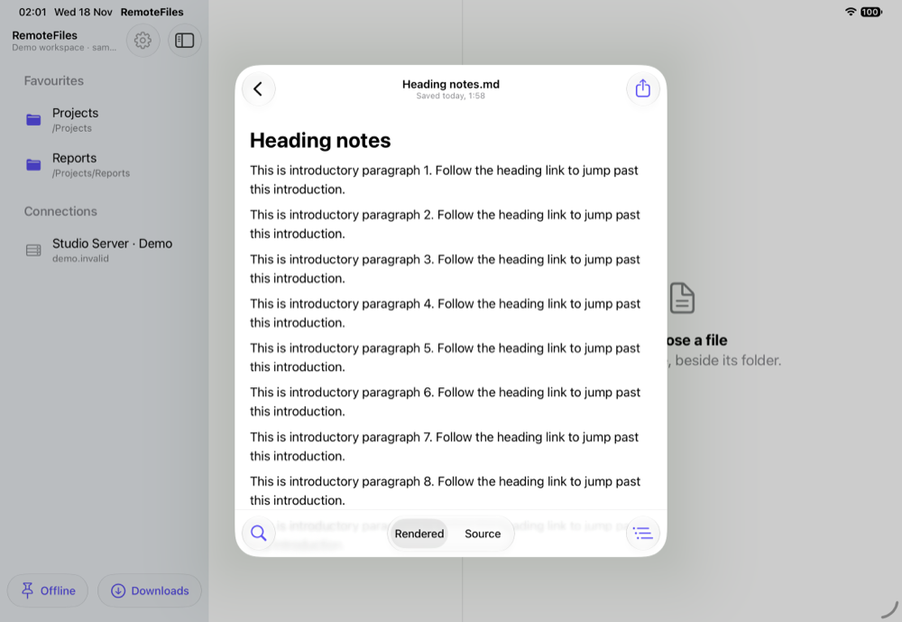
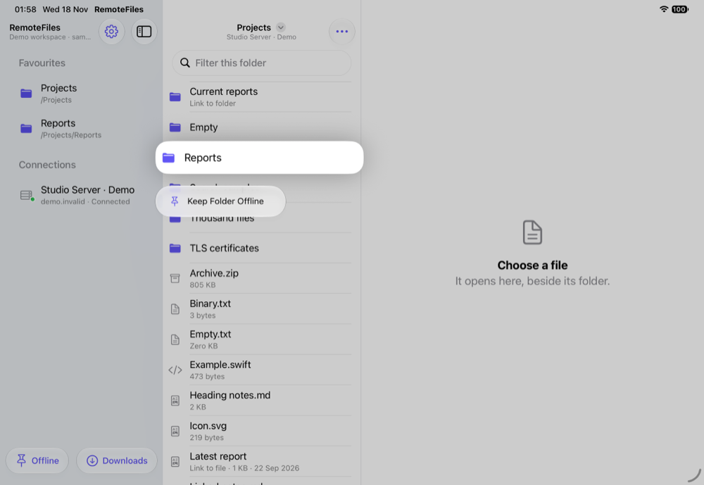
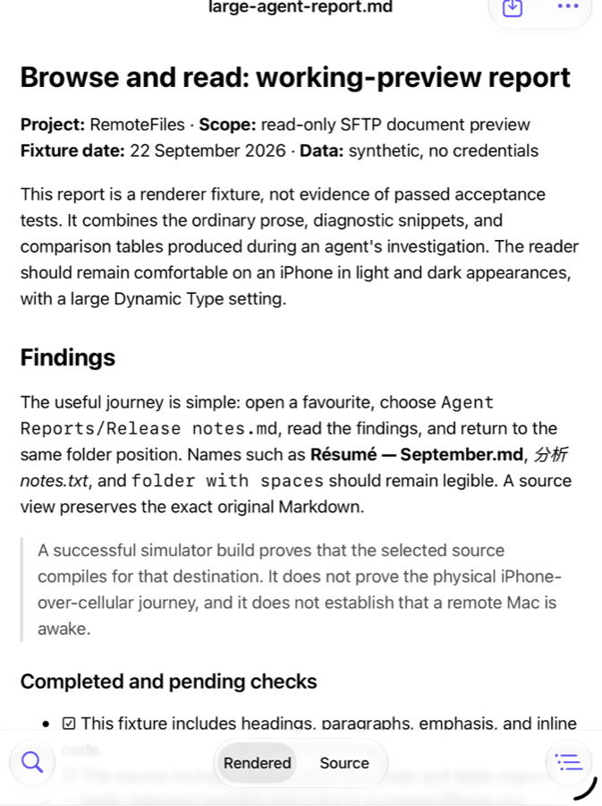

# Real Mac server acceptance

On 22 September 2026, the physical iPhone 17 Pro connected from RemoteFiles to
this Mac's existing OpenSSH service, using the Mac's Tailscale address on port 22.
This was the normal app and actual account/filesystem, not Demo or a loopback fixture.

## Setup retained for use

- Saved connection: **My MacBook**, account `iris`, starting directory
  `/Users/iris/Developer/RemoteFiles`, also saved as a favourite.
- Dedicated identity: **RemoteFiles iPhone - MacBook**, generated inside the
  iPhone app. Its private key remains in the phone's device-only Keychain.
- With explicit user approval, the public key was appended to the Mac account's
  `~/.ssh/authorized_keys`, preserving its existing entries. The entry is tagged
  `remotefiles-iphone-macbook` and uses `restrict` plus a forced
  `/usr/libexec/sftp-server -R -d /Users/iris/Developer/RemoteFiles` command.
  This forces read-only SFTP and disables shell/forwarding. The starting directory
  is **not** a filesystem jail: the account's other readable files remain readable.
- To revoke this phone's authorization, remove only the authorized_keys line
  carrying that tag. Deleting the app's saved connection alone does not revoke it.
- Existing Remote Login and Tailscale services were already running; no SSH
  host keys, tailnet policy, router ports, or other authorization entries changed.

## Verified journey

1. Create the dedicated identity through the physical app's UI; read only its
   public key for server authorization.
2. Create and save the real connection through the UI.
3. Compare the displayed Ed25519 host fingerprint with the Mac's independently
   read `/etc/ssh/ssh_host_ed25519_key.pub`, then accept the matching key.
4. Browse the actual project and `Fixtures` directory, and open
   `Live-server-report.md` with its initial revision.
5. Open Source, update that file on the Mac only after the iPhone confirms the
   first read, and Refresh. Assert the new revision in Source and Rendered.
6. Return to the real directory successfully.
7. Relaunch the app, reopen the saved connection, save the project favourite, and
   open the actual `docs/READER_PERFORMANCE.md` report from the Mac. This separate
   test passed in 15.242 seconds at 15:10:15 local time.

The browse/read/changed-file-refresh test **passed**, zero failures, in 38.164
seconds at 15:08:30 local time. This includes UI automation overhead and is not
an SFTP latency measurement. [Initial rendering](screenshots/real-server-initial.png)
and [refreshed rendering](screenshots/real-server-refreshed.png) were exported
from the actual device test. The refreshed rendering was visually inspected.

The endpoint used the Tailscale IP and the Mac's route to the phone was `utun11`.
The device screenshots display 5G. This establishes real SFTP via Tailscale with
cellular status visible, not an independently controlled off-site-network test
or proof of the complete physical acceptance matrix.

## Repeatable checks

`RealServerUITests` are opt-in and skip ordinary test runs. Enable them with
`TEST_RUNNER_REMOTEFILES_REAL_SERVER=1`. The initial journey additionally requires
`TEST_RUNNER_REMOTEFILES_REAL_HOST`, `..._USER`, `..._DIRECTORY`, and
`..._FINGERPRINT`; these are forwarded to the runner without the `TEST_RUNNER_`
prefix. Never pass private keys/passwords through these variables. `testRelativeLargeAndMissingImages`
reads `..._REAL_HOST` too when it has to create its "Image checks" connection.

Build the signed Release test target with `ENABLE_TESTABILITY=YES` as documented
in [READER_PERFORMANCE.md](READER_PERFORMANCE.md). Run only the intended test with
`xcodebuild test-without-building -only-testing:RemoteFilesUITests/RealServerUITests/TEST_NAME`.
The connection and identity are intentionally retained. The refresh check requires
resetting the dedicated fixture to revision 1, then changing it to revision 2 after
`REMOTEFILES_READY_FOR_SERVER_UPDATE` appears in the test log.

## Cellular and Tailscale evidence

`scripts/test-cellular-tailscale.py` runs one `RealServerUITests` method on a
cabled iPhone and records, on the Mac, which path its SSH traffic took. The cable
carries only the Xcode test session; the app's traffic uses the phone's own network.

Before running, turn the iPhone's Wi-Fi off in Settings (Control Center only
disconnects it for a while), turn off Personal Hotspot, connect the cable and open
Tailscale on the phone. The saved connection must use the Mac's MagicDNS name or
Tailscale IP. Export the `TEST_RUNNER_REMOTEFILES_REAL_*` variables a test needs,
then run:

```sh
/usr/bin/python3 -B scripts/test-cellular-tailscale.py --device DEVICE_UDID \
  --output /private/tmp/remotefiles-cellular-NEW_RUN --build
/usr/bin/python3 -B scripts/test-cellular-tailscale.py --device DEVICE_UDID \
  --output /private/tmp/remotefiles-cellular-NEW_RUN --manual
```

Use Apple's `/usr/bin/python3`: macOS hides the TCP socket table from netstat when
uv or Homebrew Python launches it, and the script stops if it cannot see that table.
The first form defaults to `testSavedConnectionReopensRealProject`; choose another
method with `--test`, and omit `--build` to reuse `DerivedData-device`. `--manual`
skips the device test and samples until you press Return, for checks such as
interrupting the network during a refresh. Record the screen with QuickTime
(New Movie Recording, iPhone as the camera) because iPhone Mirroring needs the
phone's Wi-Fi. If several iOS devices are online in the tailnet, pass `--peer`.

Add `--require-direct` to fail unless every sample taken during the phone's SSH
session uses a direct route to a public address, not a DERP relay. If the route
stays relayed, first run `tailscale ping` from the Mac to another peer and read
the `tailscale status` health warnings. A relay to every peer means the Mac is the
cause, not the carrier.

The script stops before testing if Xcode reaches the phone over the local network
or Tailscale routes to it through a private address, an address inside one of
the Mac's interface networks (such as a shared global IPv6 prefix) or the Mac's
own public address. While it runs, it samples `tailscale status`, established
`netstat` sockets on the SSH port, whether the iPhone is still on USB and the
`sshd` log. `summary.md` passes only when sampling continued to the end, the
phone stayed on USB, the route was never local, an SSH session arrived from the
phone's tailnet address, WireGuard traffic flowed and the device test passed
rather than skipped. A DERP relay route counts as cellular-consistent; it is weaker
evidence than a direct route to a carrier address. Passing establishes the
cellular/Tailscale path for that run, not an off-site trip, movement between cells
or a Wi-Fi/cellular handoff.

On 30 October 2026 the physical iPhone 17 Pro (iOS 27.2) passed this check, with
Wi-Fi off in Settings, 5G connected and the cable attached. The signed Release
build of the commit adding this record ran `testSavedConnectionReopensRealProject`,
which passed in 33.2 seconds. It opened **My MacBook** at its tailnet address, browsed
the real project's `docs` folder and rendered `READER_PERFORMANCE.md`. All 42
samples showed the iPhone on USB and a Tailscale DERP relay route (`lhr`), never
a local one. An SSH session from the phone's tailnet address was
established in 26 samples, and 43,648 WireGuard bytes were exchanged. Because the
route was relayed, this does not show a direct path to a carrier address. Evidence:
`/private/tmp/remotefiles-cellular-run3/` (`summary.md`, `samples.jsonl`,
`sshd.log`, `tests.xcresult`).

Two earlier runs that day didn't count as passes. In the first, the test waited for
`READER_PERFORMANCE.md` before scrolling to it in the lazy folder list. It now
scrolls until the row exists. In both runs, netstat started from a uv-installed
Python showed no TCP sockets, so the phone's SSH session went undetected even
though `sshd` logged it. The script now refuses to run without the TCP table.

Later that day `--require-direct` first failed because of the Mac. Its Tailscale
reported "The MagicSock function ReceiveIPv4 is not running", and it reached every
peer through DERP. After Tailscale restarted (updating to 1.105.140), that warning
cleared. The same test then passed in 33.4 seconds with every check, including
`direct_route`. All 40 samples used one direct WireGuard route to an O2 UK carrier
address, different from the Mac's public address. The phone's SSH session appeared
in 25 samples, and 42,320 WireGuard bytes were exchanged. `tailscale ping` round
trips were about 80–150 ms direct and 75–170 ms relayed. Those are a few samples,
not a latency benchmark. Evidence: `/private/tmp/remotefiles-cellular-direct1/`.

## 31 October 2026 iPhone session

A hands-on session on the physical iPhone 17 Pro (iOS 27.2) against **My MacBook**
over Tailscale. Builds were signed Release with `ENABLE_TESTABILITY=YES` from
[PR #46](https://github.com/eyeb0l/RemoteFiles/pull/46): `aa1daa9` for the
automated run and the first PDF check, then `844dced`, which fixed the rotation
drift that check found, for everything else. Until the network recordings, the
phone used Wi-Fi and the route was not recorded. All fixtures were synthetic files
added to `Fixtures/` for the session and removed afterwards; the phone's own key
was not exported.

### Automated

The demo `RemoteFilesUITests` class passed 28 of 29 methods in about 20 minutes,
including both PDF search journeys. `testImportRSAAndECDSAKeysShowsTheirAlgorithmsAndPublicKeys`
failed twice: the app rejected the RSA key the test generates and pastes as
malformed, so the ECDSA case never ran. Importing a real encrypted RSA file through
the UI worked, so the failure is specific to the test's generated key or paste path.
Evidence on the Mac mini: `/private/tmp/remotefiles-pdfnav-device-ui1.xcresult` and
`/private/tmp/remotefiles-pdfnav-device-key2.xcresult`.

### Passed by hand

- **PDF navigation** ([step 13](MANUAL_ACCEPTANCE.md)): a 12-page PDF with a phrase
  only on page 9. Live and saved-index results opened at page 9. A mid-page position
  returned after Back, relaunch and rotation, the last after the `844dced` fix. After
  the file was replaced on the server, Refresh opened revision 2 at the top, and a
  stale saved-index result still opened the current file at page 9.
- **Managed downloads:** three 120 MiB random files. Transfers continued in the
  background; a queued item did not start while backgrounded or locked, and started
  after unlocking. System cancellation, lock, force quit and Disconnect each exposed
  Retry, and retries started from zero. A completed download saved to iCloud Drive
  matched the server's SHA-256. Resource expiration could not be forced.
- **Save Original:** the PDF saved from the reader matched the server's SHA-256, and
  cancelling the picker kept the reader usable.
- **Offline file** (step 9): opened in Airplane Mode after Disconnect and relaunch;
  Share Original matched revision 1 byte-for-byte; Update Offline Copy fetched
  revision 2; an update interrupted by Airplane Mode kept the old copy and saved
  time; removing the copy left the server file unchanged. The offline reader has no
  Find or Headings controls.
- **Offline folder** (step 10): nested and empty folders saved with hidden files
  excluded and two symbolic links counted; browsing, sharing and relaunch worked in
  Airplane Mode. An update picked up an added, a deleted and an edited file. With a
  member made unreadable, the update failed and the previous snapshot stayed complete.
  An 18-level folder failed at the 16-level limit with nothing published.
- **Offline links** (step 11): sibling, nested, parent and heading links, and Back
  position, worked in Airplane Mode. Missing, hidden, symbolic-link, unsupported,
  query and outside-folder links each explained the failure and kept the reader.
- **Keys** (step 4, in part): encrypted RSA 3072 and Ed25519 files imported with the
  expected fingerprints, and exports matched the originals byte-for-byte. Cancelling
  authentication and the Files picker saved nothing. Both identities survived locking.
  A connection using the encrypted key prompted for the passphrase, a swipe-dismiss
  connected nothing, and after relaunch it prompted again. These keys were disposable
  and never authorized; the server rejected them as expected.
- **Appearance and accessibility** (step 6): selection and copy in Rendered and
  Source, horizontally panned code blocks and tables, light/dark, the largest
  accessibility text size, Reduce Motion, Reduce Transparency, VoiceOver continuous
  reading, the Headings rotor, focus returning to the opened row, and the PDF's page
  announcement.

### Network recordings

Both used `scripts/test-cellular-tailscale.py --manual` on the MacBook, with the
phone cabled to it and Wi-Fi off in Settings. Evidence on the MacBook:
`/private/tmp/remotefiles-net-run1/` and `/private/tmp/remotefiles-net-run2/`.

- **Interruption, 19:14–19:28, PASS.** 744 samples, all wired, with a direct route to
  an O2 UK carrier address (briefly relayed), never local, and 146 MB of WireGuard
  traffic. A refresh interrupted by Airplane Mode showed an error banner within
  seconds and kept the previous copy; the next refresh worked. Two transfers did not
  fail promptly, as described below.
- **Handoff, 19:28–19:35.** 333 samples, all wired. The route moved from the carrier
  to the home LAN when Wi-Fi joined at 19:29:51, and back through a London relay to
  the carrier at 19:31:37–38. A managed download in progress across each switch
  stalled for a few seconds and then completed; browsing worked after each. The
  summary's `path_never_local` failure is the intended Wi-Fi leg. Tailscale keeps the
  tunnel address, so this does not show a non-Tailscale handoff.

### Found

- **A dead network isn't noticed during transfers.** In Airplane Mode a managed
  download stopped moving at 19:16:54, and the Mac dropped its socket at 19:17:34,
  but the app showed no failure until the network returned at 19:19, despite the
  documented 60-second inactivity limit. An offline-copy update in the same state
  showed nothing, and its Cancel took effect only after about 3 minutes (the
  180-second limit), again without an explanation.
- **Linked offline readers exhaust preview leases.** Following links back and forth
  in a saved folder eventually showed "Close another offline preview before opening
  this file." Returning to Offline Files cleared it. Each stacked reader keeps one of
  the four leases.
- **RSA paste in the device UI test**, as above.

### Still outstanding over cellular

These runs establish the network path for one journey: saved-connection reopen,
folder listing and a rendered report, over both a relayed and a direct route. The
following remain unverified over cellular:

- **Changed-file refresh.** `testRealServerBrowseAndRefresh` needs the Mac fixture
  changed after `REMOTEFILES_READY_FOR_SERVER_UPDATE`. The script doesn't drive that
  update, and this journey hasn't run over a recorded cellular path.
- **Network interruption.** A refresh and a managed download were interrupted on
  [31 October](#31-october-2026-iphone-session); the refresh passed, but transfers
  don't notice the dead network promptly. A recursive search remains unchecked.
- **Wi-Fi/cellular handoff.** Passed in both directions over Tailscale with a
  download in progress on [31 October](#31-october-2026-iphone-session). A reader
  left open across the switch, and handoff without Tailscale, remain unchecked.
- **Off-site use.** Repeat away from home, ideally with the Mac behind a different
  network, and while moving between cells or in weak signal. A cabled run at home
  shows the same packet path but not radio conditions.
- **Background and lock over cellular.** Background teardown and foreground refetch
  passed over Tailscale ([lifecycle evidence](DEVICE_PERMISSIONS_LIFECYCLE.md)) but
  without a recorded cellular path. Background transfers, locking and relaunch
  remain unchecked over cellular.
- **Performance.** No timing compares relayed and direct cellular with Wi-Fi.
  Instruments profiling of the 1,000-entry folder and large report on cellular
  remains outstanding; `tailscale ping` samples aren't a benchmark.
- **Other carriers and networks.** Only O2 UK 5G has been recorded. Carriers that
  block UDP or use harder NAT may only ever relay.

Local evidence:

- `/private/tmp/remotefiles-real-identity2.xcresult`: successful on-phone key generation.
- `/private/tmp/remotefiles-real-journey.xcresult`: successful actual-server journey.
- `/private/tmp/remotefiles-real-reopen.xcresult`: saved-connection reopen and real project report.
- Adjacent `.log` files record the UI steps and assertions.

Denied Local Network access, permission recovery, and actual-network background
teardown/foreground refetch now pass on the physical iPhone; see
[device lifecycle evidence](DEVICE_PERMISSIONS_LIFECYCLE.md).

Still outstanding: preserved scroll position for a long folder, a recursive search
during network loss, and representative large report/directory performance. Stale
rendering after an interrupted refresh, the encrypted-key lifecycle and the
accessibility/selection matrix passed on [31 October](#31-october-2026-iphone-session). Read-only enforcement here is an OpenSSH command
restriction; this UI test deliberately did not attempt remote writes.

## 2 November 2026 download resume

A hands-on check of resuming interrupted downloads ([PR #61](https://github.com/eyeb0l/RemoteFiles/pull/61))
on the physical iPhone 17 Pro (iOS 27.2) against **My MacBook**. The build was a
signed Release of `main` at `64495cf`, installed from the Mac mini. The network route
was not recorded. The fixture was a 125,829,120-byte random file added to the
MacBook's `Fixtures/` for the session and removed afterwards. Each finished download
was saved to iCloud Drive and its SHA-256 compared on the Mac mini.

- **Airplane Mode, file unchanged: passed.** About a minute after Airplane Mode went
  on, the download failed and showed its kept amount. After the network returned,
  Retry continued from that amount, and the result matched the server
  (`697016bc…14c4`).
- **Airplane Mode, file replaced: passed.** With a second download interrupted the same
  way, the file was replaced on the server with new random bytes of the same size and
  a later modification time. Retry started from zero, and the result matched the new
  file (`ae9177cf…ac62fac`).
- **Locked: completed.** A download started before locking finished in the background
  while locked and matched the server. The transfer never stopped, so this did not
  exercise resuming.
- **Force quit: passed.** After RemoteFiles was swiped away mid-transfer and reopened,
  the row showed **Interrupted** with 8.5 MB of 125.8 MB kept. Retry continued from
  there, and the result matched the server.

Not checked: iOS ending a background transfer (resource expiration), which could not be
forced, and resuming over a recorded cellular route.

## 7 November 2026 media and certificate pass

A hands-on check of photo and video viewing ([PR #84](https://github.com/eyeb0l/RemoteFiles/pull/84)),
certificate previews ([PR #85](https://github.com/eyeb0l/RemoteFiles/pull/85)) and hidden private keys
([PR #86](https://github.com/eyeb0l/RemoteFiles/pull/86)) on the physical iPhone 17 Pro (iOS 27.2,
24B119) against the MacBook server. The build was a signed Release of `73c2359`, installed from the
Mac mini. The network route was not recorded. The fixtures were generated media, certificates and
throwaway keys in a temporary `Fixtures/iphone-pass` folder on the MacBook, removed afterwards; no
fixture key was authorised anywhere.

The tester worked from a checklist and reported the results as a whole, with no problems, rather
than item by item. The checklist covered the photo viewer's gestures, video controls and fullscreen,
a saved video in Airplane Mode, each certificate state, and each way of hiding a key.

- **Photos: no problems.** Crops of a system wallpaper, then real photographs from outside the
  fixture folder.
- **Rotated video: passed, with a screenshot.** A 1920×1080 track with 90-degree rotation metadata
  appeared upright in a portrait frame, with the controls beneath it.
- **VoiceOver on hidden keys: passed.** A line of dots reads as a count, such as "70 dots" for a
  70-column key line, rather than every dot.
- **Crash reports: none.** The phone held no report naming RemoteFiles dated 6 or 7 November, read
  with `devicectl` after the session.

Not checked: iPad, and Escape on a hardware keyboard. Reduce Motion wasn't on the checklist.

## 18 November 2026 iPad session

The first session on a physical iPad: an iPad Pro 11-inch (M5) (iOS 27.2.1, 24B156) against
the MacBook Air's OpenSSH service, over Wi-Fi with a direct Tailscale route to the Mac's MagicDNS
name. The first hosted core run used a signed Debug build of `d883793` (`main`). The runs after the
store-key fix, the demo UI journeys and the Face ID check used a signed Debug build, and the
hands-on pass a signed Release build, of the tree committed as `a3344ae`, before the offline reader
and folder preview fixes. Fixtures were synthetic, generated for the session in a
dedicated folder outside the repository and listed under [Setup](#ipad-setup).

### iPad setup

- Saved connection **My MacBook (iPad)**, starting in the dedicated fixture folder.
- Dedicated identity **RemoteFiles iPad - MacBook**, generated in the iPad app. Its public key
  was appended to the Mac account's `authorized_keys`, with explicit approval, tagged
  `remotefiles-ipad-macbook` and restricted like the iPhone's: `restrict` plus a forced
  `/usr/libexec/sftp-server -R -d` on the fixture folder. To revoke the iPad, remove only that line.
- The host fingerprint the app showed matched the Mac's `/etc/ssh/ssh_host_ed25519_key.pub`.
- Fixtures: the 1,000-entry folder and 191,002-byte report from `Fixtures/generate-fixtures.py`,
  the format samples, a wide Markdown file, a content-search tree with a phrase only inside files
  and 600 filler files, an offline tree with every link case, a long standalone HTML page with a
  script and remote resources, a 12-page PDF, ten media files, a 160 MiB folder of 40 random files
  and a 120 MiB download.

### Automated on the device

- **Hosted core suite** (`RemoteFilesTests`, `d883793`): 842 ran, 48 skipped (fixture-server, benchmark and
  opt-in Face ID cases), 17 failed. The physical-only checks passed:
  `testTrustStoreWritesUseCompleteFileProtection`, `testDeviceKeychainPersistenceAndAccessibility`
  and `testBiometricKeychainItemIsStoredWithoutPromptingAndRemovable`.
  - Ten failures, about several windows and shared stores, came from the app's shared stores keying files by
    `standardizedFileURL.path`, which drops `/private` only once the shorter path exists. They
    are fixed; see [CI history](CI_HISTORY.md#18-november-2026-shared-stores-on-a-device). With the
    fix (`a3344ae`) the six affected suites passed on the iPad (166 tests, three opt-in Face ID skips).
  - Seven reading-position tests failed in both runs, explained and fixed in the
    [follow-up](#18-november-2026-ipad-follow-up): two HTML
    `HTMLReadingPositionTests` and five Markdown `OverflowViewportTests`. By hand, an HTML position
    held through the reader's text size, rotation and window resizing (step 12 below), which
    corresponds to the root-zoom test; nothing recorded matches the page-zoom test
    (`WKWebView.pageZoom`) or the Markdown tests.
- **Demo UI journeys** (`RemoteFilesUITests`): 13 passed, 22 failed, 1 skipped (the key import,
  which already skips on devices). The iPad workspace journey passed. Most failures are journeys
  written for the iPhone's stack navigation. Two looked iPad-specific: Subfolders → This Folder,
  which passed by hand, and the keyboard journey, whose first ⌘F did not open Find in time.
- **Face ID enrolment change** (`testSimulatedEnrolmentChangeInvalidatesTheStoredKey`): a control
  read before any change matched Face ID and read the item (the test failed, as expected). After
  an alternate appearance was added, the prompt appeared and matched, and the read was still
  refused with `biometricsUnavailable`: passed.

### Passed by hand

- **Workspace:** three columns; preview replacement with the folder kept; folder scroll position
  kept; a new folder clears the reader; rotation slides the columns over the reader and back;
  Stage Manager from three columns through overlays to the stack and back with the same folder
  and file; Split View and Slide Over.
- **Several windows:** independent folders and readers; a favourite added in one window appears in
  the other; renaming a connection closes its routes in the other window; closing a window leaves
  the other untouched.
- **Accessibility** ([step 6](MANUAL_ACCEPTANCE.md)): selection and copy in Rendered and Source,
  horizontal panning without widening, light and dark, the largest accessibility size in both
  orientations, Reduce Motion, Reduce Transparency, VoiceOver landing, continuous reading, the
  Headings rotor, focus returning to the opened row, the PDF page announcement, and VoiceOver
  reaching and closing the library overlay in a narrow window.
- **Contents search** (step 8): line 13 and line 5 snippets; the hidden-file choice; results kept
  while reading; a file edited on the Mac found on refresh; cancellation on backgrounding and on
  Disconnect; Stage Manager, accessibility sizes and VoiceOver. The 600 filler files stopped the
  search at 500 files with "Stopped after 500 files. Search from a subfolder to go further."
- **Offline files** (steps 9–11): saved date, position, Find, Headings and image zoom after
  Airplane Mode and relaunch; the offline sheet's shortcuts; Share Original byte-identical to the
  server; Update Offline Copy and removal; a saved folder with hidden files excluded and two links
  skipped; every link case in Airplane Mode; eight link hops without running out of previews; and
  removing a 160 MiB saved folder in one window while another window updated it. It never
  reappeared, including after relaunch, and the other saved copies were unaffected.
- **Locked-file protection:** with the iPad locked, copying the trust file, library, offline index
  and three saved originals from the app's container over CoreDevice failed each time with
  `EPERM`; unlocked, the same six copies succeeded and the original matched the server's file.
- **HTML reading position** (step 12): scripts and remote resources blocked; position kept through
  rotation, text size and Stage Manager resizing; independent Rendered and Source positions;
  changed content opens at the top; touch, keyboard and VoiceOver scrolling during restoration;
  backgrounding and Back.
- **Changed host key** (step 4): a disposable OpenSSH server on another port, with its own host
  key, was trusted and browsed. After its key was replaced the app showed **Host Key Changed**
  with both fingerprints and only **Reset Saved Trust**. The server logged three connections, each
  closed before authentication ("connections without attempting authentication"), and no
  accepted key. The Mac's own host keys were not touched.
- **Media:** H.264/AAC in MP4 and MOV, HEVC, a 90-degree rotated video (upright), M4A, MP3, WAV,
  FLAC, AIFF and ADTS AAC all played, with full screen.

### Keyboard through Universal Control

The Mac's keyboard drove the iPad through Universal Control; iPadOS listed no hardware keyboard
under Modifier Keys, so these results may differ from an attached keyboard.

- Passed: ⌘F as the first shortcut with the keyboard present at launch, then ⌘G, ⇧⌘G and Escape;
  ⌥⌘U, ⇧⌘J and layered Escape; ⇧⌘F, the arrows and Return; ⌘[, ⌘↑, ⇧⌘R, ⌘R, ⇧⌘., ⌥⌘L and ⇧⌘O;
  shortcuts ignored under a sheet.
- Holding ⌘ showed no list. iPadOS 26 replaced that list with the menu bar, which showed Edit,
  View and Go.
- **Search field:** with the cursor in the folder's search field, Return did not leave it (only
  Escape did), and the arrows moved the row highlight although the field was being edited.
- **Tab** only reached the folder's search field, never the library or the reader. This is the
  state the [9 November investigation](CI_HISTORY.md#9-november-2026-portrait-library-overlay-tab-report-pr-66)
  could not settle. A diagnostic build with a wired keyboard explained both ([follow-up](#18-november-2026-ipad-follow-up)).

### Found

- **Blank band in Offline Files readers.** Every saved text file opened with about half the sheet
  blank above it. Fixed: the reader's frame reached each view of a `Group`, so the empty
  hidden-character notice took as much height as the document.
- **Folder row previews and focus rings spread across columns.** The folder column's cells run on
  under the floating library. The long-press preview now has its own shape; the keyboard focus
  ring, which the Simulator does not draw, stayed within the column with a wired keyboard ([follow-up](#18-november-2026-ipad-follow-up)).
- The keyboard and reading-position test findings above.

| Offline reader before | Offline reader after |
| --- | --- |
|  |  |

| Folder preview before | Folder preview after |
| --- | --- |
|  |  |

*Demo data on an iPad Pro 11-inch (M5) Simulator (iOS 27.2), reproducing what the device showed.*

### Not done

- **Instruments profiling** (step 7). A 120-second SwiftUI and Allocations recording attached to
  the app over the network connection held no process data, and later attempts, including over
  the cable, timed out waiting for the device. The build was profileable (`get-task-allow`).
- Cellular, managed downloads and encrypted-key unlock on the iPad, and an attached hardware
  keyboard.

All of these were done in the [follow-up](#18-november-2026-ipad-follow-up).

Evidence on the MacBook Air: `/private/tmp/remotefiles-ipad-20261118/` holds the build and test
logs, `core.xcresult` (first core run), `fix2.xcresult` (affected suites after the fix),
`web.xcresult` (reading-position rerun), `ui.xcresult`, the four Face ID result bundles, `band-fixed` and
`band-unfixed` (the offline regression with and without its fix), `session-log.md` (the hands-on
record), the fixture and fixture-server scripts, `cold.trace`, and the iPad screenshots in
`evidence/`, including the fixture server's log after the key change.

## 18 November 2026 iPad follow-up

The same iPad, connection, identity and fixtures as the [first iPad session](#18-november-2026-ipad-session),
later the same day, to close what that session left open. Builds, all signed Release:

- **Profiling:** `e510e81` (`main`).
- **Hands-on checks** (keyboard, cellular, downloads, offline, encrypted key, the report's loading
  view and the second folder trace): `8e0a9b0`, plus the change later committed as `4a050d8`, a
  temporary patch that logged key presses and focus changes, and a folder-list change that was
  then reverted.
- **Hosted reading-position tests and the HTML text-size check:** `80ef359`.

### Hosted reading-position tests

All seven failures from the first session are explained and fixed. On the iPad, the five
Markdown `OverflowViewportTests`, the two HTML `HTMLReadingPositionTests` and two new regression
tests passed: 9 of 9, none skipped.

- **Markdown reading anchor (product bug).** The rendered reader centres a 760-point column in a
  wide window, but Textual sampled its reading anchor 30 points from the viewport's edge. In a
  full-width iPad window that point is empty margin, so no anchor was captured. After a fast jump
  through a large document, the visible line moved by hundreds of points, and Source/Rendered
  switches fell back to raw offsets. The anchor is now sampled inside the content's column
  ([provenance](../Vendor/Textual/UPSTREAM.md)). `testReadingAnchorIsFoundInACentredColumnOfAWideWindow`
  hosts the reader in a 1,180-point window, so CI's iPhone simulators catch a regression; with the
  fix reverted it fails there.
- **HTML text size (product bug).** WebKit's recommended content mode is desktop on an iPad, even
  in a narrow view, and there it kept text at its unzoomed size under the reader's text size: only
  the margins grew. HTML previews now request mobile content, which an iPhone already resolves
  ([details](HTML_PREVIEWS.md)). The first session's hand check recorded only that the position
  held after a text-size change, not whether the text grew. On a simulator in desktop mode the text
  kept its size and only the margins changed, so a position check can pass despite the defect.
- **Prose-boundary test (test assumption).** Its 40-section fixture was 3.3 viewports tall in an
  iPad Pro 11-inch window, and the test looks for a scroll view at least four viewports tall. It
  now uses 100 sections.
- On an iPad Pro 11-inch (M5) Simulator, `testLargeFastJumpKeepsVisibleProseAnchorAndSourceReturnRestoresSameCharacter`
  still failed 3 times in 13 runs. The same character landed 36 points high after the jump, and
  in one run about 88 points away after returning from Source. It passed on the device. The
  36-point failures were the test's: it read the position after a fixed two-second sleep, which
  could fall between a code block's layout and the next frame's correction. It now waits for the
  corrections to finish ([18 November investigation](CI_HISTORY.md#18-november-2026-a-fixed-sleep-read-a-reading-anchor-mid-correction)).
  The return from Source did not fail in 36 runs since, 16 of them with the test host slowed, so
  its cause is still not established.

### Profiling (step 7)

Instruments recorded on the iPad over the cable once `xcrun devicectl device info ddiServices`
had run; until then `xctrace` listed the iPad as offline. The SwiftUI template, with or without
Allocations, saved empty CPU, hitch and SwiftUI-update tables on this device, which explains the
first session's empty trace. The Animation Hitches and Allocations templates recorded normally.
Instruments writes its raw kernel trace to the Mac's temporary folder whatever output path it is
given, and a 180-second Animation Hitches and Allocations recording grew past 19 GB, so the hitch
recordings were kept to 60 seconds. Each opened a folder or report, scrolled it to the end, went
Back and repeated.

- **1,000-entry folder:** opening, Back and reopening stalled the main thread for 80–100 ms each.
  Scrolling to the bottom dropped runs of consecutive frames: a 0.4-second cluster in one run, and
  clusters of 0.2-0.75 seconds in another, in both its first and second scroll. In each cluster a
  quarter to a third of the main thread's samples were in SwiftUI's List, finding each new cell's row for its separator
  (`UICollectionViewListCoordinator.separatorConfiguration` → `ListDiffable.rowIndex(at:)` →
  `ShadowRowCollection.index(after:)`), a walk that grows with the row's position. Skipping
  refreshes that return identical rows did not help, so that change was reverted; the cause in
  the folder's List is still open ([performance](PERFORMANCE.md)).
- **191,002-byte report:** it renders in WebKit. Opening it stalled the main thread for 93 ms, with
  one 92 ms render hitch. Scrolling dropped single frames (8 ms at 120 Hz) about every 0.6 seconds,
  without clusters.
- **Memory** (Allocations, 180 seconds of the same steps on both): at the end, 38.7 MB of heap was
  live in 187,112 allocations, after 12.4 million transient allocations (1.83 GB) during the run.
  Anonymous VM was 2.9 GB of address space, of which 2 GB was one JavaScriptCore reservation and
  737 MB render surfaces (IOSurface). Allocations reports address space, not the app's footprint,
  and inactive HTML reader memory was not profiled separately.

### Found and fixed

- **Loading view over the report.** Opening the large report showed the "Rendering Markdown…"
  skeleton lying over real text for about a second: WebKit paints before it reports a page
  finished. Markdown and HTML web views now stay hidden until they finish, as SVG previews
  already did. Two opens on the device then showed no overlap.

| Report opening before | Report opening after |
| --- | --- |
|  |  |

*Physical iPad, reader column only.*

### Keyboard with a wired keyboard

A temporary build logged each key press, focus change and keyboard-command decision on the iPad.

- **Without focus:** Down, Up and Return moved and opened the app's row selection.
- **Tab** put focus in the folder's search field and began editing. Ten further presses reached
  the system, which left focus in the field. The library and the reader were never reached.
- **In the search field:** the app declined Down, as designed, and iPadOS then moved keyboard focus
  from the field to the first result row; Return, also declined, opened the focused row. The caret
  kept blinking in the field throughout. Escape ended editing, after which the app's arrows and
  Return acted again. So nothing in the app overrides the field: the arrows that seemed to act
  through it in the first session were the system's focus moving into the results.
- **Focus width:** the focused row's frame started at the window's left edge, under the library,
  but its highlight was drawn only within the folder column. The over-wide ring from the first
  session, seen through Universal Control, did not appear.

### Passed by hand

- **Cellular** (step 2): Wi-Fi off in Settings; the iPad's own cellular data reached the Mac
  through a Tailscale relay (DERP). The fingerprint was accepted unchanged, the folder and
  report opened, Back kept the folder position, Refresh reloaded, and Airplane Mode during a
  further refresh left the previous copy readable and labelled. `scripts/test-cellular-tailscale.py --manual`
  passed: 79 samples, the route always the relay, never local, and 63 samples with SSH sockets
  from the iPad's tailnet address.
- **Managed downloads**, over cellular, with the 120 MiB file: Downloads said background
  continuation was available. The transfer continued in another app, with a Live Activity, and
  while the iPad was locked. Cancelling from the Live Activity, Disconnect, and force-quitting
  each stopped it; each time Retry continued from the kept bytes. The finished file copied out
  of the app's container matched the server's SHA-256 (125,829,120 bytes). This covers iOS
  stopping a background transfer at the person's request; iOS expiring one by itself was not seen.
- **Offline** (step 9): a saved 12-page PDF reopened at page 7 after a force quit, in Airplane
  Mode. An update of a saved 64 MiB file, interrupted with Airplane Mode, explained the failure
  after about three minutes, the offline transfer limit, as on the iPhone. The saved copy kept its
  date, and its bytes in the container still matched revision 1. In a narrow Stage Manager window
  the Offline Files library, a saved file, the saved folder and the PDF all fitted and worked, and
  VoiceOver read the library and a saved file sensibly.
- **Encrypted key** (step 4): a throwaway passphrase-protected Ed25519 key, pasted from the Mac
  through Universal Clipboard, imported with the expected fingerprint. It signed in to a
  disposable unprivileged `sshd` with its own host key, `authorized_keys` and read-only SFTP, on
  a separate port; the Mac account's `authorized_keys` was not touched. Cancelling and
  swiping away the passphrase prompt each left the connection unopened. The passphrase was asked
  again after Disconnect, after backgrounding and after locking, and the server log showed one sign-in
  per passphrase entry. The fixture server was then stopped and deleted.
- **HTML text size** (`80ef359`): the long HTML page looked as before, with no desktop layout or
  sideways scrolling. Raising the system text size from Control Center enlarged the text itself
  and kept the reader at about the same paragraph; so did lowering it again and rotating.

### Not done

- Inactive HTML reader memory (step 12), the storage and depth limits for saved folders on the
  iPad (step 10), and the other-window and other-route link cases (step 11).
- The demo UI journeys that assume the iPhone's stack (22 in the first session) were not adapted.
  Later the same day, on an iPad simulator, nine of the 22 passed and thirteen were recorded as
  iPhone-only ([UI journeys on an iPad](AUTOMATED_ACCEPTANCE.md#ui-journeys-on-an-ipad)).

The three hand checks were done in the [evening checks](#18-november-2026-ipad-evening-checks).

Evidence is on an external SSD attached to the MacBook Air, in `remotefiles-ipad-20261119/`: the
traces (`folder.trace`, `report.trace`, `folder-fixed.trace`; the Allocations run is
`/private/tmp/remotefiles-ipad-20261119/profile-1000-report.trace`), their exported tables, the key
log (`keydiag-1.log`) and its patch, the cellular capture (`cellular/`), the downloaded file and
the offline copy after the interrupted update, the device test result `readpos-device.xcresult`,
the encrypted-key fixture's server log and `session-log.md`.

## 18 November 2026 iPad evening checks

The same iPad and connection, the hand checks the [follow-up](#18-november-2026-ipad-follow-up)
left open, on a signed Release build of `ad679dd` (`main`). The same evening's measurements of
folder scrolling and Tab focus are in [Performance](PERFORMANCE.md#scrolling-deep-in-a-large-folder-18-november)
and [iPad](IPAD.md#known-differences-on-a-physical-ipad).

- **Saved-folder limits** (step 10). Four synthetic folders, each just over one limit: 20 nested
  levels, 257 folders, 10,001 files, and five 110 MiB files of random bytes (550 MiB, over the
  512 MiB for all offline copies). **Keep Folder Offline** on each was refused with that limit's
  message, the storage one after downloading up to the space left. None of the four appeared in
  Offline Files, and the copies saved before were unchanged.
- **Links after another window changes the source** (step 11). In two windows, window A opened
  `index.md` from the saved `offline-tree`. Window B updated the saved folder; a link in A then
  said "This saved document was updated or removed. Reopen it from Offline Files before following
  its links." After A reopened it, B removed the folder, and a link in A said the same. Neither
  reconnected or downloaded anything.
- **Links between individual copies and routes** (step 11). A second connection to the same Mac,
  with the same account and key but its own starting folder, is a different route. With `from.md`
  saved through one connection and its link target `to.md` saved only through the other, the
  saved `from.md`'s link said "This linked file isn't saved here. Save it with the same
  connection, or include it in this saved folder, then try again." Once `to.md` was saved through
  the same connection too, the link opened it. (Opened from the live folder rather than Offline
  Files, the same link opens `to.md` from the server, as a connected reader should.)
- **Inactive HTML reader memory** (step 12). Instruments' Activity Monitor template recorded each
  process's physical footprint about every three seconds, because an HTML reader's page lives in a
  WebKit content process that Allocations on the app doesn't see. Opening `long-anchor.html`
  started a content process at 43 MB, 50 MB after scrolling. On the Home Screen it shrank to 36 MB
  and then ended. Returning rendered the page again in a new content process (40 MB), which ended
  within about three seconds of opening another file. The app's own footprint was 41–46 MB with the
  reader open and 68–70 MB after it had been in the background; what that growth is wasn't
  established (the app-switcher snapshot and privacy cover are likely, but unmeasured). The Markdown
  report opened afterwards took 103 MB in its own content process, with the app at 92–98 MB.

Evidence is on the external SSD, in `remotefiles-followup-20261118/`: the Activity Monitor trace
`device-traces/html-memory.trace` and its exported table. The limit fixtures were generated under
`limits/` in the fixture folder and are not kept.
